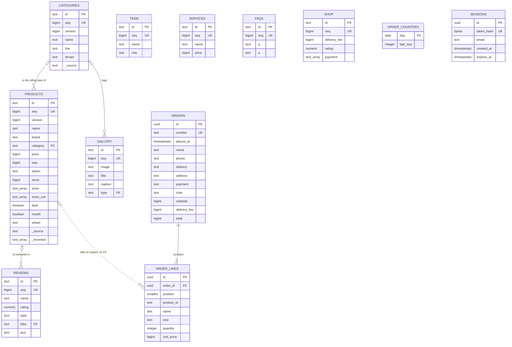

# Database Design (ERD) — Đèo Bikes

Engine: PostgreSQL 16 (UTF-8 database; `normalize()` in §3.14 needs it)
Last updated: 2026-11-18
Source requirements: `docs/data/SRS.md` (DATA-001 to DATA-008), `docs/orders/SRS.md` (ORD-001 to ORD-008), `docs/admin/SRS.md` (ADMIN-001 to ADMIN-013), `docs/site/SRS.md` (SITE-001 to SITE-016; the storefront stores nothing of its own). Shape: `fullstack`. Conventions: `code/backend/migrations/` (`{YYYYMMDDHHMMSS}_{name}.up.sql` + `.down.sql`, applied on boot).

## 1. Overview

The database holds three things: the shop's **eight record collections** (`products`, `categories`, `reviews`, `gallery`, `team`, `services`, `faqs`, `shop`) that today are JSON files; the **orders** customers place (an order, its lines, and a per-day counter that issues the order number); and the owner's **sign-in sessions**. Aggregate roots are `products` (its `stock` is the one number an order and an owner edit both change) and `orders` (insert-only).

Each collection is its own typed table, not one generic `records(jsonb)` table: DATA-001.5 needs the database itself to refuse a bike whose riding type does not exist, ADMIN-006 needs `ON DELETE` rules between collections, and ORD-005 needs `CHECK (stock >= 0)`. A JSONB blob would move every one of those into application code.

Deliberately **not** in the database:

| Thing | Where it lives | Requirement |
|---|---|---|
| Contact and "ask the shop to call" messages | Sent to the owner's inbox in Agent Team; never stored here | SITE-012, SITE-013 |
| The bag and the hearted bikes | The visitor's browser | SITE-006, SITE-007 |
| The owner's email, password and its hash | `ADMIN_EMAIL` / `ADMIN_PASSWORD` secrets; the argon2id hash is computed at boot and held in memory. There is no accounts table | ADMIN-001 |
| The sign-in throttle (5 failures / 15 min / client address) | In-process memory; resets on restart (accepted: a restart is rare and the owner is one person) | ADMIN-002 |
| Photographs | Files under `/images/…`; the tables hold the path as text | DATA-001 |
| Card payment | Not built; payment is a text choice on the order | ORD §3 |

## 2. Diagram



Cardinality notation: `||` exactly one, `o|` zero or one, `}o` zero or many, `}|` one or many. Read left to right. The dashed line is a **copy, not a foreign key** (§3.10). `ORDER_COUNTERS` and `SESSIONS` stand alone on purpose: the counter is read only by number, and a session holds the owner's email as text, not a reference (there is no accounts table).

Every optional relationship is optional on the child side because the SRS lets a bike have no riding type, a review no bike and a photograph no riding type (§3.2 to §3.4).

## 3. Entities

### 3.0 Rules that apply to every table in §3.1 to §3.8 (the eight collections)

These four rules are deliberate departures from `references/conventions.md`; each is forced by the SRS, and each is stated once here instead of being repeated in every table.

| # | Rule | Departs from | Forced by |
|---|---|---|---|
| R1 | **Primary key is the record's text `id`** (`talon-2`, `trail`, `r-thao`), not a surrogate. The id is a slug, but it is **immutable by contract**: on a change the body's id must equal the address's id, and there is no rename. Foreign keys hold the same text, so a record reads and filters the way the API returns it, with no join to translate an id | "never make a slug the primary key" and "uuid everywhere" | DATA-001.1 (text id unique within its collection), ADMIN-005.7, DATA-006 |
| R2 | **Column names are the schema's field keys, verbatim** (`category`, `deal`, `month`, `price_listed`, `_source`, `_invented`), table names are the collection names (`gallery`, `shop`, not `galleries`), and a reference column is named after the field (`category`, `bike`, `type`), not `category_id`. A record is then one row serialised by key, with no translation table to keep in step with `schema.json` | `snake_case` plural tables, `_id` foreign keys, `is_` booleans | DATA-001.3 (same field names), DATA-003 (any schema field is a filter) |
| R3 | **Every field the schema calls optional is a nullable column, and `NULL` means the record has no such field.** The API omits it from the record and never returns `null` (DATA-001.4). `NULL` and an empty value are the same thing (ADMIN-005.6: an empty value is "left out of the saved record"), so the application never writes an empty text; it writes `NULL`. Nullable is the only encoding that also gives "a record with no value does not match a condition" (DATA-003.5) and "no value sorts last in either direction" (DATA-005.2, `NULLS LAST`); a `''` or `0` sentinel would break both, and `0` is a real stock and a real price | "`NOT NULL` is the default" | DATA-001.4, DATA-003.5, DATA-005.2, ADMIN-005.6 |
| R4 | **`seq bigint GENERATED ALWAYS AS IDENTITY` with a `UNIQUE` constraint** is the order a collection lists in. Seeded rows are inserted in file order, so seq follows the files; records added later get higher numbers. It is the tie-break of every ordering. It is never returned | A surrogate key | DATA-002.3, DATA-005.2, DATA-001.2 |

How a column's SRS type maps to a Postgres type (one mapping, used by all eight tables):

| `schema.json` type | Column type | Why |
|---|---|---|
| `text`, `longtext`, `image`, `url` | `text` | Paths and prose, no length class worth a `varchar` |
| `number` | `numeric` | "Kept exactly" (DATA-001.2): ADMIN-005.3 only requires `year`, `rating`, `review_count` to be numbers, so a fractional value is legal and an `integer` column would round it. `numeric` returns `4.8` as `4.8` and `2027` as `2027` through `to_jsonb` |
| `number` named `stock` | `bigint` + `CHECK (stock >= 0)` | ADMIN-005.3 says a whole number not below 0, and ORD-005 does arithmetic on it |
| `price` | `bigint` (whole đồng, the currency's minor unit) + `CHECK (… >= 0)` | Money is never a float; VND has no sub-unit (ORD §6) |
| `bool` | `boolean` | |
| `list` | `text[]` | An ordered list of text with no identity of its own; ≤ 50 entries (ADMIN-005.3). `NULL` = the record has no such list; `'{}'` = an empty list, which DATA-001.4 returns as `[]`. A text array cannot hold `NULL` elements (the writer never sends one) |
| `ref:<collection>` | `text` + foreign key | DATA-001.5 |

Every `created_at` / `updated_at` is `timestamptz NOT NULL DEFAULT now()`, stored in UTC.

Where the database and the application split the work:

| Enforced by the database | Enforced by the application (ADMIN-005, one writer) |
|---|---|
| id format; required field not blank; closed value sets; `stock`, `price`, `was` ≥ 0; a live bike has a price; references exist; `stock` never below 0; order totals add up | text ≤ 5000 characters and list ≤ 50 entries (25 identical checks with no integrity value); "an empty value is stored as `NULL`"; which fields a body may carry; the 400 sentences |

### 3.1 `categories`

**Purpose** — the riding types (hardtail, cross-country, trail, e-MTB). **Traces to** — DATA-001, ADMIN-005, ADMIN-006, ADMIN-012, SITE-002, SITE-003.

| Column | Type | Null | Default | Unique | Description |
|---|---|---|---|---|---|
| `id` | `text` | no | — | PK | Slug; `CHECK (id ~ '^[a-z0-9][a-z0-9-]{0,63}$')` (ADMIN-005.7). Server-made ids are `categories-<6 chars>` |
| `seq` | `bigint` | no | identity | UNIQUE | Listing order (R4) |
| `version` | `bigint` | no | `1` | | Compare-and-swap token (ADMIN-008). The `touch_record` trigger (§3.14) adds 1 on every update; the API sends it as the `ETag` header, never in the body |
| `name` | `text` | no | — | | Required (schema); `CHECK (btrim(name) <> '')` |
| `line` | `text` | yes | `NULL` | | Who it is for |
| `terrain` | `text` | yes | `NULL` | | Where it rides best |
| `_source` | `text` | yes | `NULL` | | Origin of the record |
| `created_at` | `timestamptz` | no | `now()` | | |
| `updated_at` | `timestamptz` | no | `now()` | | Set by the trigger |

**Nullable columns** — `line`, `terrain`: optional in the schema (R3). `_source`: a riding type added in the management area has no document origin, and `_source` is not a schema field, so a body can never carry it (see open question 2).

**Foreign keys** — none. Referenced by `products.category` and `gallery.type`.

**Constraints** — `ck_categories_id_format` (id pattern above); `ck_categories_name_not_blank` (`btrim(name) <> ''`: ADMIN-005.2 "blank is refused").

**Indexes**

| Name | Columns | Type | Query it serves |
|---|---|---|---|
| `uq_categories_seq` | `seq` | unique btree | Default listing order and stable paging (DATA-002.3) |

**Lifecycle** — hard delete, by the owner (ADMIN-006). Refused while a bike uses it (`products.category` is `RESTRICT`); gallery photographs that carried it keep existing and lose the link (`gallery.type` is `SET NULL`).

### 3.2 `products`

**Purpose** — the bikes: what is for sale, its price, its stock, its specification. **Traces to** — DATA-001, DATA-003 to DATA-006, ADMIN-004 to ADMIN-008, ADMIN-010, ADMIN-011, ORD-002, ORD-004, ORD-005, SITE-002 to SITE-005.

| Column | Type | Null | Default | Unique | Description |
|---|---|---|---|---|---|
| `id` | `text` | no | — | PK | Slug (as §3.1). Server-made ids are `products-<6 chars>` |
| `seq` | `bigint` | no | identity | UNIQUE | Listing order (R4) |
| `version` | `bigint` | no | `1` | | CAS token, bumped by every update — **including the stock hold of an order**, which is what makes ADMIN-008 hold |
| `name` | `text` | no | — | | Model name; required; `CHECK (btrim(name) <> '')` |
| `brand` | `text` | yes | `NULL` | | `Giant` or `Liv` |
| `category` | `text` | yes | `NULL` | | Riding type → `categories.id` |
| `year` | `numeric` | yes | `NULL` | | Model year |
| `price` | `bigint` | yes | `NULL` | | Whole đồng, ≥ 0. A draft needs none |
| `was` | `bigint` | yes | `NULL` | | Price before, ≥ 0; shown struck through |
| `price_listed` | `text` | yes | `NULL` | | The maker's page price, as text (hidden field) |
| `fact` | `text` | yes | `NULL` | | One line under the name |
| `status` | `text` | yes | `NULL` | | `draft` or `live`. `NULL` is "never published": not listed, not orderable |
| `stock` | `bigint` | yes | `NULL` | | Bikes in stock, ≥ 0. `NULL` = not tracked: cannot be ordered |
| `sizes` | `text[]` | yes | `NULL` | | Frame sizes in display order |
| `sizes_out` | `text[]` | yes | `NULL` | | Sizes the owner marked out |
| `size_fit` | `text[]` | yes | `NULL` | | Rider height per size, in the order of `sizes` |
| `deal` | `boolean` | yes | `NULL` | | "Lead with it" |
| `month` | `boolean` | yes | `NULL` | | "Bike of the month" |
| `wheel` | `text` | yes | `NULL` | | `29` or `mixed` |
| `travel` | `text` | yes | `NULL` | | |
| `frame` | `text` | yes | `NULL` | | |
| `fork` | `text` | yes | `NULL` | | |
| `shock` | `text` | yes | `NULL` | | |
| `motor` | `text` | yes | `NULL` | | Motor and battery |
| `drivetrain` | `text` | yes | `NULL` | | |
| `brakes` | `text` | yes | `NULL` | | |
| `wheels` | `text` | yes | `NULL` | | |
| `tyres` | `text` | yes | `NULL` | | |
| `weight` | `text` | yes | `NULL` | | |
| `colour` | `text` | yes | `NULL` | | |
| `description` | `text` | yes | `NULL` | | What it is for |
| `ride` | `text` | yes | `NULL` | | What it is like to own |
| `rating` | `numeric` | yes | `NULL` | | |
| `review_count` | `numeric` | yes | `NULL` | | Number of ratings |
| `image` | `text` | yes | `NULL` | | Main photograph path; copied into an order's answer, not stored on the order |
| `image_back` | `text` | yes | `NULL` | | Close-up: drivetrain |
| `image_detail` | `text` | yes | `NULL` | | Close-up: cockpit and fork |
| `_source` | `text` | yes | `NULL` | | Origin of the record (e.g. `web:https://…`, `assumed`) |
| `_invented` | `text[]` | yes | `NULL` | | Names of the fields the team made up; absent on records that have none |
| `created_at` | `timestamptz` | no | `now()` | | |
| `updated_at` | `timestamptz` | no | `now()` | | Set by the trigger |

**Nullable columns** — every column marked `yes` is optional in the schema, so `NULL` means "the record has no such field" (R3); the ones that need a sentence of their own: `price` (a draft needs none, ADMIN-005.5), `was` (absent unless the price was reduced; two seeded bikes have one), `stock` (DATA-005 AC-8 requires a bike with no stock value to exist and sort last), `status` (a body that omits it saves a record that is not live), `month` (set on one seeded bike only), `category` and `brand` (the schema does not require them, so a draft can be saved before they are chosen), `image_back` / `image_detail` (not every bike has close-ups), `_source` (§3.1), `_invented` (absent on records that invented nothing).

**Foreign keys**

| Column | References | On delete | On update | Why |
|---|---|---|---|---|
| `category` (`fk_products_category`) | `categories(id)` | `RESTRICT` | `RESTRICT` | ADMIN-006.2: a riding type that bikes use cannot be deleted. The 409 sentence with the count is the application's; this is the backstop for a race. Ids never change, so no `CASCADE` on update |

**Constraints**

| Name | Rule | Enforces |
|---|---|---|
| `ck_products_id_format` | `id ~ '^[a-z0-9][a-z0-9-]{0,63}$'` | ADMIN-005.7 |
| `ck_products_name_not_blank` | `btrim(name) <> ''` | ADMIN-005.2 |
| `ck_products_brand` | `brand IN ('Giant','Liv')` | ADMIN-005.4 (closed set; a new brand is a migration) |
| `ck_products_status` | `status IN ('draft','live')` | ADMIN-005.4 |
| `ck_products_wheel` | `wheel IN ('29','mixed')` | ADMIN-005.4 |
| `ck_products_price_nonneg` | `price >= 0` | ADMIN-005.3 |
| `ck_products_was_nonneg` | `was >= 0` | ADMIN-005.3 |
| `ck_products_stock_nonneg` | `stock >= 0` | ADMIN-005.3 and ORD-005.2: stock never goes below 0, even if the application's conditional update were wrong |
| `ck_products_live_has_price` | `status IS DISTINCT FROM 'live' OR COALESCE(price, 0) > 0` | ADMIN-005.5: a live bike has a price above 0. `COALESCE` matters: a bare `price > 0` is `NULL` for a missing price and a `CHECK` passes on `NULL` |

A `NULL` column passes every `CHECK` above except `ck_products_live_has_price`, which is the intent.

**Indexes**

| Name | Columns | Type | Query it serves |
|---|---|---|---|
| `uq_products_seq` | `seq` | unique btree | Default order of every list and the tie-break of every sort (DATA-002.3, DATA-005.2) |
| `idx_products_category` | `category` | btree | `SELECT count(*) FROM products WHERE category = $1` (ADMIN-006.2), the `RESTRICT` check when a riding type is deleted, and the `category=` filter of the shop |

No index on `status`, `brand`, `wheel`, `price` or `stock`: the table has 14 rows today and the shop asks for all live bikes in one request of at most 100 (DATA-008.3), so a sequential scan is the fastest plan. See §5.

**Lifecycle** — hard delete, by the owner (ADMIN-006.4). Its reviews survive and lose the link (`reviews.bike` `SET NULL`); orders already placed keep their lines (§3.10). The bike's row is the only thing an order changes: `stock` goes down (ORD-005), `version` goes up.

### 3.3 `reviews`

**Purpose** — what riders say, shown on Home, About and a bike's page. **Traces to** — DATA-001, DATA-008 AC-11, SITE-002, SITE-005, SITE-011.

| Column | Type | Null | Default | Unique | Description |
|---|---|---|---|---|---|
| `id` | `text` | no | — | PK | Slug; id-format `CHECK` as §3.1 |
| `seq` | `bigint` | no | identity | UNIQUE | Listing order (R4) |
| `name` | `text` | no | — | | Reviewer's first name; required; `CHECK (btrim(name) <> '')` |
| `rating` | `numeric` | yes | `NULL` | | Stars |
| `date` | `text` | yes | `NULL` | | ISO date as **text** (`2026-09-14`): DATA-001 AC-8 returns it as text and DATA-003.3 ranges over it "by text". `CHECK (date ~ '^\d{4}-\d{2}-\d{2}$')` |
| `bike` | `text` | yes | `NULL` | | → `products.id` |
| `text` | `text` | yes | `NULL` | | The review |
| `_source` | `text` | yes | `NULL` | | Origin |
| `created_at` / `updated_at` | `timestamptz` | no | `now()` | | |

**Nullable columns** — `rating`, `date`, `text`: optional in the schema (R3). `bike`: a review whose bike was deleted survives with no link (ADMIN-006.4). `_source`: origin not recorded.

**Foreign keys**

| Column | References | On delete | On update | Why |
|---|---|---|---|---|
| `bike` (`fk_reviews_bike`) | `products(id)` | `SET NULL` | `RESTRICT` | ADMIN-006.4 AC-6: the review stays, with no `bike` |

**Constraints** — `ck_reviews_id_format`, `ck_reviews_name_not_blank`, `ck_reviews_date_iso` (the pattern above; the 12 seeded dates all match it, and the seed migration stops if one did not).

**Indexes**

| Name | Columns | Type | Query it serves |
|---|---|---|---|
| `uq_reviews_seq` | `seq` | unique btree | Default order |
| `idx_reviews_bike` | `bike` | btree | A bike's Reviews tab, `bike = $1` (DATA-008 AC-11), and the `SET NULL` scan when a bike is deleted |

**Lifecycle** — hard delete only by a migration: there is no write endpoint (ADMIN-004.3: 405).

### 3.4 `gallery`

**Purpose** — the large photographs on `/gallery`. **Traces to** — DATA-001, ADMIN-006.3, SITE-010.

| Column | Type | Null | Default | Unique | Description |
|---|---|---|---|---|---|
| `id` | `text` | no | — | PK | Slug |
| `seq` | `bigint` | no | identity | UNIQUE | Listing order (R4) |
| `image` | `text` | no | — | | Photograph path; required by the schema; `CHECK (btrim(image) <> '')` |
| `title` | `text` | yes | `NULL` | | |
| `caption` | `text` | yes | `NULL` | | |
| `type` | `text` | yes | `NULL` | | Riding type → `categories.id` |
| `_source` | `text` | yes | `NULL` | | Origin |
| `created_at` / `updated_at` | `timestamptz` | no | `now()` | | |

**Nullable columns** — `title`, `caption`: optional (R3). `type`: a photograph loses its riding type when that type is deleted (ADMIN-006.3 AC-5). `_source`: origin not recorded.

**Foreign keys**

| Column | References | On delete | On update | Why |
|---|---|---|---|---|
| `type` (`fk_gallery_type`) | `categories(id)` | `SET NULL` | `RESTRICT` | ADMIN-006.3: the photograph is still listed, without a riding type |

**Constraints** — `ck_gallery_id_format`, `ck_gallery_image_not_blank`.

**Indexes**

| Name | Columns | Type | Query it serves |
|---|---|---|---|
| `uq_gallery_seq` | `seq` | unique btree | Default order |
| `idx_gallery_type` | `type` | btree | The `SET NULL` scan when a riding type is deleted, and `type=` filters |

**Lifecycle** — hard delete only by a migration (no write endpoint).

### 3.5 `team`

**Purpose** — the four people on About. **Traces to** — DATA-001, SITE-011.

| Column | Type | Null | Default | Unique | Description |
|---|---|---|---|---|---|
| `id` | `text` | no | — | PK | Slug |
| `seq` | `bigint` | no | identity | UNIQUE | Listing order (R4) |
| `name` | `text` | no | — | | Required; `CHECK (btrim(name) <> '')` |
| `role` | `text` | yes | `NULL` | | |
| `line` | `text` | yes | `NULL` | | One line |
| `rides` | `text` | yes | `NULL` | | |
| `_source` | `text` | yes | `NULL` | | Origin |
| `created_at` / `updated_at` | `timestamptz` | no | `now()` | | |

**Nullable columns** — `role`, `line`, `rides`, `_source`: optional (R3). **Foreign keys** — none. **Constraints** — `ck_team_id_format`, `ck_team_name_not_blank`. **Indexes** — `uq_team_seq` (`seq`, unique): default order. **Lifecycle** — hard delete only by a migration.

### 3.6 `services`

**Purpose** — the workshop jobs and their prices on About and in search. **Traces to** — DATA-001, SITE-011, SITE-014.

| Column | Type | Null | Default | Unique | Description |
|---|---|---|---|---|---|
| `id` | `text` | no | — | PK | Slug |
| `seq` | `bigint` | no | identity | UNIQUE | Listing order (R4) |
| `name` | `text` | no | — | | The job; required; `CHECK (btrim(name) <> '')` |
| `line` | `text` | yes | `NULL` | | What is done |
| `time` | `text` | yes | `NULL` | | How long (`60 min`, `Included`) |
| `price` | `bigint` | yes | `NULL` | | Whole đồng, `CHECK (price >= 0)`; `0` is a real price (the build is included) |
| `_source` | `text` | yes | `NULL` | | Origin |
| `created_at` / `updated_at` | `timestamptz` | no | `now()` | | |

**Nullable columns** — `line`, `time`, `price`, `_source`: optional (R3). **Foreign keys** — none. **Constraints** — `ck_services_id_format`, `ck_services_name_not_blank`, `ck_services_price_nonneg`. **Indexes** — `uq_services_seq`: default order. **Lifecycle** — hard delete only by a migration.

### 3.7 `faqs`

**Purpose** — the questions on About and in search. **Traces to** — DATA-001, DATA-004 AC-4/AC-5, SITE-011, SITE-014.

| Column | Type | Null | Default | Unique | Description |
|---|---|---|---|---|---|
| `id` | `text` | no | — | PK | Slug (`delivery`, `service`, …) |
| `seq` | `bigint` | no | identity | UNIQUE | Listing order (R4) |
| `q` | `text` | no | — | | The question; required; `CHECK (btrim(q) <> '')` |
| `a` | `text` | yes | `NULL` | | The answer |
| `_source` | `text` | yes | `NULL` | | Origin |
| `created_at` / `updated_at` | `timestamptz` | no | `now()` | | |

**Nullable columns** — `a`, `_source`: optional (R3). **Foreign keys** — none. **Constraints** — `ck_faqs_id_format`, `ck_faqs_q_not_blank`. **Indexes** — `uq_faqs_seq`: default order. **Lifecycle** — hard delete only by a migration. The column is called `q` because the field is; the API's `q` search parameter always means search words (DATA-003.6), which is an API rule and does not touch the column.

### 3.8 `shop`

**Purpose** — the shop's own numbers and terms: one row, id `shop`. It is where the courier charge an order uses (`delivery_fee`) and the stock rule live. **Traces to** — DATA-001, ORD-002.2, SITE-002, SITE-005, SITE-012.

| Column | Type | Null | Default | Unique | Description |
|---|---|---|---|---|---|
| `id` | `text` | no | — | PK | `shop` |
| `seq` | `bigint` | no | identity | UNIQUE | Listing order (R4) |
| `founded` | `numeric` | yes | `NULL` | | Open since |
| `bikes_built` | `numeric` | yes | `NULL` | | |
| `rating` | `numeric` | yes | `NULL` | | Average rating |
| `review_count` | `numeric` | yes | `NULL` | | Number of ratings |
| `reply_hours` | `numeric` | yes | `NULL` | | "We reply within N hours" |
| `warranty_years` | `numeric` | yes | `NULL` | | |
| `free_service_months` | `numeric` | yes | `NULL` | | |
| `delivery_local` | `text` | yes | `NULL` | | Delivery terms in town |
| `delivery_nationwide` | `text` | yes | `NULL` | | Delivery terms elsewhere |
| `delivery_fee` | `bigint` | yes | `NULL` | | Courier charge, whole đồng, `CHECK (delivery_fee >= 0)`. Absent is read as 0 by the order code |
| `pickup` | `text` | yes | `NULL` | | |
| `payment` | `text[]` | yes | `NULL` | | How customers pay |
| `confirm` | `text` | yes | `NULL` | | How an order is confirmed |
| `stock_rule` | `text` | yes | `NULL` | | How stock is kept |
| `_source` | `text` | yes | `NULL` | | Origin |
| `_invented` | `text[]` | yes | `NULL` | | Names of the made-up fields |
| `created_at` / `updated_at` | `timestamptz` | no | `now()` | | |

**Nullable columns** — every `yes` column is optional in the schema (R3); there is no write path, so the only way a field is absent is a migration that leaves it out. **Foreign keys** — none. **Constraints** — `ck_shop_id_format`, `ck_shop_delivery_fee_nonneg`. **Indexes** — `uq_shop_seq`: default order. **Lifecycle** — never deleted; changed only by a migration (ADMIN-004.3: 405). One row by convention, not by constraint: nothing writes to it, so a constraint would guard against nobody.

### 3.9 `orders`

**Purpose** — one placed order: who, how it reaches them, how they pay, and the three money figures the server computed. **Traces to** — ORD-001 to ORD-006, ORD §6 (privacy).

| Column | Type | Null | Default | Unique | Description |
|---|---|---|---|---|---|
| `id` | `uuid` | no | `gen_random_uuid()` | PK | Internal; no endpoint exposes it |
| `number` | `text` | no | — | UNIQUE | `DEO-YYMMDD-NNNN` (ORD-006); issued by the server from `order_counters` |
| `placed_at` | `timestamptz` | no | `now()` | | The moment the server stored the order (ORD-001.3); `now()` is the transaction's start, which is also the instant the number's day is read from. The API renders it as ISO 8601 with its offset |
| `name` | `text` | no | — | | Customer's name, trimmed, 1–100 characters |
| `phone` | `text` | no | — | | Trimmed, 1–30 characters |
| `delivery` | `text` | no | — | | `local`, `courier` or `pickup` |
| `address` | `text` | no | `''` | | Trimmed, ≤ 300; required unless `pickup`. Empty means "none given", which `pickup` allows |
| `payment` | `text` | no | — | | `transfer`, `cod` or `shop` |
| `note` | `text` | no | `''` | | Trimmed, ≤ 1000; stored, never returned. Empty means no note |
| `subtotal` | `bigint` | no | — | | Whole đồng: Σ `unit_price × quantity` |
| `delivery_fee` | `bigint` | no | — | | The shop's courier charge when `delivery = 'courier'`, else 0 |
| `total` | `bigint` | no | — | | `subtotal + delivery_fee` |

No `created_at` / `updated_at`: `placed_at` is the creation time and the row is insert-only (§3.13).

**Nullable columns** — none. `address` and `note` are `NOT NULL DEFAULT ''` because "not given" and "empty" mean the same thing (conventions, Nullability).

**Foreign keys** — none. (Nothing points to an order except its lines.)

**Constraints**

| Name | Rule | Enforces |
|---|---|---|
| `ck_orders_number_format` | `number ~ '^DEO-\d{6}-\d{4}$'` | ORD-006.1 |
| `ck_orders_name` | `btrim(name) <> '' AND char_length(name) <= 100` | ORD-003.1, .5 |
| `ck_orders_phone` | `btrim(phone) <> '' AND char_length(phone) <= 30` | ORD-003.1, .5 |
| `ck_orders_delivery` | `delivery IN ('local','courier','pickup')` | ORD-003.2 |
| `ck_orders_payment` | `payment IN ('transfer','cod','shop')` | ORD-003.2 |
| `ck_orders_cod_local` | `payment <> 'cod' OR delivery = 'local'` | ORD-003.3 |
| `ck_orders_address` | `char_length(address) <= 300 AND (delivery = 'pickup' OR btrim(address) <> '')` | ORD-003.4, .5 |
| `ck_orders_note_length` | `char_length(note) <= 1000` | ORD-003.5 |
| `ck_orders_money` | `subtotal >= 0 AND delivery_fee >= 0 AND total = subtotal + delivery_fee` | ORD-002.2 |
| `ck_orders_fee_courier_only` | `delivery = 'courier' OR delivery_fee = 0` | ORD-002.2 |

The database mirrors these (unlike the catalogue's length limits) because an order is customer-supplied text and money, written once and never corrected; a wrong row cannot be fixed by an edit screen, since there is none.

**Indexes**

| Name | Columns | Type | Query it serves |
|---|---|---|---|
| `uq_orders_number` | `number` | unique btree | ORD-006.2: no two orders share a number, even if the counter were wrong; also the only lookup by number the owner could do by hand in SQL |

No index on `placed_at`, `phone` or `name`: no endpoint reads orders (ORD-001.5), so there is no query to serve; the owner reads each order as a message in Agent Team.

**Lifecycle** — insert-only. No endpoint updates, cancels, deletes or reads an order (ORD §3). Retention of the personal data is open question 1.

### 3.10 `order_lines`

**Purpose** — what was bought, **as it was when ordered**. **Traces to** — ORD-001.2, ORD-001.4, ORD-002.3, ORD-004, ADMIN-006.4.

| Column | Type | Null | Default | Unique | Description |
|---|---|---|---|---|---|
| `id` | `uuid` | no | `gen_random_uuid()` | PK | |
| `order_id` | `uuid` | no | — | | → `orders.id` |
| `position` | `smallint` | no | — | | 1-based place of the line in the request; the answer and the owner's message list lines in this order. `CHECK (position BETWEEN 1 AND 20)` (ORD-003.1: at most 20 lines) |
| `product_id` | `text` | no | — | | The bike's id **copied**, not a foreign key (below) |
| `name` | `text` | no | — | | `<brand> <model>` when ordered; `CHECK (btrim(name) <> '')` |
| `size` | `text` | no | `''` | | The chosen frame size, ≤ 20; `''` for a bike with no sizes (ORD-004.4) |
| `quantity` | `integer` | no | — | | `CHECK (quantity BETWEEN 1 AND 10)` (ORD-003.1) |
| `unit_price` | `bigint` | no | — | | The bike's price when ordered; `CHECK (unit_price > 0)` — a live bike always has one (`ck_products_live_has_price`) |

**Nullable columns** — none.

**Why `product_id` is not a foreign key.** ADMIN-006.4 AC-7 says that deleting a bike leaves "the order's lines unchanged". Every foreign-key action fails that sentence: `RESTRICT` / `NO ACTION` refuse the delete (the AC wants 204), `CASCADE` deletes the lines, `SET NULL` erases the bike id the line must keep (ORD-001.4). The line is a historical record of a sale, so it carries a copy of the id, name and price, and `products` is read only while the order is being placed (ORD-004 checks existence inside the order's transaction). A bike re-created later under the same id would be read as the same bike by anyone joining on the text; accepted — ids are slugs the owner picks, and nothing in the SRS joins an old line to a bike.

**Foreign keys**

| Column | References | On delete | On update | Why |
|---|---|---|---|---|
| `order_id` (`fk_order_lines_order_id`) | `orders(id)` | `CASCADE` | `RESTRICT` | A line has no meaning without its order. Nobody can delete an order through the site, so the cascade fires only for a deliberate purge by the operator (open question 1) |

**Constraints** — `ck_order_lines_position`, `ck_order_lines_quantity`, `ck_order_lines_unit_price`, `ck_order_lines_name_not_blank`, `ck_order_lines_size_length` (`char_length(size) <= 20`, ORD-003.5); `UNIQUE (order_id, position)` (`uq_order_lines_order_id_position`): one line per position. A bike may appear on several lines in different sizes (ORD-003 AC-4), so there is deliberately no unique on `(order_id, product_id)`.

**Indexes**

| Name | Columns | Type | Query it serves |
|---|---|---|---|
| `uq_order_lines_order_id_position` | `order_id, position` | unique btree | Reading an order's lines in order (the answer built at placing time; any purge of an order). Its leading column also serves the foreign key, so no second index on `order_id` |

**Lifecycle** — insert-only, with its order; no `created_at` / `updated_at` (§3.13).

### 3.11 `order_counters`

**Purpose** — issues `NNNN` of the order number: one row per Vietnam calendar day. **Traces to** — ORD-006.

| Column | Type | Null | Default | Unique | Description |
|---|---|---|---|---|---|
| `day` | `date` | no | — | PK | The date in `Asia/Ho_Chi_Minh` on which the order was stored: `(now() AT TIME ZONE 'Asia/Ho_Chi_Minh')::date` (ORD-006 AC-3: 18:00 UTC on the 16th is the 17th) |
| `last_seq` | `integer` | no | — | | The last `NNNN` issued that day. `CHECK (last_seq BETWEEN 1 AND 9999)` |
| `updated_at` | `timestamptz` | no | `now()` | | |

The key is a calendar date, which cannot change, so it is used as the primary key instead of a surrogate (a deviation from "surrogate on every table", taken because the table is a counter keyed by its day and nothing else refers to it).

**Nullable columns** — none. **Foreign keys** — none.

**Constraints** — `ck_order_counters_last_seq_range` (above). The four-digit counter allows 9,999 orders a day; the 10,000th would fail the `CHECK`, the order's transaction rolls back and the customer sees the generic 5xx sentence. That is far above what a bike shop sells (§6) and is cheaper than a five-digit number the SRS does not describe.

**Allocation** (inside the order's transaction, last, after the stock holds succeeded):

```sql
INSERT INTO order_counters (day, last_seq) VALUES ($1, 1)
ON CONFLICT (day) DO UPDATE
   SET last_seq = order_counters.last_seq + 1, updated_at = now()
RETURNING last_seq;
-- number = 'DEO-' || to_char($1, 'YYMMDD') || '-' || lpad(last_seq::text, 4, '0')
```

The `ON CONFLICT` takes the day row's lock, so concurrent orders are numbered one after the other (ORD-006 AC-5: twenty at once → twenty different numbers). Because the increment is part of the order's transaction, a refused or failed order rolls it back: no number is spent and there are no gaps (ORD-006 §failure: "a refused order issues no number"). The lock is held to commit, which serialises all orders of one day for the length of one short transaction: acceptable at this volume (§6).

**Indexes** — none beyond the primary key (every access is by `day`). **Lifecycle** — one row per day that had an order, never deleted (365 a year).

### 3.12 `sessions`

**Purpose** — the owner's signed-in sessions, so a sign-out ends one on the server and an old cookie stops working. **Traces to** — ADMIN-002, ADMIN-003, ADMIN-004.

| Column | Type | Null | Default | Unique | Description |
|---|---|---|---|---|---|
| `id` | `uuid` | no | `gen_random_uuid()` | PK | |
| `token_hash` | `bytea` | no | — | UNIQUE | SHA-256 of the random session token; `CHECK (octet_length(token_hash) = 32)`. The cookie holds the token, never this hash, and the token itself is never stored |
| `email` | `text` | no | — | | The owner's email, trimmed and lower-cased, as at sign-in. The `me` check also compares it to the **current** `ADMIN_EMAIL`, so changing the secret ends every old session (ADMIN §3: "the owner changes the account by changing its two secrets") |
| `created_at` | `timestamptz` | no | `now()` | | Sign-in time |
| `expires_at` | `timestamptz` | no | — | | `created_at + interval '7 days'`, set by the application at sign-in (fixed, not sliding: ADMIN-003.2). `CHECK (expires_at > created_at)` |

**Nullable columns** — none. **Foreign keys** — none: there is no accounts table to point at (ADMIN-001; decision.auth).

**Indexes**

| Name | Columns | Type | Query it serves |
|---|---|---|---|
| `uq_sessions_token_hash` | `token_hash` | unique btree | The `me` check and the guard on every write: `WHERE token_hash = $1 AND expires_at > now() AND email = $2`. Also sign-out: `DELETE WHERE token_hash = $1` (no row is still success, ADMIN-003 AC-9) |

No index on `expires_at`: the table holds a handful of rows (one owner), so the purge `DELETE FROM sessions WHERE expires_at <= now()`, run on each sign-in, scans it faster than it would use an index.

**Lifecycle** — hard delete: on sign-out, and on expiry by that purge. Insert-only otherwise (§3.13).

### 3.13 Rules for the four transactional tables (`orders`, `order_lines`, `order_counters`, `sessions`)

- Primary key `uuid DEFAULT gen_random_uuid()` (built into Postgres 16, no extension). They are internal and never addressed by a URL, which is the case where the conventions allow either type; `uuid` is used so a future endpoint cannot leak how many orders there are. `order_counters` is the one exception (§3.11).
- `updated_at` is omitted on `orders`, `order_lines` and `sessions`: their rows are never changed, so the column could only ever equal `created_at` / `placed_at`. `order_lines` has neither timestamp: it is created with its order.
- Money is `bigint` whole đồng; time is `timestamptz` in UTC.

### 3.14 Helper functions and the version trigger (part of migration 1)

Three small functions, no extension (an extension needs privileges the project's database role may not have; `normalize()`, `translate()` and `regexp_replace()` are built in).

```sql
-- Folds text for search and sort: lower case, no accents, "đ" as "d" (DATA-004.1).
-- translate() runs first because lower() leaves non-ASCII capitals alone in a C-locale database.
CREATE FUNCTION fold_text(t text) RETURNS text
LANGUAGE sql IMMUTABLE PARALLEL SAFE STRICT AS $$
  SELECT lower(regexp_replace(normalize(translate(t, 'Đđ', 'Dd'), NFD), '[̀-ͯ]', '', 'g'))
$$;

-- Natural-order key (DATA-005.1): digit runs are zero-padded to 40 digits, so "Talon 2"
-- sorts before "Talon 29 3". Compare it with COLLATE "C" so the result does not depend
-- on the database's locale.
CREATE FUNCTION natural_key(t text) RETURNS text
LANGUAGE sql IMMUTABLE PARALLEL SAFE STRICT AS $$
  SELECT coalesce(string_agg(CASE WHEN m[1] IS NOT NULL THEN lpad(m[1], 40, '0') ELSE m[2] END, '' ORDER BY n), '')
  FROM regexp_matches(fold_text(t), '(\d+)|(\D+)', 'g') WITH ORDINALITY AS r(m, n)
$$;

-- Bumps the compare-and-swap token and the edit time on every update of a writable collection.
CREATE FUNCTION touch_record() RETURNS trigger LANGUAGE plpgsql AS $$
BEGIN
  NEW.version := OLD.version + 1;
  NEW.updated_at := now();
  RETURN NEW;
END $$;

CREATE TRIGGER trg_products_touch   BEFORE UPDATE ON products   FOR EACH ROW EXECUTE FUNCTION touch_record();
CREATE TRIGGER trg_categories_touch BEFORE UPDATE ON categories FOR EACH ROW EXECUTE FUNCTION touch_record();
```

Why a trigger rather than `version = version + 1` in the application: every writer must bump it — the owner's save **and** the order's stock hold. ADMIN-008 breaks the day one path forgets, and a trigger makes forgetting impossible. The trigger overrides whatever `version` an update sets, so the application cannot send a wrong one. The six read-only tables have no `version` and no trigger; a migration that changes one of their rows sets `updated_at` itself.

The three functions' bodies are the design; Dev verifies them against Postgres 16 in the seeded-database test (CI has no database, so the unit tests cannot). The database must be UTF-8 for `normalize()`.

### 3.15 Coverage check — every entity the SRS names has a home

| SRS entity | Table | SRS entity | Table |
|---|---|---|---|
| Bike (`products`) | `products` | Riding type (`categories`) | `categories` |
| Review | `reviews` | Gallery photograph | `gallery` |
| Team member | `team` | Workshop job (`services`) | `services` |
| Question (`faqs`) | `faqs` | The shop's numbers and terms | `shop` |
| Order and its lines (ORD-001) | `orders`, `order_lines` | Order number (ORD-006) | `order_counters` |
| Owner session (ADMIN-002/003) | `sessions` | Message, bag, hearted bikes, throttle, credentials | not stored here (§1) |

## 4. Enumerations

All are closed sets that only a deploy changes (the SRS fixes the values and the owner cannot add one), so each is a `CHECK` rather than a lookup table; none is a Postgres `enum`, because removing a value from one needs a type rewrite.

| Name | Values | Mechanism | Why |
|---|---|---|---|
| `products.status` | `draft`, `live` | `CHECK` (`ck_products_status`) | ADMIN-005.4. `NULL` also means not live |
| `products.brand` | `Giant`, `Liv` | `CHECK` (`ck_products_brand`) | ADMIN-005.4. Selling a third brand is a migration plus a one-line schema change |
| `products.wheel` | `29`, `mixed` | `CHECK` (`ck_products_wheel`) | ADMIN-005.4 |
| `orders.delivery` | `local`, `courier`, `pickup` | `CHECK` (`ck_orders_delivery`) | ORD-003.2 |
| `orders.payment` | `transfer`, `cod`, `shop` | `CHECK` (`ck_orders_payment`) | ORD-003.2 |

## 5. Access patterns

| # | Pattern | Frequency | Index used |
|---|---|---|---|
| 1 | List a collection, a page at a time: `ORDER BY seq LIMIT $l OFFSET $o`, with `count(*)` of the matches (DATA-002) | Every page view | `uq_<table>_seq` |
| 2 | Narrow by field values, any-of lists, ranges (`category`, `brand`, `wheel`, `status`, `stock`, `price`, `deal`, `_from`/`_to`) (DATA-003) | Every shop view | `idx_products_category` for `category`; none for the rest — ≤ 100s of rows, a sequential scan wins; the shop asks for all live bikes in one request |
| 3 | Search words: `fold_text(col) LIKE '%' || fold_text($q) || '%'` over each text-like column, `%`, `_`, `\` escaped (DATA-004) | Every search | None. The tables are ≤ a few hundred rows (DATA §6: 100 bikes in 500 ms p95). If `products` ever passes ~10,000 rows, add a `pg_trgm` GIN index on `fold_text(...)` in a `CREATE INDEX CONCURRENTLY` migration |
| 4 | Sort: numbers by value `NULLS LAST`, text by `natural_key(col) COLLATE "C" NULLS LAST`, always followed by `seq` (DATA-005) | Shop sort | None (as 3) |
| 5 | One record by id (DATA-006), and its `version` for the `ETag` | Every bike page, every admin open | Primary key |
| 6 | Owner save: `UPDATE … WHERE id = $1 AND version = $2`; 0 rows then `SELECT` to tell 404 from 409 (ADMIN-008) | Rare (owner) | Primary key |
| 7 | Count a riding type's bikes: `count(*) FROM products WHERE category = $1` (ADMIN-006.2) | Rare (owner) | `idx_products_category` |
| 8 | A bike's reviews: `reviews WHERE bike = $1` (DATA-008 AC-11) | Every bike page | `idx_reviews_bike` |
| 9 | Hold a bike: lock the row, then `UPDATE products SET stock = stock - $q WHERE id = $1 AND status = 'live' AND stock >= $q` (ORD-004, ORD-005) | Every order | Primary key |
| 10 | Allocate the order number: the upsert of §3.11 | Every order | Primary key of `order_counters` |
| 11 | Insert the order and its lines | Every order | — (write only) |
| 12 | Session lookup, sign-out, purge (§3.12) | Every owner request / rare | `uq_sessions_token_hash`; purge is a scan of a handful of rows |

## 6. Data volume and growth

The brief gives no sales figures; the rows below are estimates for a regional bike shop.

| Table | Rows at launch | Growth | Retention |
|---|---|---|---|
| `products` | 14 | a few per month, ≤ 500 for years | Until the owner deletes |
| `categories` | 4 | ~0 | Until deleted |
| `reviews` | 12 | no write path today | Forever |
| `gallery` | 7 | no write path today | Forever |
| `team`, `services`, `faqs`, `shop` | 4, 6, 8, 1 | ~0 | Forever |
| `orders` | 0 | tens to a few hundred / month | Open question 1 |
| `order_lines` | 0 | ~1.5 per order | With its order |
| `order_counters` | 0 | ≤ 1 row per day | Forever (365 / year) |
| `sessions` | 0 | one per sign-in; expired rows purged on each sign-in | 7 days |

No table is expected to approach 10M rows in a year; no partitioning or archival is needed.

## 7. Integrity, privacy, and security

**What the database guarantees, and what the application does**

- The database guarantees: references exist (`fk_products_category`, `fk_reviews_bike`, `fk_gallery_type`); the closed sets of §4; `stock`, `price`, `was` ≥ 0; a live bike has a price above 0; blank required names are refused; orders add up (`total = subtotal + delivery_fee`), obey ORD-003's delivery / payment / address rules, and cannot reuse a number; the `version` of a bike or riding type rises on every update.
- The application guarantees the rest (ADMIN-005 / ORD-003 validation, one writer package): text ≤ 5000 characters, list ≤ 50 entries, "an empty value is written as `NULL`", sentence-level 400 / 409 answers, the rule that a size must be one of the bike's sizes and not in `sizes_out` (a rule across two list columns, which a `CHECK` could state but whose sentence only the application can give).
- **The order's transaction** (one transaction, or nothing — ORD-005.1, .5): `BEGIN` → lock each distinct bike row in ascending `id` order (`SELECT … FOR UPDATE`; one fixed lock order means two orders for overlapping bikes never deadlock) → validate status, size and the **sum** of quantities per bike → `UPDATE products SET stock = stock - $q …` (bumps `version`) → allocate the number (§3.11) → insert the order and its lines → `COMMIT`. Any refusal or error rolls everything back, including the counter. Twenty concurrent orders for a bike with stock 1 therefore queue on that bike's row lock: the first takes the bike, the other nineteen then see `stock = 0` and are refused (ORD-005 AC-5), and `ck_products_stock_nonneg` makes a stock of −1 impossible even if that logic had a bug.
- **Owner save vs order** (ADMIN-008): both take the bike's row lock, and both bump `version`. If the order lands first, the owner's `WHERE version = $loaded` matches nothing → 409; if the save lands first, the order subtracts from the saved stock.

**Personal data**

| Column | Whose | Rule |
|---|---|---|
| `orders.name`, `orders.phone`, `orders.address`, `orders.note` | The customer | Needed to call and to deliver (ORD §6, Privacy). No endpoint returns them; they exist only in this database, in the owner's message in Agent Team and in the customer's own browser. Retention: open question 1 |
| `sessions.email` | The owner | Lives at most 7 days past sign-in; deleted on sign-out and by the expiry purge |

The eight collections hold no personal data a visitor could not already see (DATA §2), so reads are public.

**Secrets** — no password, and no password hash, is stored: the hash is made at boot from `ADMIN_PASSWORD` and kept in memory. `sessions.token_hash` is the SHA-256 of a random token; the token (the cookie's value) is never stored, so a copy of the database cannot be replayed as a session. No encryption at rest beyond the hosting provider's.

**Row-level access** — none. One database role (the project's own) is used by the one backend, and the API, not the database, decides what a visitor may read and the owner may write.

## 8. Migrations

Files go in `code/backend/migrations/` (embedded, applied on boot under an advisory lock, one transaction per file, a matching `.down.sql` for each). Each story owns one fixed timestamp slot after the baseline `20261118000000`, so stories built in parallel on separate branches never collide on a filename. The runner applies every file `schema_migrations` does not list, so a later-stamped file merged first is still followed by an earlier-stamped one merged after it.

| # | Change | Forward | Backward | Safe on a non-empty table |
|---|---|---|---|---|
| 1 | The three helper functions (§3.14), the eight collection tables with their keys, `CHECK`s, foreign keys, indexes, and the two version triggers. Story: *Site data from the database* | `20261118000100_collections.up.sql` | `…_collections.down.sql`: drop `reviews`, `gallery`, `products`, `categories`, `team`, `services`, `faqs`, `shop` in that order (foreign keys first), then the three functions | Yes: every object is new, and the only earlier file is the empty baseline. Plain `CREATE INDEX` is fine on a table that does not exist yet |
| 2 | **Data migration**: the 14 / 4 / 12 / 7 / 4 / 6 / 8 / 1 records of the eight JSON files. Kept separate from 1 because a data change and a schema change fail and roll back differently. Story: *Site data from the database* | `20261118000200_seed_collections.up.sql`: `categories` first, then `products`, `reviews`, `gallery`, the rest; **one `INSERT` per record, in file order**, so `seq` follows the file with no explicit value; `INSERT … ON CONFLICT (id) DO NOTHING`, so a second run changes and duplicates nothing (DATA-001.6). A reference to a record that is missing stops the migration, and Postgres names the constraint | `…_seed_collections.down.sql`: delete the seeded ids in reverse dependency order. It fails (by `RESTRICT`) if an owner-added bike still uses a seeded riding type, which is intended: the down file is for development, and rolling back a populated shop is a restore, not a migration | Yes: inserts only. Re-running does not move `seq`, because `ON CONFLICT DO NOTHING` does not consume an identity value for a row it skips only when the conflict is detected before the default is evaluated; the migration runner never re-runs an applied file anyway, so this guards a manual re-run only |
| 3 | `orders`, `order_lines`, `order_counters`. Story: *Place an order and hold the bike* | `20261118000300_orders.up.sql` | `…_orders.down.sql`: drop `order_lines`, `orders`, `order_counters`. **Destroys every order**; for development only. In production a rollback restores a backup | Yes: new tables, no foreign key to `products` (§3.10), so it does not depend on migration 1 having run |
| 4 | `sessions`. Story: *Shop admin: real sign-in and saved edits* | `20261118000400_sessions.up.sql` | `…_sessions.down.sql`: drop `sessions`. The owner signs in again; nothing else is lost | Yes: a new table |

Later changes follow the conventions: a new `NOT NULL` column on a populated table is add nullable → backfill in batches → `SET NOT NULL`; an index on a populated table is `CREATE INDEX CONCURRENTLY` in its own file, one statement per file; a rename is expand → migrate → contract. A migration that is applied is never edited: a correction is a new file.

## 9. Open questions

| # | Question | Owner | Blocking |
|---|---|---|---|
| 1 | **How long are orders kept?** `orders` stores the customer's name, phone, address and note, and the SRS sets no retention. Proposed default: keep every order until the owner asks for a purge (the confirming call and a stock correction may come days later), review at 24 months. A purge is a manual `DELETE FROM orders`, which cascades to the lines | PM / stakeholder | No |
| 2 | **Does the owner's save keep a record's `_source`?** ADMIN-005.1 says a change "replaces the whole record with the body", and ADMIN-005.2 refuses any field the schema lacks; `_source` is not in `schema.json`, so a body can never carry it. Decided here: the replace writes the schema's fields only and leaves `_source` untouched, so a seeded bike keeps its origin after the owner edits its stock; a bike the owner adds has `_source = NULL`. `_invented` *is* in the schema, so a body replaces it | TL (service design) | No |
| 3 | **`year`, `rating`, `review_count` may be any number** (ADMIN-005.3 says only "numbers"). Storage keeps what it is given (`numeric`). If the owner wants whole numbers for the first and last, tighten the validation; no schema change | PM | No |
| 4 | **`docs/architecture/overview.md` is not on `main`.** PR #4 describes it, but the merged tree holds the scaffold and no `docs/architecture/` directory, so this ERD was written from the four SRS files, `schema.json` and the JSON data, the committed scaffold (migration runner, baseline) and the team's recorded decisions (`decision.auth`, `decision.concurrency`, `convention.migrations`). It should be re-checked against the overview if that file is restored | TL | No |
| 5 | A customer who presses "Place order" twice after a lost answer places two orders; the schema has no idempotency key. Accepted by `docs/orders/SRS.md` §7, question 2 | Stakeholder (already asked) | No |
