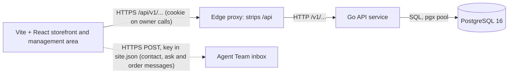

<!-- GENERATED from docs/architecture/services/ — DO NOT EDIT THIS FILE.
     Every write here is overwritten the next time a story's technical design
     merges. This document is the whole contract and is what every reader,
     review and gate reads; it is assembled from one file per story so that
     twenty stories do not edit one file. Add or change what YOUR story needs
     in docs/architecture/services/<your-story-slug>.md. -->

# Service & Interface Design — Đèo Bikes

Last updated: 2026-11-18
Source: `docs/data/SRS.md`, `docs/admin/SRS.md`, `docs/orders/SRS.md`, `docs/site/SRS.md`, `docs/architecture/erd.md`, and the committed backend scaffold (`code/backend/internal/httpx`, `internal/server`, `internal/config`, `cmd/api`). Shape: `fullstack`.

This file is the contract. The frontend Dev and the backend Dev both build to it; the test cases are written from it. Where the SRS fixes a sentence, a status or a shape, this file repeats it and marks it **fixed**; where it is silent this file decides, and says so. Where this file departs from `references/api-conventions.md` because an SRS requirement forces it, the departure is listed once in §2.8.

## 1. Service map



| Service | Responsibility | Owns (tables) | Depends on | Deploy unit |
|---|---|---|---|---|
| `api` (`code/backend/cmd/api`) | Serves the eight record collections to everyone, lets the one signed-in owner add, replace and delete bikes and riding types, takes and prices orders and holds their bikes, signs the owner in and out | `categories`, `products`, `reviews`, `gallery`, `team`, `services`, `faqs`, `shop`, `orders`, `order_lines`, `order_counters`, `sessions` (every table of `erd.md`) | PostgreSQL 16 (`DATABASE_URL`); the edge proxy in front of it; the secrets `ADMIN_EMAIL`, `ADMIN_PASSWORD` | one container (`backend` in `docker-compose.yml`) |
| Edge proxy (existing, not ours to change) | Terminates TLS, strips `/api`, forwards `X-Forwarded-For` and `X-Forwarded-Proto` | nothing | `api` | the deployment's Caddy |
| Agent Team inbox (third party, called by the **browser**, not by `api`) | Receives the contact form, the ask-the-shop-to-call form and one message per placed order, for the owner to read | nothing of ours | its own availability | not ours |

**Why these boundaries** — single service: no boundary is justified yet. There is one team, one release cadence, one database and one owner of every table, and every split would add a network call and a partial-failure mode to a shop that sells a few hundred bikes a month. The Agent Team inbox is deliberately *not* behind `api`: the SRS wires it from the browser through the key in `src/site.json` (SITE-012, SITE-013, ORD-008), the owner's messages are never stored here (`erd.md` §1), and routing them through `api` would put a third-party dependency on the order path.

**Who writes what inside the one service.** Every table has exactly one owning service (`api`). Inside it, each table has one *writer package*, with one deliberate exception that the contract depends on:

| Table(s) | Writer package | Other code paths that write it |
|---|---|---|
| `products`, `categories` | `collections` (the owner's `POST`/`PUT`/`DELETE`) | `orders` lowers `products.stock` in the order's transaction. Both paths take the bike's row lock and both bump `version` through the `touch_record` trigger, which is what makes the compare-and-swap of §3.5 true (ADMIN-008) |
| `reviews`, `gallery`, `team`, `services`, `faqs`, `shop` | none at run time (a migration writes them) | none |
| `orders`, `order_lines`, `order_counters` | `orders` | none |
| `sessions` | `auth` | none |

## 2. Cross-cutting contract

### 2.1 Base

- Base URL: `{scheme}://{host}/v1` — the backend's own routes, **without `/api`**. Browsers reach them as `/api/v1/...` (or `<VITE_API_URL>/v1/...`) through the edge proxy, which strips `/api` before forwarding. Every path in this file is written the way the backend mounts it. `GET /healthz` is the one unversioned route.
- Paths are exact: a trailing slash, a different case or an extra segment is `404 NOT_FOUND`. A route is added with one line in `internal/server.Router`.
- Content type: `application/json; charset=utf-8` on every body. A `204` has no body.
- Versioning: URL path major version (`/v1`). A new major version only for a breaking change (§8).
- Caching: **every** response, success or error, carries `Cache-Control: no-store` (the existing `httpx.NoStore` middleware). A saved edit must show on the next read from any visitor and no cache between the server and the browser may hold an older copy (ADMIN-007.1).
- Trace header: `X-Request-Id` is accepted from the caller when it matches `^[A-Za-z0-9._-]{1,64}$`, otherwise generated (32 hex characters); it is echoed on every response and present in every log line. It is a response *header only*, never part of a body.
- Same-origin only: the backend sends no CORS headers. The owner's cookie is sent by the browser to the same origin that served the page. Pointing `VITE_API_URL` at a different origin works for the public reads and not for the owner's calls; see §9, question 3.
- Date and time: only `POST /v1/orders` returns a time (`placed`). It is RFC 3339, to the second, in Vietnam time with its offset: `2026-11-16T09:40:00+07:00` (ORD-001.3, and the same zone the order number's date is counted in).
- Money: whole đồng as a JSON integer, never a float and never a string.
- Unknown values: a response consumer must ignore a response key it does not know, and must show an unknown `brand`, `status` or `wheel` value as plain text rather than fail (what makes §8's "new value" additive).

### 2.2 Authentication and authorization

| Aspect | Decision |
|---|---|
| Mechanism | One owner account; **server-side session** held in `sessions` and referenced by a random cookie. No accounts table, no JWT |
| Credentials | `ADMIN_EMAIL` and `ADMIN_PASSWORD`, two secrets the owner enters in the console (`request_secret`). Read once at start. The email is compared trimmed and lower-cased; the password is compared exactly |
| Password at rest | Only an in-memory `argon2id` hash (`m=19456 KiB, t=2, p=1`, 16-byte random salt made at each start, 32-byte output) of `ADMIN_PASSWORD`; the password string is dropped after hashing. Nothing is written to the database, the logs or any response (ADMIN-001.1, .2) |
| Session cookie | Name `deo_session`; value is 32 random bytes from `crypto/rand`, base64url (43 characters); `Path=/`; `HttpOnly`; `SameSite=Lax`; `Max-Age=604800` (7 days) with a matching `Expires`; `Secure` whenever the request arrived over HTTPS, i.e. `X-Forwarded-Proto: https` or a TLS connection |
| Session lifetime | Fixed 7 days from sign-in, not sliding (ADMIN-003.2). Expired rows are purged on each sign-in |
| Stored form | `sessions.token_hash` = `HMAC-SHA256(key = credential_fingerprint, message = token)`, 32 bytes, where `credential_fingerprint = SHA-256("deo-admin-v1" 0x00 email 0x00 password)` is computed in memory at start from the normalized secrets. The token itself is never stored. A copy of the database cannot be replayed as a cookie, and **changing either secret and restarting makes every earlier session fail the lookup** — that is how "the owner changes the account by changing its two secrets" (ADMIN §3) ends a stolen session. The column is still a 32-byte hash; `erd.md` §3.12 is unchanged |
| Refresh | None. After 7 days the owner signs in again |
| Transport | The cookie above. There is no `Authorization` header and no token in a body or URL |
| Roles | None. Signed in = owner. The only two kinds of caller are *anyone* and *owner* |
| Enforcement point | `requireOwner` middleware, applied per route to `POST`/`PUT`/`DELETE` on `/v1/{collection}…` after the collection checks of §3.4. It looks the cookie up with `WHERE token_hash = $1 AND expires_at > now() AND email = $2` (`$2` is the current normalized `ADMIN_EMAIL`). A malformed, unknown, expired or tampered cookie is `401 UNAUTHENTICATED` |
| CSRF | A write must be `Content-Type: application/json` (otherwise `400 MALFORMED_REQUEST`), the cookie is `SameSite=Lax`, and the backend sends no CORS headers, so a cross-site page can neither send the cookie on a write nor send JSON without a preflight that fails. `GET` never changes anything |
| Not configured | While `ADMIN_EMAIL` or `ADMIN_PASSWORD` is empty after trimming, no password hash exists and **every sign-in is refused exactly as a wrong password is** (`401`, the same sentence), counts toward the throttle like any failure, and the log says once per attempt `admin account is not configured`. The service still starts: the public shop must work before the owner has entered the secrets (ADMIN-001.3). This is fail-closed: there is no default account, no default password and no fallback value in the source |
| Secrets the project issues itself | **None.** The session token is random per sign-in and verified against the database; there is no signing key, cookie secret or HMAC secret to supply (the fingerprint above is derived from the two owner secrets). Nothing in this design is "generated at deploy time" |

**Throttle (ADMIN-002.3)** — in process memory, keyed by client address. Client address = the last entry of `X-Forwarded-For` (the one the edge proxy appended), else the connection's remote host, port removed. Rules: a *failure* is a `401` from `POST /v1/sessions` (wrong email, wrong password, or account not configured); a `400` is not a failure. An address with 5 failures inside the last 15 minutes is locked until 15 minutes after its latest failure; while locked **every** `POST /v1/sessions` from it is `429`, right password or wrong, and a `429` is not itself a failure (it does not extend the lock). A success clears that address's failures. The table is purged of entries older than 15 minutes on every access and capped at 10,000 addresses (oldest evicted). It resets on restart (accepted: `erd.md` §1). The clock is injected so tests can advance it.

### 2.3 Error contract

Every non-2xx response, from every endpoint, including the unknown-route and wrong-method answers, has this shape:

```json
{
  "error": "That email and password do not match.",
  "code": "UNAUTHENTICATED",
  "field": "price"
}
```

| Key | Type | Always present | Meaning |
|---|---|---|---|
| `error` | string | yes | One sentence a customer or the owner can read, never containing SQL, a stack trace, a path or a host. This is the key the scaffold's `httpx.WriteError` already writes and the one the frontend reads (`body.error`); it stays a string |
| `code` | string | yes | Machine-readable `UPPER_SNAKE` code from the catalog below. **Consumers branch on `code` (and the status), never on `error`** — with one exception: a sentence marked **fixed** is spelled by the SRS, appears in a test case verbatim, and is part of the contract |
| `field` | string | no | The one body field or query parameter to blame, present only on `MALFORMED_REQUEST`, `VALIDATION_FAILED` and `INVALID_QUERY` when a single one is at fault; the same name appears in the sentence (SRS: "400 naming the field") |

This extends the scaffold's `{"error": "<sentence>"}` additively (`code` and `field` are new keys, `error` is unchanged), so `httpx.WriteError` keeps working for existing callers; a handler that needs a specific code uses a sibling helper that takes the code and the field.

**Error catalog** — the full closed set for this project.

| Code | HTTP | Meaning | Retryable |
|---|---|---|---|
| `MALFORMED_REQUEST` | 400 | The body is not valid JSON or not a JSON object; the `Content-Type` of a write is not `application/json`; a body key has the wrong JSON type (a string where a number is expected); the body carries a key this contract does not define; `If-Match` is not one quoted whole number | no |
| `VALIDATION_FAILED` | 400 | A well-typed body whose values break a rule: blank, too long, out of range, not whole, not in a closed set, bad id, missing riding type, a live bike without a price, an order rule (cash on delivery, address, quantity) | no |
| `INVALID_QUERY` | 400 | A query parameter of a `GET` list is unknown, repeated, not parseable as the type of its field, a range on a boolean or list, or breaks a limit (`page`, `limit`, `q` length, `search`, `sort`) | no |
| `UNAUTHENTICATED` | 401 | No valid session on an owner call; wrong sign-in (the same code and sentence whichever of email or password is wrong) | no |
| `NOT_FOUND` | 404 | Unknown route, unknown collection, or no record with that id | no |
| `METHOD_NOT_ALLOWED` | 405 | The method is not offered on that path; includes every write to a collection other than `products` and `categories`. Carries `Allow` | no |
| `ID_TAKEN` | 409 | A new record's id is already used in its collection | no |
| `STALE_RECORD` | 409 | The record changed since the caller read it (`If-Match` no longer matches) | no — reload, then save again |
| `IN_USE` | 409 | A riding type still used by bikes cannot be deleted | no |
| `BIKE_UNAVAILABLE` | 409 | An order line names a bike that is gone, not live, short of stock, or has no such size | no |
| `PAYLOAD_TOO_LARGE` | 413 | The body is larger than the cap of its endpoint (§6) | no |
| `PRECONDITION_REQUIRED` | 428 | `PUT` without an `If-Match` header | no |
| `RATE_LIMITED` | 429 | The sign-in throttle; carries `Retry-After` (seconds) | yes, after `Retry-After` |
| `INTERNAL` | 500 | Unexpected failure, including a query or insert that failed; details are logged with the `X-Request-Id`, never returned. Sentence: "Something went wrong. Please try again." | yes |
| `UNAVAILABLE` | 503 | The database refused the connection, the pool cannot hand out a connection, or the process is shutting down. Sentence: "The service is not ready." | yes |

There is no `422` and no `403` in this project: the SRS fixes `400` for every refused value (ADMIN-005.8, ORD-003.6, DATA-003) and there are no roles.

**Which check answers first.** When a request breaks several rules the endpoint answers with the first failing check in the order its section lists; the order is part of the contract, so a test case that breaks two rules has one right answer. The common order is: route and method → collection (404) → writability (405) → session (401) → body shape (400) → value rules (400) → record existence (404) → `If-Match` (428/400) → database rules (400/409).

### 2.4 Pagination

One scheme for the whole project: **page number and page size**, because the SRS fixes it (DATA-002) and the frontend's `useCollection` already speaks it.

```
GET /v1/products?page=2&limit=12&status=live&sort=-price
```

```json
{ "items": [ { "id": "talon-2", "name": "Talon 2" } ], "total": 14, "page": 2, "limit": 12 }
```

| Aspect | Decision |
|---|---|
| Style | offset: `page` (1-based) and `limit` |
| Default | `page=1`, `limit=12` |
| Max limit | 100. A larger `limit` is **answered as 100** and the answer says `limit: 100` (DATA-002.2, AC-6). This is the SRS's rule and it is the one place the contract clamps instead of rejecting (§2.8) |
| Bad values | `page` or `limit` that is empty, not a whole number, or below 1 → `400 INVALID_QUERY` naming it (`page=0`, `limit=0`, `limit=-1`, `limit=abc`). `page` above 1,000,000,000 is also refused |
| Past the last page | `200` with `items: []` and the true `total` — not an error (DATA-002.4) |
| `total` | The number of records that match every condition and the search words, never the size of the page (DATA-003 AC-13) |
| Default sort | `seq` ascending: seeded records in file order, later records in the order they were added. The sort is stable and unique because `seq` is the final tiebreak of every ordering, so consecutive pages neither repeat nor skip a record (DATA-002.3) |

Offset paging is acceptable here and cursor paging is not needed: each collection holds at most a few hundred rows (`erd.md` §6), is read by an admin table that shows "1–14 of 14" and page numbers, and a record added between two page reads can at worst shift one row, which the owner's refresh (ADMIN-007.2) corrects.

### 2.5 Validation boundary

**The edge is the handler layer of the `api` service, before any SQL.** Each handler decodes and validates the whole request in one function (`internal/<package>/validate.go`), producing either a typed value or the first error of §2.3. Code below that point — the SQL layer and the transaction — trusts the typed value and does not re-validate defensively. The database's own `CHECK`s (`erd.md` §7) remain as a backstop; a `CHECK` that fires means a validator is missing a rule, and the answer is `500 INTERNAL` plus an error log, never a leaked constraint name.

Rules that hold for every endpoint:

1. **A field the contract does not define is rejected, never ignored.** A body key that is not listed for the endpoint answers `400 MALFORMED_REQUEST` naming the key (JSON decoding uses `DisallowUnknownFields` and rejects trailing data after the object). A query parameter that is not defined for the endpoint answers `400 INVALID_QUERY` naming it. There is exactly one carve-out, on `POST /v1/orders`, forced by the SRS (ORD-002 AC-1, ORD-006 AC-6): the keys listed there as *advisory* are accepted and never read.
2. A write body must be a JSON object, at most the cap of its endpoint (§6), `Content-Type: application/json` (a charset parameter is allowed).
3. **Reject, do not coerce:** `"5"` is not a number, `5.0` is not an integer for an integer field (an integer field takes a JSON integer literal: optional minus, digits, no fraction, no exponent), `"true"` is not a boolean. Text is stored exactly as sent; only the fields a section says are trimmed are trimmed.
4. "Characters" means Unicode code points, not bytes (`"Hùng Vương"` is 10 characters).
5. Path parameters are taken as given and never validated beyond lookup: an `{id}` that no record has is `404`, never `400`.
6. Every database value travels as a bound parameter; no request text is ever part of an SQL string. Field and sort names from the query are checked against the collection's schema and then selected from a fixed map to a column, never concatenated.

### 2.6 Idempotency

| Endpoint | Idempotent? | Decision |
|---|---|---|
| `GET` anything | yes | |
| `PUT /v1/{collection}/{id}` | in effect, not in status | Replaying the same request after it succeeded answers `409 STALE_RECORD` (the first save bumped `version`). The owner's double press is stopped in the browser (the button is disabled while sending, ADMIN-013.2) |
| `DELETE /v1/{collection}/{id}` | in effect, not in status | The second delete is `404` (ADMIN-006.1) |
| `POST /v1/{collection}` | no | Without an `id` every call makes a new record; with an `id` a replay is `409 ID_TAKEN` |
| `POST /v1/orders` | **no, by decision** | There is no `Idempotency-Key`. A customer who presses "Place order" again after a lost answer makes a second order that holds a second bike; the confirming call catches it and the owner corrects the stock (orders SRS §7, question 2; `erd.md` §9, question 5). The server never retries a write by itself and the client does not retry automatically |
| `POST /v1/sessions` | no | Each success creates another session; earlier ones stay valid until they expire or are signed out |
| `DELETE /v1/sessions/current` | yes | Always `204` (ADMIN-003.4) |

No `Idempotency-Key` header is read anywhere; sending one is not an error (it is a header, not a body or query field).

### 2.7 How a record is written on the wire

One representation, used by every `GET`, and by the `201`/`200` of a write. It is DATA-001.3 and .4 made precise.

- A record is a JSON object: `id` (string) plus one key per column the schema lists for the collection (`code/frontend/src/data/schema.json` — the column names *are* the schema keys, `erd.md` R2), plus `_source` and `_invented` where the row has them.
- **A column that is `NULL` has no key.** No field of any record is ever `null` (DATA-001.4). The empty list is `[]`, not omitted (`sizes_out` of `talon-2`).
- Types: text, long text, image and url → string; `number` → JSON number as stored (`4.8`, `2027`, never `"4.8"`); `price` and `stock` → JSON integer; `bool` → `true`/`false`; `list` → array of strings in stored order; a reference → the referenced id as a string.
- Never returned: `seq`, `version`, `created_at`, `updated_at`. `version` leaves only as the `ETag` header of §3.3.
- **Key order is not part of the contract.** Consumers compare records key for key, never as text (DATA-001 AC-2).

Records of the writable collections have these keys (all optional except the ones marked required; see §3.11 for their rules). Read-only collections return the columns of `erd.md` §3.3–§3.8 the same way.

| Collection | Keys |
|---|---|
| `products` | `id`, `name` (required), `brand`, `category`, `year`, `price`, `was`, `price_listed`, `fact`, `status`, `stock`, `sizes`, `sizes_out`, `size_fit`, `deal`, `month`, `wheel`, `travel`, `frame`, `fork`, `shock`, `motor`, `drivetrain`, `brakes`, `wheels`, `tyres`, `weight`, `colour`, `description`, `ride`, `rating`, `review_count`, `image`, `image_back`, `image_detail`, `_source`, `_invented` |
| `categories` | `id`, `name` (required), `line`, `terrain`, `_source` |

### 2.8 Departures from `api-conventions.md`

Each is forced by an SRS requirement and is stated once here, not repeated per endpoint.

| Convention | What this contract does | Forced by |
|---|---|---|
| Collection responses are `{ "data": [...] }` with cursor pagination | `{ "items": [...], "total", "page", "limit" }` with page numbers | DATA-002.1; the frontend module and the admin table's "1–14 of 14" |
| A `limit` over the cap is rejected, never clamped | A `limit` over 100 is answered as 100 | DATA-002.2, AC-6 |
| `422 VALIDATION_FAILED`; error object with `message`, `details`, `request_id` in the body | `400` for every refused value; error body is `{error, code, field?}`; the request id is the `X-Request-Id` header | ADMIN-005.8, ORD-003.6, DATA-003; the scaffold's `httpx` envelope that the frontend already reads |
| An undefined field is rejected | …except the advisory keys of `POST /v1/orders` | ORD-002 AC-1, ORD-006 AC-6 |
| `201` carries `Location` | No `Location`: the backend does not know the edge's `/api` prefix, the body carries the new `id`, and no consumer follows it | — |
| Timestamps in UTC | `placed` is in Vietnam time with its offset | ORD-001.3 ("with its offset"), ORD-006.1 |
| Optimistic locking in the body | Token in the `ETag` / `If-Match` headers, never in the body | DATA-001 AC-2 compares bodies key for key; `decision.concurrency` |
| `PATCH` for updates | `PUT`, a full replacement | ADMIN-005.1 ("replaces the whole record with the body", AC-4) |
| Lists are public only when the data is | Every record of every collection is public, drafts included | ADMIN-004.2; the storefront asks for `status=live` itself (SITE-003.3). A draft bike opens by its address (site SRS §7, question 2) |

## 3. Endpoints

Ten endpoints in four groups: health, the record collections (`/v1/{collection}`), the owner's session, and orders. The eight collection names are a closed set: `products`, `categories`, `reviews`, `gallery`, `team`, `services`, `faqs`, `shop`. Any other name in `{collection}` is `404 NOT_FOUND` ("That collection does not exist.") for every method the route shape offers, **before** anything else is checked (so `GET /v1/orders` and `GET /v1/orders/DEO-261116-0001` are `404`: no order is ever served, ORD-001.5, AC-6; `GET /v1/sessions/current` is `404` too, a session is never readable).

Route shapes and their methods: `/v1/{collection}` offers `GET` and `POST`; `/v1/{collection}/{id}` offers `GET`, `PUT` and `DELETE`; `/v1/sessions` offers `POST`; `/v1/sessions/current` offers `DELETE`; `/v1/me` offers `GET`; `/v1/orders` offers `POST`; `/healthz` offers `GET`. A literal route wins over `{collection}`. Any other method on a path that exists is `405 METHOD_NOT_ALLOWED` with an `Allow` header listing the methods it does offer (for example `PATCH /v1/products/talon-2` → `Allow: GET, PUT, DELETE`); `HEAD` and `OPTIONS` are not offered. A path that matches no shape is `404 NOT_FOUND` ("That address does not exist."). All of these answers use the envelope of §2.3.

### 3.1 `GET /healthz`

**Purpose** — liveness and readiness for compose and the deploy. **Traces to** — none (infrastructure; exists in the scaffold). **Auth** — none. Unversioned.

**Success** — `200 {"status":"ok"}` only while `SELECT 1` answers within 2 s. **Errors** — `503 UNAVAILABLE` "The service is not ready.".

### 3.2 `GET /v1/{collection}`

**Purpose** — one page of a collection, narrowed, searched and ordered. **Traces to** — DATA-001, DATA-002, DATA-003, DATA-004, DATA-005, DATA-007, DATA-008; read by every storefront page and every management list (SITE-002 to SITE-005, SITE-011, SITE-014, ADMIN-009 to ADMIN-012). **Auth** — none: any visitor, signed in or not (DATA-002.6, ADMIN-004.2).

**Path and query parameters**

| Name | In | Type | Required | Constraints | Description |
|---|---|---|---|---|---|
| `collection` | path | string | yes | one of the eight names above | Which collection |
| `page` | query | integer | no | ≥ 1, ≤ 1,000,000,000; default 1 | Page number, 1-based |
| `limit` | query | integer | no | ≥ 1; default 12; above 100 is answered as 100 | Page size |
| `sort` | query | string | no | `<field>` ascending or `-<field>` descending; one field; the field must exist and must not be a list | Ordering. Empty = none (seed order) |
| `q` | query | string | no | trimmed; at most 100 characters; empty or blank filters nothing | Search words, one phrase. **Always** the search words, even on `faqs`, whose field is also called `q` (that field's exact value cannot be filtered on, DATA-003.6) |
| `search` | query | string | no | comma-separated field names; each must exist and be text-like (below) | Restricts `q` to these fields. Without it every text-like field is searched |
| `<field>` | query | string | no | `<field>` is `id` or a key of the collection's schema (`schema.json`); a comma separates alternatives | Keeps records whose field equals the value, or any of the comma-separated values |
| `<field>_from`, `<field>_to` | query | string | no | the same field names; both ends inclusive; not on a bool or a list | Keeps records whose field is at or above / at or below the value |

Parameter names `page`, `limit`, `q`, `search`, `sort` are the API's own. Any other name must be a field, a field with `_from`, or a field with `_to`; anything else is `400 INVALID_QUERY` naming it (DATA-003.6, AC-12). A parameter given twice (`category=a&category=b`) is also `400` naming it — use a comma. The query is never logged (`httpx.Log` logs the path only: a visitor's search words are private).

**How each kind of field behaves** (the kind comes from `schema.json`: `id` and every `text`, `longtext`, `image`, `url` and `ref:*` field are *text-like*; `number` and `price` are *numeric*; `bool`; `list`)

| Kind | `<field>=v` equality | `<field>_from` / `_to` | `sort` | Searched by default (`q`) |
|---|---|---|---|---|
| text-like | equal ignoring capitals and accents (`fold_text`, `erd.md` §3.14); `đ` equals `d` | compared as text in byte order (`COLLATE "C"`) on the stored value, which is how ISO dates (`2026-09-01`) compare | natural order of the folded text: digit runs compare as numbers (`Talon 2` before `Talon 29 3`), ignoring capitals and accents | yes, with `id`; **never** a field whose name begins with an underscore |
| numeric | numeric equality; `v` must be a plain decimal (`-?\d+(\.\d+)?`) or `400` | numeric; same parsing | numeric | no (`q=20990000` finds no bike by its price, DATA-004 AC-12) |
| bool | `v` must be exactly `true` or `false` or `400` | `400` | `false` before `true` | no |
| list | the record's list contains `v` (compared like text-like) | `400` | `400` (a list has no order) | no |

- A comma-separated value (`category=trail,e-mtb`) means *any of*; empty parts are ignored. A value that itself contains a comma cannot be filtered on (accepted). `q` and ranges are never split.
- An **empty** value (`category=`, `price_from=`, `sort=`, `search=`) filters nothing. An empty `page` or `limit` is not a whole number and is refused.
- A record that has **no value** (the column is `NULL`) does not match any condition on that field, and sorts **after** every record that has one, in either direction (DATA-003.5, DATA-005.2). Equal values keep `seq` order.
- Conditions on several fields, the search words, the sort and the page all combine; `total` counts every record matching all conditions and the search, and is the same with or without a sort.
- Search: the words, trimmed and folded, must appear as one phrase anywhere in at least one searched field; `%`, `_` and `\` in the words mean themselves (escaped for `LIKE`); the quote, semicolon and every other character are plain data (DATA-004 AC-13). A named `search` field that is numeric, bool or list is refused (`400`, "<field> cannot be searched.").
- `id` is accepted as a field in conditions, `search` and `sort` (the record has one); `_source` is not a schema field and is refused everywhere; `_invented` (a schema list) can be filtered with `_invented=<field>` and nothing else.

**Request body** — none (a body is not read).

**Success response** — `200`

```json
{
  "items": [
    { "id": "talon-2", "name": "Talon 2", "brand": "Giant", "category": "hardtail", "price": 18990000, "status": "live", "stock": 9, "sizes": ["XS", "S", "M", "L", "XL"], "sizes_out": [], "deal": true, "wheel": "29", "_source": "web:https://example.test/talon-2" }
  ],
  "total": 14,
  "page": 1,
  "limit": 12
}
```

| Field | Type | Nullable | Description |
|---|---|---|---|
| `items` | array of record (§2.7) | no | At most `limit` records; `[]` past the last page or when nothing matches |
| `total` | integer | no | Every match, not only this page |
| `page` | integer | no | The page asked for, as asked (not clamped to the last page; DATA-007's module clamps for its own state) |
| `limit` | integer | no | The size used: the one asked for, or 12, or 100 when more was asked |

**Errors** — in the order they are checked: unknown collection, then repeated parameter, then `page`, `limit`, `sort`, `search`, `q`, then the remaining parameters alphabetically.

| Code | HTTP | Trigger |
|---|---|---|
| `NOT_FOUND` | 404 | `collection` is not one of the eight |
| `INVALID_QUERY` | 400 | repeated parameter; `page`/`limit` not a whole number ≥ 1 (`page=0`, `limit=-1`, `limit=abc`, `limit=`); `sort` names a field the collection lacks or a list; `search` names a field the collection lacks or a non-text-like field; `q` longer than 100 characters; a parameter that is not a field, `<field>_from` or `<field>_to` (`colourful=red`); a non-numeric value on a numeric field (`stock=abc`); a bool field with anything but `true`/`false` (`deal=maybe`); a range on a bool or list field (`deal_from=1`). `field` is the field at fault: a condition's own parameter name, `page`, `limit` or `q`, and the field named inside `sort` or `search` (`search=nothing` → `field: "nothing"`); the sentence names the same, e.g. "There is no field “colourful” to filter bikes by." |
| `INTERNAL` | 500 | the query failed for any reason other than connectivity |
| `UNAVAILABLE` | 503 | the database refused the connection |

**Notes** — read-only and side-effect free. Never cached (§2.1). Performance: a page of 100 bikes, with or without `q`, p95 ≤ 500 ms over 100 sequential requests on the seeded database (data SRS §6). The shop asks for all live bikes in one request: `GET /v1/products?status=live&limit=100`. The search page asks five lists with the same words: `products?q=…&status=live`, `categories?q=…`, `services?q=…`, `faqs?q=…`, `gallery?q=…` (DATA-008 AC-8).

### 3.3 `GET /v1/{collection}/{id}`

**Purpose** — one record, and for a bike or riding type the token a later save needs. **Traces to** — DATA-006, DATA-007.6, ADMIN-008, SITE-005, SITE-016, ADMIN-011. **Auth** — none.

**Path parameters**

| Name | In | Type | Required | Constraints | Description |
|---|---|---|---|---|---|
| `collection` | path | string | yes | one of the eight names | |
| `id` | path | string | yes | any text; no format check | The record's id (`stance-0`, `trail`, `r-thao`, `shop`) |

**Request body** — none.

**Success response** — `200` with the record of §2.7, identical to the record the list holds for that id (DATA-006 AC-1). For `products` and `categories` the response also carries:

```
ETag: "7"
```

The `ETag` is the record's `version` as a quoted decimal integer: the **only** place a version is ever read. A list carries none, so a screen that is about to edit a record reads it by id first and keeps the `ETag` for its `PUT` (§3.5). The six read-only collections send no `ETag`. `If-None-Match` is not honoured (every answer is `no-store`).

**Errors**

| Code | HTTP | Trigger |
|---|---|---|
| `NOT_FOUND` | 404 | unknown collection ("That collection does not exist."); no record with that id ("That record does not exist.") — also an id with capitals or any other shape no record can have |
| `INTERNAL` | 500 | the query failed |
| `UNAVAILABLE` | 503 | the database refused the connection |

**Notes** — a bike in `draft` is returned like any other (ADMIN-004.2: reading is public; the storefront filters `status=live` itself).

### 3.4 `POST /v1/{collection}`

**Purpose** — the owner adds a bike or a riding type. **Traces to** — ADMIN-004, ADMIN-005, ADMIN-010, ADMIN-012, ADMIN-013. **Auth** — owner session (cookie). Only `products` and `categories`.

**Checks, in this order** — (1) collection exists, else `404`; (2) collection is `products` or `categories`, else `405` — **before** the session is looked at, so every other collection answers `405` to a write whether or not anyone is signed in (ADMIN-004.3, AC-5); (3) valid session, else `401`; (4) `Content-Type: application/json` and body within the cap, else `400`/`413`; (5) the body rules of §3.11, field by field in the schema's order, `id` first, then the cross-field rule "a live bike needs a price"; (6) inside the transaction: `category` names an existing riding type; (7) the id is not taken.

**Request body** — a record as §2.7, without `version` or `_source` (not schema fields, so refused as undefined keys), every key optional except `name`. Rules in §3.11.

```json
{ "name": "Test Bike", "brand": "Giant", "category": "trail", "price": 25000000, "status": "draft", "stock": 3 }
```

| Field | Type | Required | Constraints | Description |
|---|---|---|---|---|
| `id` | string | no | `^[a-z0-9][a-z0-9-]{0,63}$` | Used as given when present and free. When absent the server makes `<collection>-<6 random characters from a–z, 0–9>` (`products-k3f9a2`) and retries on a collision up to 5 times (ADMIN-005.7) |
| `name` | string | yes | not blank | The bike's model name, or the riding type's name |
| every other schema key of the collection | per §3.11 | no | per §3.11 | |

**Success response** — `201` with the saved record (§2.7, the same values as sent, plus the id) and `ETag: "1"`.

**Errors**

| Code | HTTP | Trigger |
|---|---|---|
| `NOT_FOUND` | 404 | unknown collection |
| `METHOD_NOT_ALLOWED` | 405 | any collection other than `products`, `categories`; `Allow: GET` |
| `UNAUTHENTICATED` | 401 | no cookie, or a cookie that is unknown, expired, tampered or signed out. **Nothing is created** (ADMIN-004 AC-1, AC-2, AC-3). Sentence: "You are not signed in." |
| `PAYLOAD_TOO_LARGE` | 413 | body over 1 MiB |
| `MALFORMED_REQUEST` | 400 | not JSON, not an object, trailing data, wrong `Content-Type`, an undefined key (`colourful`), a key of the wrong JSON type |
| `VALIDATION_FAILED` | 400 | any value rule of §3.11, including `id` format, a blank `name`, and **"A live bike needs a price."** (fixed) |
| `ID_TAKEN` | 409 | the `id` in the body already exists in the collection. **Fixed sentence:** "That id is already used." |
| `INTERNAL` | 500 | insert failed |
| `UNAVAILABLE` | 503 | database refused the connection |

**Notes** — a refused body saves nothing (ADMIN-005 AC-22): the insert is one statement in one transaction. A new bike's `_source` is `NULL` (`erd.md` §9, question 2). The saved record is readable by every visitor at once (`no-store`, no cache to invalidate).

### 3.5 `PUT /v1/{collection}/{id}`

**Purpose** — the owner replaces a bike or a riding type with the body, only if it is unchanged since it was read. **Traces to** — ADMIN-004, ADMIN-005, ADMIN-007, ADMIN-008, ADMIN-010, ADMIN-011, ADMIN-012, ADMIN-013. **Auth** — owner session. Only `products` and `categories`.

**Checks, in this order** — (1) collection exists `404`; (2) writable `405`; (3) session `401`; (4) content type and size `400`/`413`; (5) body rules of §3.11 field by field, **including `id`, which when present must equal the address's id**; (6) the record exists, else `404` ("That record does not exist."); (7) `If-Match` present, else `428`; well-formed (exactly one quoted whole number, e.g. `"7"`; no `*`, no weak `W/`, no list), else `400 MALFORMED_REQUEST`; (8) inside the transaction: `category` names an existing riding type (`400`); (9) the record's current `version` equals the `If-Match` number, else `409 STALE_RECORD`.

**Headers**

| Name | Required | Description |
|---|---|---|
| `If-Match` | yes | The `ETag` the caller last read for this record (§3.3), or got back from its own last `POST`/`PUT` |

**Request body** — the whole record, as §3.4. **It replaces the record:** every schema field absent from the body (or sent as an empty value) becomes "no value" (the column is set `NULL` and the key leaves the record, ADMIN-005 AC-4, AC-16). `id`, `seq` and `_source` are not touched: a seeded bike keeps its origin after the owner edits it (`erd.md` §9, question 2, decided here); `_invented`, being a schema field, is replaced like any other.

**Success response** — `200` with the saved record and the new `ETag: "<version + 1>"`. The caller may edit again with that `ETag` without re-reading.

**Errors**

| Code | HTTP | Trigger |
|---|---|---|
| `NOT_FOUND` | 404 | unknown collection; no record with that id (ADMIN-005 AC-5) |
| `METHOD_NOT_ALLOWED` | 405 | other collections; `Allow: GET` |
| `UNAUTHENTICATED` | 401 | no valid session (ADMIN-004 AC-1 to AC-3) |
| `PAYLOAD_TOO_LARGE` | 413 | body over 1 MiB |
| `MALFORMED_REQUEST` | 400 | as §3.4; also a malformed `If-Match` |
| `VALIDATION_FAILED` | 400 | as §3.4; also a body `id` that differs from the address (ADMIN-005 AC-17) |
| `PRECONDITION_REQUIRED` | 428 | no `If-Match` header |
| `STALE_RECORD` | 409 | the record changed since the caller read it — an order lowered its stock, or the owner saved it from another window. **Fixed sentence:** "This record changed while you were editing it — for example an order was placed. Reload and make your change again." Nothing is overwritten (ADMIN-008 AC-1, AC-3) |
| `INTERNAL`, `UNAVAILABLE` | 500, 503 | as §3.4 |

**Notes** — the write is one statement, `UPDATE … WHERE id = $1 AND version = $2`, whose row lock the order's transaction also takes; 0 rows is followed by a `SELECT` to tell `404` (deleted meanwhile) from `409`. When a save and an order for the same bike run at the same moment they apply one after the other: if the save lands first the order lowers the saved stock; if the order lands first the save is `409` (ADMIN-008.3, AC-5). The `touch_record` trigger bumps `version` on every update, so no code path can forget (`erd.md` §3.14). The token is never in the body, because DATA-001 compares bodies key for key.

### 3.6 `DELETE /v1/{collection}/{id}`

**Purpose** — the owner deletes a bike or a riding type. **Traces to** — ADMIN-004, ADMIN-006, ADMIN-008.4, ADMIN-010 to ADMIN-013. **Auth** — owner session. Only `products` and `categories`.

**Checks, in this order** — (1) collection `404`; (2) writable `405`; (3) session `401`; (4) the record exists, else `404`; (5) for `categories`, no bike uses it, else `409 IN_USE`.

**Request body** — none (never read). `If-Match` is not read: deleting is not refused for a change since the screen loaded the record (ADMIN-008.4, AC-6).

**Success response** — `204`, no body.

**Errors**

| Code | HTTP | Trigger |
|---|---|---|
| `NOT_FOUND` | 404 | unknown collection; no record with that id (ADMIN-006 AC-9) |
| `METHOD_NOT_ALLOWED` | 405 | other collections; `Allow: GET` |
| `UNAUTHENTICATED` | 401 | no valid session; nothing is deleted (ADMIN-006 AC-10) |
| `IN_USE` | 409 | a riding type that bikes still use. **Fixed sentence:** "<Name> is still the riding type of <N> bike. Give those bikes another riding type first." for one bike, "…of <N> bikes. Give…" for more (`<Name>` is the riding type's `name`: "Trail is still the riding type of 4 bikes. Give those bikes another riding type first.") |
| `INTERNAL`, `UNAVAILABLE` | 500, 503 | as §3.4 |

**Notes** — what the delete does to other tables follows `erd.md`: a deleted bike's reviews stay and lose `bike` (`SET NULL`); orders already placed keep their lines, because `order_lines.product_id` is a copy, not a key (ADMIN-006 AC-7); a deleted riding type's gallery photographs stay and lose `type`. The riding-type delete runs in one transaction: lock the row, count its bikes, delete; if a bike took the type in the instant between (the `RESTRICT` foreign key fires), the count is read again and the answer is the same `409`.

### 3.7 `POST /v1/sessions`

**Purpose** — the owner signs in. **Traces to** — ADMIN-001, ADMIN-002. **Auth** — none (this is how it is obtained).

**Request body** — max 8 KiB.

```json
{ "email": "  OWNER@deo.test ", "password": "the-owners-password" }
```

| Field | Type | Required | Constraints | Description |
|---|---|---|---|---|
| `email` | string | yes | at most 320 characters | Compared trimmed and ignoring capitals |
| `password` | string | yes | at most 1,024 bytes | Compared exactly, not trimmed |

An empty `email` or `password` string is accepted as a value and simply does not match (a `401` failure); a missing key or a non-string is `400`.

**Checks, in this order** — (1) the client address is not locked, else `429` (the lock is checked **first**, so a locked address gets `429` whatever it sends); (2) body is a JSON object with `Content-Type: application/json`, within 8 KiB, with exactly those two string keys, else `400`; (3) credentials: the email matches `ADMIN_EMAIL` (both trimmed, lower-cased) and the password verifies against the in-memory hash, else `401`. Step 3 **always runs one `argon2id` verification**, against a dummy hash when the account is not configured or the email is wrong, so the time taken does not say which part was wrong.

**Success response** — `200`

```
Set-Cookie: deo_session=<43 characters>; Path=/; Max-Age=604800; Expires=<now + 7 days>; HttpOnly; SameSite=Lax[; Secure]
```

```json
{ "email": "owner@deo.test" }
```

| Field | Type | Nullable | Description |
|---|---|---|---|
| `email` | string | no | The owner's email, trimmed and lower-cased. The password is never in any answer (ADMIN-001 AC-2) |

**Errors**

| Code | HTTP | Trigger |
|---|---|---|
| `RATE_LIMITED` | 429 | five failures from this address in the last 15 minutes and fewer than 15 minutes since the latest. **Fixed sentence:** "Too many attempts. Try again in a few minutes." `Retry-After: <seconds until unlock>` (1 to 900) |
| `MALFORMED_REQUEST` | 400 | body not a JSON object, a key missing (no password), a non-string, an undefined key, wrong `Content-Type` (ADMIN-002 AC-3) |
| `PAYLOAD_TOO_LARGE` | 413 | body over 8 KiB |
| `UNAUTHENTICATED` | 401 | wrong email, wrong password, or the account is not configured — the **same** answer for all three. **Fixed sentence:** "That email and password do not match." |
| `INTERNAL`, `UNAVAILABLE` | 500, 503 | the session row could not be written |

**Notes** — on success the server inserts one `sessions` row (`email` normalized, `expires_at = created_at + 7 days`), deletes every expired row, and clears this address's failures. It does not end the owner's other sessions. Every `401` adds a failure for the client address. Neither the password nor the typed email is ever logged; the log line carries the outcome (`ok`, `bad_credentials`, `not_configured`, `locked`) and the request id.

### 3.8 `GET /v1/me`

**Purpose** — who is signed in; the "me check" the site makes when it loads. **Traces to** — ADMIN-003.1 to .3, .7. **Auth** — the session cookie, if any.

**Request body** — none.

**Success response** — `200 { "email": "owner@deo.test" }` for a cookie whose session row exists, has not expired and carries the current normalized `ADMIN_EMAIL`.

**Errors**

| Code | HTTP | Trigger |
|---|---|---|
| `UNAUTHENTICATED` | 401 | no cookie; unknown, expired, tampered or signed-out cookie; secrets changed since sign-in; `ADMIN_EMAIL` not set. **Sentence:** "You are not signed in." (ADMIN-003 AC-2, AC-3, AC-8) |
| `INTERNAL`, `UNAVAILABLE` | 500, 503 | the lookup failed; the site then treats nobody as signed in (ADMIN-003.7) |

**Notes** — one indexed lookup (`uq_sessions_token_hash`); no write; it does not extend the session.

### 3.9 `DELETE /v1/sessions/current`

**Purpose** — the owner signs out. **Traces to** — ADMIN-003.4, .5. **Auth** — the session cookie, if any; none is required.

**Request body** — none.

**Success response** — `204`, always, whether or not a session existed (ADMIN-003 AC-9). It deletes the session row for the cookie, if any, and always sends the clearing cookie `Set-Cookie: deo_session=; Path=/; Max-Age=0; HttpOnly; SameSite=Lax[; Secure]`. The old cookie value fails the next `GET /v1/me` (AC-8).

**Errors**

| Code | HTTP | Trigger |
|---|---|---|
| `INTERNAL`, `UNAVAILABLE` | 500, 503 | the row could not be deleted: the cookie is then **not** cleared, so the owner is never told they are signed out while the session still works |

### 3.10 `POST /v1/orders`

**Purpose** — a customer places an order: the server prices it, checks every bike, holds the stock, numbers it and stores it, and answers with what it stored. **Traces to** — ORD-001 to ORD-006, ORD-007 (the caller), ADMIN-006.4, ADMIN-008. **Auth** — none: the customer has no account (ORD §2).

**Request body** — max 32 KiB. Sent by `src/lib/orders.ts`; the request carries no price and no total the server uses (ORD-001.1).

```json
{
  "name": "Minh",
  "phone": "0901234567",
  "delivery": "courier",
  "address": "12 Hùng Vương",
  "payment": "transfer",
  "note": "Please call after 5pm",
  "lines": [ { "id": "talon-2", "variant": "M", "qty": 2 } ],
  "website": ""
}
```

| Field | Type | Required | Constraints | Description |
|---|---|---|---|---|
| `name` | string | yes | trimmed, 1–100 characters | Customer's name |
| `phone` | string | yes | trimmed, 1–30 characters | Customer's phone |
| `delivery` | string | yes | `local`, `courier` or `pickup` | How it reaches them |
| `address` | string | when `delivery` is `local` or `courier` | trimmed, at most 300 characters; for `pickup` it may be absent or empty | Delivery address |
| `payment` | string | yes | `transfer`, `cod` or `shop`; `cod` only with `delivery: "local"` | How they pay |
| `note` | string | no | trimmed, at most 1,000 characters | Stored, never returned |
| `lines` | array | yes | 1 to 20 objects (a bike may repeat in different sizes) | The bikes |
| `lines[].id` | string | yes | non-empty, at most 200 characters | The bike's id |
| `lines[].variant` | string | no | trimmed, at most 20 characters | The chosen frame size. Required by the bike when it has sizes (a missing one is a `409`, not a `400`); ignored, and stored as `""`, for a bike with no sizes |
| `lines[].qty` | integer | yes | whole number, 1 to 10 | Quantity |
| `website` | string | no | — | The hidden field. Any text in it marks a bot |

**Advisory keys.** These keys are accepted and **never read**, so a browser that sends its own figures cannot change a price (ORD-002 AC-1, ORD-006 AC-6): at order level `number`, `placed`, `subtotal`, `delivery_fee`, `total`; at line level `name`, `price`, `image`. They are not type-checked. Every other undefined key, at either level, is `400 MALFORMED_REQUEST`.

**Checks, in this order**
1. Body within 32 KiB (`413`); `Content-Type: application/json` and a JSON object (`400 MALFORMED_REQUEST`, ORD-003 AC-16).
2. **Bot:** a `website` that is a string of at least one character → `202 {}`; nothing is validated, stored, held or sent (ORD-003.7, AC-15). A `website` that is not a string is `400`.
3. Undefined keys and wrong JSON types, `400 MALFORMED_REQUEST`. An **absent** required key is not a type error: it is caught in step 4 (`VALIDATION_FAILED`), so a body with no `name` answers "Your name is needed." and a body with `qty: "2"` answers `MALFORMED_REQUEST`.
4. Value rules, `400 VALIDATION_FAILED`, in this order: `name`, `phone`, `delivery`, `payment`, cash on delivery, `address`, `note`, `lines` (empty, then more than 20), then each line in the order sent: `id`, `variant`, `qty`. The first failure answers.
5. The transaction, `409 BIKE_UNAVAILABLE` or success (next paragraph).

**The transaction (one, all or nothing — ORD-005.1, .5; mechanics in `erd.md` §7).** `BEGIN` → lock each distinct bike row in ascending `id` order (`SELECT … FOR UPDATE`, one fixed order so overlapping orders never deadlock) → walk the lines in the order sent and refuse at the **first** line that fails, checking that line in this order:
1. the bike does not exist → "A bike in your bag is no longer in the shop."
2. the bike's `status` is not `live` → "<Brand> <Model> is no longer in the shop."
3. the sum of the quantities of that bike **up to and including this line** exceeds its stock (a `NULL` stock counts as 0) → "<Brand> <Model> is out of stock." when the stock is 0, otherwise "<Brand> <Model>: only <N> in stock." where `<N>` is the bike's whole stock
4. the bike has sizes and the line's `variant` is missing → "<Brand> <Model> needs a frame size."; or is not one of `sizes`, or is in `sizes_out` → "<Brand> <Model> is not available in size <variant>." (compared exactly, after trimming)

`<Brand> <Model>` is the brand, a space and the bike's `name`; the brand is left out when the bike has none. These sentences are **fixed** (ORD-004). A quantity equal to the stock is accepted (ORD-004.5). Then: read the courier charge from the `shop` record → lower each bike's stock with `UPDATE products SET stock = stock - $q WHERE id = $1 AND stock >= $q` (this bumps `version`, which is what makes an owner's concurrent save `409`) → allocate the number (`order_counters` upsert, `erd.md` §3.11) → insert the order and its lines → `COMMIT`. Any refusal or error rolls back all of it, including the counter, so a refused order spends no number, holds no stock and stores nothing (ORD-004.3, AC-13, ORD-005 AC-7).

**Pricing (ORD-002).** Each line's `name` and `price` are read from the bike's record **inside the transaction**; `subtotal` is the sum of `price × qty`; `delivery_fee` is the `shop` record's `delivery_fee` (absent = 0) when `delivery` is `courier`, else 0; `total = subtotal + delivery_fee`. A price the owner changes applies to the next order; a stored line keeps the price it was ordered at.

**Number (ORD-006).** `DEO-YYMMDD-NNNN`: the date is the day the order was stored in `Asia/Ho_Chi_Minh` (18:00 UTC on the 16th is the 17th), `NNNN` a counter that starts at `0001` each day. Issued only by the server.

**Success response** — `201` (no `Location`)

```json
{
  "number": "DEO-261116-0001",
  "placed": "2026-11-16T09:40:00+07:00",
  "name": "Minh",
  "phone": "0901234567",
  "delivery": "local",
  "address": "12 Hùng Vương",
  "payment": "transfer",
  "lines": [
    { "id": "talon-2", "name": "Giant Talon 2", "price": 18990000, "image": "/images/ref/talon-2.jpg", "variant": "M", "qty": 2 }
  ],
  "subtotal": 37980000,
  "delivery_fee": 0,
  "total": 37980000
}
```

| Field | Type | Nullable | Description |
|---|---|---|---|
| `number` | string | no | `DEO-YYMMDD-NNNN` |
| `placed` | string | no | RFC 3339 to the second with the Vietnam offset `+07:00` |
| `name`, `phone` | string | no | As stored (trimmed) |
| `delivery`, `payment` | string | no | `local`/`courier`/`pickup`; `transfer`/`cod`/`shop` |
| `address` | string | no | As stored; `""` for a pickup with none given. Always present |
| `lines` | array | no | In the order sent. `id`, `name` (`<Brand> <Model>`), `price` (unit price when ordered), `qty` always; `image` (the bike's main photograph) only when the bike has one; `variant` only when the order line has a size |
| `subtotal`, `delivery_fee`, `total` | integer | no | Whole đồng |

The note is stored and is **not** in the answer; the answer has exactly these eleven keys (ORD-001 AC-2, AC-3). No endpoint ever returns an order again (ORD-001.5).

**Success response, bot** — `202 {}`.

**Errors**

| Code | HTTP | Trigger |
|---|---|---|
| `PAYLOAD_TOO_LARGE` | 413 | body over 32 KiB |
| `MALFORMED_REQUEST` | 400 | not JSON; not an object; wrong `Content-Type`; an undefined key; a wrong JSON type (`qty: "2"`, `lines` not an array, `website` not a string) |
| `VALIDATION_FAILED` | 400 | a rule of step 4. `field` is `name`, `phone`, `delivery`, `payment`, `address`, `note` or `lines`, or `lines[i].id`, `lines[i].variant`, `lines[i].qty` with a zero-based `i`. Default sentences: "Your name is needed." · "Your phone number is needed." · "The delivery method must be local, courier or pickup." · "The payment method must be transfer, cod or shop." · "Cash on delivery is only available for delivery in town." · "A delivery address is needed." · "Your bag is empty." · "An order holds at most 20 lines." · "The quantity of line 1 must be a whole number from 1 to 10." · "A text is too long: name 100, phone 30, address 300, note 1000, size 20 characters." Tests match the quoted key words (name, phone, cash on delivery, address, quantity) and the status, not the exact wording |
| `BIKE_UNAVAILABLE` | 409 | the four refusals above; the sentence names the first failing line's bike (ORD-004.2) |
| `INTERNAL` | 500 | any other failure, including a simulated failure after the order row (ORD-005 AC-7): nothing is kept. Sentence: "Something went wrong. Please try again." |
| `UNAVAILABLE` | 503 | the database refused the connection |

**Notes** — no `Idempotency-Key` (§2.6). No rate limit at launch (§9, question 2). Concurrency: twenty simultaneous orders for a bike with stock 1 queue on its row lock — one `201`, nineteen `409`, stock 0, one order stored (ORD-005 AC-4 to AC-6); the `CHECK (stock >= 0)` makes −1 impossible even if that logic had a bug. A bike deleted while an order is in flight is either locked first (the order wins and keeps its lines) or gone (the order is `409`); neither loses an answered `201`. The server sends **nothing** to the owner: the Agent Team message is sent afterwards by the browser (§5, ORD-008). Personal data (`name`, `phone`, `address`, `note`) is never logged; the log line carries the status, the order `number` on success, and the request id. p95 ≤ 1 s for an order of 20 lines over 50 sequential requests on the seeded database (ORD §6).

### 3.11 Rules for the body of a bike or a riding type (shared by §3.4 and §3.5)

Fields are checked in the order of `schema.json`, `id` first; for each, the JSON type first (`MALFORMED_REQUEST`), then the value (`VALIDATION_FAILED`). The first failure answers and nothing is saved. Sentences name the field by its **key** in curly quotes (`The field “price” must be …`), except the ones marked fixed; tests match the key and the status.

**Empty values.** For an optional field, `null` and `""` (for a text, a number or a price field) mean *no value*: the field is left out of the saved record and is never stored as `null` (ADMIN-005.6, AC-16). A list takes `null` for "no value"; `[]` is a real empty list. A boolean takes only `true`, `false` or `null`. A required field (`name`) that is absent, `null`, `""` or only spaces is `VALIDATION_FAILED` naming it ("The field “name” is needed.").

| Keys | JSON type | Rule |
|---|---|---|
| `id` | string | `^[a-z0-9][a-z0-9-]{0,63}$` (lowercase letters, digits, hyphens, 1–64, not starting with a hyphen); on a `PUT` it must equal the address's id |
| `name` | string | required; not blank; at most 5,000 characters |
| text fields — products: `image`, `price_listed`, `fact`, `travel`, `frame`, `fork`, `shock`, `motor`, `drivetrain`, `brakes`, `wheels`, `tyres`, `weight`, `colour`, `description`, `ride`, `image_back`, `image_detail`; categories: `line`, `terrain` | string | at most 5,000 characters (5,000 is accepted, 5,001 is refused: ADMIN-005 AC-21) |
| `brand` | string | `Giant` or `Liv` |
| `status` | string | `draft` or `live` |
| `wheel` | string | `29` or `mixed` (the string `"29"`, not the number) |
| `category` | string | the id of a riding type that exists (`VALIDATION_FAILED`, `field: "category"`, checked in the transaction) |
| `year`, `rating`, `review_count` | number | any finite JSON number (fractions allowed: `erd.md` §9, question 3) |
| `price`, `was` | number | a JSON integer, 0 to 9,007,199,254,740,991 (`"cheap"` is `MALFORMED_REQUEST`; `-1` and `1.5` are `VALIDATION_FAILED`) |
| `stock` | number | a JSON integer, 0 to 9,007,199,254,740,991 |
| `deal`, `month` | boolean | `true` or `false` (`"yes"` is `MALFORMED_REQUEST`) |
| `sizes`, `sizes_out`, `size_fit`, `_invented` | array of string | at most 50 entries, each at most 5,000 characters (`"M"` instead of `["M"]` is `MALFORMED_REQUEST`) |
| cross-field | — | when the saved `status` is `live`, `price` must be present and above 0, else `VALIDATION_FAILED`, `field: "price"`, **fixed sentence** "A live bike needs a price." A `draft`, or a bike with no `status`, needs none (ADMIN-005 AC-14, AC-15) |

`price_listed` and `_invented` are hidden from the owner's form but are schema fields, so they are accepted when sent (ADMIN-005 "Data touched"). `_source`, `seq`, `version`, `created_at` and `updated_at` are not schema fields and are refused as undefined keys.

Default sentences: "The request must be a JSON object." · "The field “colourful” is not part of a bike." / "…of a riding type." · "The field “name” is needed." · "The field “price” must be a number." / "…must be text." / "…must be true or false." / "…must be a list of text." · "The field “price” must be a whole number of đồng, not below 0." · "The field “stock” must be a whole number, not below 0." · "The field “description” must be at most 5000 characters." · "The field “sizes” must have at most 50 entries." · "The field “status” must be one of: draft, live." · "The field “category” must be the id of a riding type that exists." · "The field “id” must be 1 to 64 lowercase letters, digits or hyphens, and not start with a hyphen." · "The field “id” must equal the address's id."

## 4. Asynchronous work

None. There is no queue, no scheduled job and no background worker. The two things that look like background work are not: expired sessions are purged inline on each sign-in (`erd.md` §3.12), and the owner's message for an order is sent by the browser after the `201` (§5), not by `api`.

| Name | Trigger | Payload | Retry | Backoff | Dead letter | Idempotent |
|---|---|---|---|---|---|---|
| — | — | — | — | — | — | — |

## 5. External integrations

| System | Purpose | Protocol | Timeout | Retry | On failure | Secrets |
|---|---|---|---|---|---|---|
| PostgreSQL 16 | Every read and write of `api` | pgx v5 pool over `DATABASE_URL`; hand-written SQL, bound parameters | Connect at start: fail the start-up. Per request: the request context with a 5 s deadline for reads and 10 s for writes and orders; `/healthz` 2 s | None. A failed write is never retried by the server (it could double an order or a save); a failed read is not retried either, the caller may | Connection refused or pool exhausted → `503 UNAVAILABLE` ("The service is not ready."); any other failure, including a deadline → `500 INTERNAL` ("Something went wrong. Please try again."). The storefront shows its existing empty states and the owner's screens show their own "could not be saved" sentences (DATA-007.5, ADMIN-013.4); nothing is stored half-way because every write is one transaction | `DATABASE_URL` (injected by the runtime; never logged) |
| Agent Team inbox — contact message, ask-to-call message, one message per placed order | The owner reads what customers send. Called by the **browser** through `src/site.ts` `sendEnquiry`, never by `api` | `POST {site.json.api}/{site.json.key}/messages`, JSON `{ name, reply_to, message, details?, website?, page }`, answers `{ "error": "<sentence>" }` on refusal | The caller stops waiting after **10 s** (the scaffold's `sendEnquiry` takes no abort signal, so the order screen races it against a 10 s timer and moves on) | **None.** A second try could put two messages in the owner's inbox. No idempotency key exists on this line | Contact and ask forms: the answer's sentence (or "The message could not be sent. Please try again, or call us.") in the `role="alert"` line, typed values kept (SITE-012 AC-8, SITE-013 AC-10). Order: **nothing is shown**; the order is already stored and the customer goes to the confirmation page (ORD-008.3, AC-4, AC-5) — the owner then learns of the order only from the stock falling (orders SRS §7, question 1). Not connected (no key): "This form is not connected yet — please try again later." | None. `site.json.key` is a write-only inbox key written when the project starts and shipped in the bundle by design; it is not a secret and needs no `request_secret` |
| Edge proxy (Caddy) | Strips `/api`, sets `X-Forwarded-For` and `X-Forwarded-Proto` | HTTP | its own | its own | The browser sees the proxy's own error page; `api` is not involved | none |

**Credentials this contract implies** — `ADMIN_EMAIL` and `ADMIN_PASSWORD` only, requested from the owner in the console (`request_secret`), listed in `code/backend/.env.example`, read at start. No third-party account is called by `api`, so there is no payment gateway, e-mail or SMS key, and **no callback, webhook or redirect address exists to register** (no `request_setup`). Card payment is not built (orders SRS §3). Nothing in the contract is a self-issued secret (§2.2).

The order of the two calls that make up "placing an order" is part of the contract between `OrderForm` and the outside world (ORD-008.1): `POST /v1/orders` first; the Agent Team message only after a `201`; never after a `400` or `409` (ORD-008 AC-2). The message is built from the **server's** answer, not from the bag: the server's `number`, one line per bike `"<qty> × <name> (size <variant>) — <line total>"` with line totals in the site's price format (`37.980.000 ₫`), `delivery` and `address`, `payment`, the server's `total`, and the customer's note when there is one (no empty note line, ORD-008 AC-7). The name and phone go in `name` and `reply_to`.

## 6. Non-functional targets

| Aspect | Target |
|---|---|
| p95 latency (read) | A page of 100 bikes, with or without `q`: ≤ 500 ms over 100 sequential requests on the seeded database on the same host (data SRS §6). A single record: ≤ 100 ms |
| p95 latency (write) | A bike or riding-type save: ≤ 1 s over 50 sequential requests (admin SRS §6). An order of 20 lines: ≤ 1 s over 50 sequential requests (orders SRS §6). Sign-in: ≤ 500 ms (one `argon2id` verification) |
| Availability | One container, restarted by compose; `/healthz` answers 200 only while the database answers. No stated SLA; a restart clears the sign-in throttle and nothing else |
| Rate limit | Sign-in only: 5 failures per client address per 15 minutes, then a lock until 15 minutes after the latest failure (§2.2). Nothing else is limited at launch (§9, question 2) |
| Payload cap | `POST`/`PUT` of a bike or riding type: 1 MiB; `POST /v1/orders`: 32 KiB; `POST /v1/sessions`: 8 KiB. Over the cap → `413 PAYLOAD_TOO_LARGE`. Reads have no body. Arrays are capped in the schema (50 entries; 20 order lines) |
| Timeout (inbound) | The existing server's: header 5 s, read 15 s, write 30 s, idle 60 s. Graceful shutdown drains for up to 10 s |
| Concurrency | Twenty simultaneous orders for one bike with stock 1: one `201`, nineteen `409`, stock 0 (ORD §6). A save racing an order: applied one after the other, neither lost (ADMIN-008) |
| Security | Passwords only as an `argon2id` hash in memory; cookie `HttpOnly` / `SameSite=Lax` / `Secure` over HTTPS; every database value bound as a parameter; no secret in the repository, a response or a log line |

## 7. Observability

- **Log line per request** (the existing `httpx.Log`, JSON via `slog`): `msg: "request"`, `request_id`, `method`, `path` (never the query), `status`, `ms`. A handler may add `outcome` (sign-in: `ok`, `bad_credentials`, `not_configured`, `locked`) and, for an accepted order, `order_number` and `lines`.
- **Error lines** carry the real cause (the SQL error, the constraint, the panic) and the same `request_id`; the response carries only the generic sentence. A support question starts from the `X-Request-Id` the browser saw.
- **Metrics** — none are exported: at a few hundred orders a month the request log answers rate, error count and duration per path and status. No `/metrics` route exists.
- **Never logged**: the query string (a visitor's search words), request bodies, cookies, the typed sign-in email and password, `ADMIN_EMAIL`, `ADMIN_PASSWORD`, `DATABASE_URL`, and a customer's name, phone, address or note.

## 8. Contract evolution

Everything here is `v1` and new, so nothing is breaking today. For later:

| Change | Additive or breaking | Migration path |
|---|---|---|
| A new field on a collection (a migration plus a key in `schema.json`) | Additive | Records gain an optional key; consumers ignore keys they do not know (§2.1). Writers may start sending it |
| A new collection | Additive | New name in the closed set; read-only until a section here makes it writable |
| A new value of `brand`, `status` or `wheel` | Additive for readers (they show unknown values as text); a relaxation for writers | A migration for the `CHECK` and one line in §3.11 |
| A new optional query parameter or a new response key | Additive | none |
| `GET` of an order, or a list of orders | Additive (new endpoint) | Needs an owner-only design and a retention decision first (`erd.md` §9, question 1) |
| Optional `Idempotency-Key` on `POST /v1/orders` | Additive | Closes the lost-answer duplicate (§2.6); needs a table or column for the key |
| Cursor pagination instead of `page`/`limit`, or `{data}` instead of `{items}` | **Breaking** | `/v2` served beside `/v1` for one release; the one-version rule applies after the frontend has moved |
| A different `ETag` format, or moving the token into the body | **Breaking** | `/v2`; the old and new frontends cannot both be live |
| Tightening a rule (whole-number `year`, a password minimum, a lower cap) | Breaking | Announce, fix existing data first, then tighten |
| Removing or renaming a key or an error code | **Breaking** | Deprecate with a `Deprecation` header and a date, ship the replacement, `410` only after the date |

## 9. Open questions

| # | Question | Owner | Blocking |
|---|---|---|---|
| 1 | **Password strength.** `ADMIN_PASSWORD` is chosen by the owner and the server enforces no minimum (a minimum would make a short test password a "not configured" account and break ADMIN-001 AC-1). The throttle is the only brake: 5 tries per address per 15 minutes. Proposed default: none now; add a 10-character minimum when the owner confirms the account | Stakeholder | No |
| 2 | **No limit on `POST /v1/orders`.** An order holds stock the moment it is accepted and there is no payment, so anyone can place orders for every bike and make the shop look sold out until the owner corrects stock by hand. The SRS accepts hold-on-order and sets no limit (orders SRS §2, §7). Proposed default: accept at launch; if it happens, add a per-address limit (for example 5 orders per hour, `429`) as an additive change | Stakeholder | No |
| 3 | **Cross-origin API address.** `VITE_API_URL` may point at another origin (DATA-007 AC-2). The public reads work; the owner's cookie does not travel to another origin and the backend sends no CORS headers. Proposed default: the deployment always uses the same origin through `/api`; local development uses the compose proxy | PM | No |
| 4 | **Sessions after a secret change.** The new secrets are read when the container restarts, and every earlier session then fails (§2.2), so the owner signs in again. Proposed default: as designed | — | No |
| 5 | **`docs/architecture/overview.md` is not in the repository** (`erd.md` §9, question 4). This file was written from the SRS files, the ERD and the committed scaffold; it should be re-checked against the overview if it is restored | TL | No |

## 10. Traceability

Every requirement that reads or writes data maps to at least one endpoint; every endpoint maps back to a requirement; a requirement about presentation only maps to none and says so.

**Endpoint → requirements**

| Endpoint | Requirements |
|---|---|
| `GET /healthz` | none — infrastructure (compose and deploy health check; exists in the scaffold) |
| `GET /v1/{collection}` | DATA-001 to DATA-005, DATA-007, DATA-008, ADMIN-004.2, ADMIN-007, ADMIN-009 to ADMIN-012, SITE-001 to SITE-003, SITE-005, SITE-010, SITE-011, SITE-014 |
| `GET /v1/{collection}/{id}` | DATA-006, DATA-007, ADMIN-008, ADMIN-011, SITE-005, SITE-016 |
| `POST /v1/{collection}` | ADMIN-004, ADMIN-005, ADMIN-010, ADMIN-012, ADMIN-013 |
| `PUT /v1/{collection}/{id}` | ADMIN-004, ADMIN-005, ADMIN-007, ADMIN-008, ADMIN-010 to ADMIN-013 |
| `DELETE /v1/{collection}/{id}` | ADMIN-004, ADMIN-006, ADMIN-008.4, ADMIN-010 to ADMIN-013 |
| `POST /v1/sessions` | ADMIN-001, ADMIN-002 |
| `GET /v1/me` | ADMIN-003 |
| `DELETE /v1/sessions/current` | ADMIN-003 |
| `POST /v1/orders` | ORD-001 to ORD-007, SITE-008, ADMIN-006.4, ADMIN-008 |

**Requirement → endpoint** (the whole of the four SRS files)

| Requirement | Maps to |
|---|---|
| DATA-001 | `GET /v1/{collection}`, `GET /v1/{collection}/{id}` serve what `erd.md` stores (the wire form is §2.7); the tables, the seed and the migrations are `erd.md` §8 and need no endpoint |
| DATA-002 | `GET /v1/{collection}` — `page`, `limit`, `items`/`total`/`page`/`limit`, stable order |
| DATA-003 | `GET /v1/{collection}` — field conditions, any-of, `_from`/`_to`, the 400s |
| DATA-004 | `GET /v1/{collection}` — `q`, `search` |
| DATA-005 | `GET /v1/{collection}` — `sort` |
| DATA-006 | `GET /v1/{collection}/{id}` |
| DATA-007 | consumes the two reads above. The hooks, `loadMore`, `loading`, `error`, stale-answer discard and the "collection changed" refresh are frontend behaviour and map to no endpoint |
| DATA-008 | none of its own (a parity requirement); exercised through `GET /v1/products?status=live&limit=100` and the five search lists of §3.2 |
| ADMIN-001 | §2.2 (account, hash, not configured) and `POST /v1/sessions` |
| ADMIN-002 | `POST /v1/sessions` (200/400/401/429, cookie). The sign-in screen's layout and copy are presentation: none |
| ADMIN-003 | `GET /v1/me`, `DELETE /v1/sessions/current`. The gate, deep links and the sidebar footer are frontend: none |
| ADMIN-004 | `POST`, `PUT`, `DELETE /v1/{collection}…` — 401 without a session, 405 for the six read-only collections; reads stay public |
| ADMIN-005 | `POST /v1/{collection}`, `PUT /v1/{collection}/{id}`, §3.11 |
| ADMIN-006 | `DELETE /v1/{collection}/{id}` |
| ADMIN-007 | `Cache-Control: no-store` on every response (§2.1) plus the two reads; the redraw of lists on screen is frontend: none |
| ADMIN-008 | `ETag` on `GET /v1/{collection}/{id}`, `If-Match` on `PUT`, the stock hold of `POST /v1/orders`, an unconditional `DELETE` |
| ADMIN-009 | `GET /v1/{collection}` (bikes with `limit=100` and the riding types); the frame, figures and panel are presentation: none |
| ADMIN-010 | `GET /v1/products` (`q`, `status`, `sort`, `page`, `limit`), `POST`, `PUT`, `DELETE` |
| ADMIN-011 | `GET /v1/products/{id}`, `PUT`, `DELETE`; tabs and fields are presentation |
| ADMIN-012 | the same four calls on `categories` |
| ADMIN-013 | the codes and sentences of §2.3 and §3.4 to §3.6 that the screens show; waiting, dialogs and "Saved." are presentation: none |
| ORD-001 | `POST /v1/orders` (the stored order and its answer; no read endpoint) |
| ORD-002 | `POST /v1/orders` — pricing |
| ORD-003 | `POST /v1/orders` — checks 1 to 4 |
| ORD-004 | `POST /v1/orders` — the transaction's four refusals |
| ORD-005 | `POST /v1/orders` — the hold, concurrency |
| ORD-006 | `POST /v1/orders` — the number |
| ORD-007 | the caller of `POST /v1/orders`: `src/lib/orders.ts` and `OrderForm`; none of its own |
| ORD-008 | §5, the Agent Team line; no `api` endpoint (`api` sends nothing) |
| SITE-001 | none — presentation; the footer and contact buttons read `categories` and `shop` through the list endpoint |
| SITE-002 | none — presentation; reads `products`, `categories`, `reviews`, `shop` through the list endpoint |
| SITE-003 | `GET /v1/products?status=live&limit=100` with `category`, `brand`, `wheel`, `sort=price`; frame-size and price-band narrowing stay in the browser (DATA-008.3) |
| SITE-004 | none — presentation of a bike's `stock` |
| SITE-005 | `GET /v1/products/{id}`; `GET /v1/reviews?bike={id}`; `GET /v1/products?status=live&category={id}`; `shop` through the list endpoint |
| SITE-006, SITE-007 | none — the hearts and the bag live in the browser |
| SITE-008 | `POST /v1/orders` through ORD-007; the form itself is presentation |
| SITE-009 | none — draws the `201` answer kept in the browser |
| SITE-010 | `GET /v1/gallery` |
| SITE-011 | `GET /v1/team`, `/v1/services`, `/v1/reviews`, `/v1/faqs`, `/v1/shop` |
| SITE-012, SITE-013 | §5 Agent Team line; no `api` endpoint. SITE-012 reads `shop` for the reply hours |
| SITE-014 | `GET /v1/{collection}?q=…` on `products`, `categories`, `services`, `faqs`, `gallery` |
| SITE-015 | none — layout |
| SITE-016 | `GET /v1/products/{id}` (a `404` is "no such bike"; the empty wait before the answer is frontend): none beyond that |

<!-- story 2: Site data from the database -->
# Service contract extension — Site data from the database

Story: `docs/data/stories/site-data-from-the-database.md` · Requirements: DATA-001 to DATA-008 (`docs/data/SRS.md`) · Plan item: *Site data from the database* (feature, P1) · Companion: `docs/architecture/erd/site-data-from-the-database.md`

## 1. Result

**This story adds no endpoint, no request or response field, no error code and no pagination or auth rule.** It builds the two reads that `docs/architecture/services.md` already specifies — §3.2 `GET /v1/{collection}` and §3.3 `GET /v1/{collection}/{id}` — with every parameter, answer and error of §2.3, §2.4 and §2.7, and the frontend module that speaks them. Nothing of that is restated here.

There is no UI pull request and no mock module for this story: the "mock" is the eight JSON files and the in-memory filter of `src/data/index.ts`. Section 7.6 reads that module as unreviewed input, says where the API departs from it and what the frontend does about it.

What this file adds, because the contract leaves it to the builder:

| § | What |
|---|---|
| 2 | The routes, and what the other methods answer in this story |
| 3 | Reading the query, step by step: the order of the checks, how a name is classified, the sentence and `field` of every 400 |
| 4 | The two statements: how every filter, the search, the sort and the page become SQL with bound values only |
| 5 | Failures, headers, the request id and the `httpx` changes this story makes for every story after it |
| 6 | Package layout and what is tested without a database |
| 7 | How the frontend module speaks the contract: request terms, state, the refresh signal, shared in-flight requests, its differences from today's module, its tests |
| 8 | Conflicts with merged decisions, resolved |
| 9 | Rollout, dependencies, open questions |

## 2. Routes

In `internal/server.Router`, two lines beside the health route (no method in the pattern, so the handler, not the mux, decides what a method gets):

```go
mux.HandleFunc("/v1/{collection}", collections.Collection(db))
mux.HandleFunc("/v1/{collection}/{id}", collections.Record(db))
```

The `DB` interface does **not** grow: both reads are one statement answered by one row (§4), which `QueryRow` already provides.

| Request | Answer |
|---|---|
| `GET /v1/{collection}` / `GET /v1/{collection}/{id}` | §3.2 / §3.3 of the contract |
| Any other method (including `HEAD`, `OPTIONS`) on either shape, collection known | `405 METHOD_NOT_ALLOWED`, `Allow: GET`, "That method is not offered here." In the final contract `Allow` also lists `POST` (collection) and `PUT, DELETE` (record); the admin story widens it |
| Unknown collection, any method | `404 NOT_FOUND` "That collection does not exist." The collection is checked **before** the method. This differs from the contract's final order only for a method the contract never offers (a `PATCH` on an unknown collection is 404 here and 405 there); nothing depends on it |
| `/v1/products/` (trailing slash), `/v1/products/talon-2/extra`, `/v1/` | `404 NOT_FOUND` "That address does not exist." by the catch-all: Go's mux does not let `{id}` match an empty trailing segment, so no handler code is needed |
| `/v1/PRODUCTS` | `404` "That collection does not exist." (names are exact) |
| `/v1/orders`, `/v1/me`, `/v1/sessions/current` | unknown collection, `404`, until the stories that own those routes register their literal patterns (a literal wins over `{collection}`) |

## 3. Reading the query

One function, `ParseQuery(collection, url.Values) (Query, *QueryError)`, takes the whole query string and returns a typed value or the first refusal. Everything after it trusts the typed value. It runs these checks **in this order**; the first failure answers:

1. **A repeated parameter**: names in alphabetical order, the first with more than one value → 400, `field` = that name.
2. **`page`**, then **`limit`**. Absent: 1 and 12. Present: the whole value must be decimal digits (`^[0-9]+$`; empty, signs, spaces, `1.0`, `abc` all fail) with `page` between 1 and 1,000,000,000 and `limit` at least 1. A `limit` above 100 becomes 100 and is **echoed as 100**. Digit strings too long for an `int64` fail as out of range.
3. **`sort`**: trimmed; empty is "none". A leading `-` is descending. The rest must be `id` or a schema key of the collection, and not a list.
4. **`search`**: split on `,`, parts trimmed, empty parts dropped; none left is "default". Each must be `id` or a schema key, and text-like. `_source` is not a schema key.
5. **`q`**: trimmed (Unicode white space); empty means no search. Longer than 100 code points after trimming → 400. A `q` that folds to nothing at all (a lone combining mark) matches every record that has a searched value; accepted.
6. **Every other parameter, alphabetical.** Classify the *name*, whatever the value, **even an empty one** (`colourful=` is 400; an empty value only means "no condition" for a name that is a field):
   1. the name is `id` or a schema key → an equality condition;
   2. else it ends in `_from` or `_to` and the rest is `id` or a schema key → a range on that field. The field must be text-like or numeric; on a boolean or a list → 400;
   3. else → 400 "no such field". `_source`, `seq`, `version`, `created_at`, `updated_at` are not schema keys. `_invented` is (a list: equality only);
   4. an equality value is split on `,`, empty parts dropped (none left: no condition); a range value is **not** split and an empty one is no condition. Numeric values (equality parts and range ends) must match `^-?[0-9]+(\.[0-9]+)?$`; a boolean's parts must each be exactly `true` or `false`.

`q` on `faqs` is **always** the search words (SC-32); the question's text cannot be filtered on by equality, but `q_from`/`q_to` and `sort=q`, `search=q` work, because those names are not `q`.

**The 400 answers.** `code` is `INVALID_QUERY`; `field` and the sentence are fixed here so that two builders and a test agree. `<noun>` is: products → "bikes", categories → "riding types", reviews → "reviews", gallery → "photographs", team → "team members", services → "workshop jobs", faqs → "questions", shop → "shop records". Tests match the status, the `code`, `field` and the quoted name, never the rest of the wording.

| Trigger | `field` | `error` |
|---|---|---|
| a repeated name `x` | `x` | The parameter “x” was given more than once. Use a comma to give several values. |
| `page` | `page` | The page must be a whole number from 1 to 1000000000. |
| `limit` | `limit` | The limit must be a whole number of 1 or more. |
| `sort` names no field | the name (for `-` alone: `sort`) | There is no field “colourful” to sort bikes by. |
| `sort` names a list | the name | “sizes” is a list and cannot be sorted. |
| `search` names no field | the name | There is no field “nothing” to search questions by. |
| `search` names a number, price, boolean or list | the name | “price” cannot be searched. |
| `q` too long | `q` | The search words must be at most 100 characters. |
| an unknown name `x` (also `x_from`, `x_to` of no field) | the name as given | There is no field “colourful” to filter bikes by. |
| a non-number on a numeric field | the name as given (`stock`, `price_from`) | The value of “stock” must be a number. |
| anything but `true`/`false` on a boolean | the name | The value of “deal” must be true or false. |
| a range on a boolean or list (`deal_from`) | the name as given | “deal_from” cannot be used: a range needs a number, a price or text. |

An unknown collection is not a query error (§2); `GET /v1/nothing?limit=0` is `404`.

**What each kind means** is the table in `services.md` §3.2 and is not repeated. The one thing it leaves open: **text-like** is `id` and every field of type `text`, `longtext`, `image`, `url` and `ref:*`; **numeric** is `number` and `price`; the default `search` set is `id` followed by every text-like schema key in schema order — for `products` that includes the three image paths, `category` and `status`, exactly the fields the current module searches (it searches every string-valued key that does not begin with an underscore).

## 4. The two statements

Built by `BuildList(collection, Query) (sql string, args []any)` and `BuildRecord(collection) string`, from **fixed fragments and a fixed field table only**. A column name is written into the SQL from the table (`"price"`, quoted), never from the request; a value is written only as a placeholder. Every placeholder carries an explicit cast, so a prepared statement never has to guess a type.

### 4.1 The list: one statement, one row, one snapshot

```sql
WITH m AS MATERIALIZED (
  SELECT t."seq", t."id", t."name", t."brand", …          -- the collection's answer columns, schema order, then "_source"
  FROM "products" AS t
  WHERE <condition> AND <condition> AND …                  -- the whole clause is omitted when there is none
)
SELECT
  (SELECT count(*) FROM m) AS total,
  COALESCE((
    SELECT jsonb_agg(p.rec ORDER BY p.rn)
    FROM (
      SELECT jsonb_strip_nulls(to_jsonb(m) - 'seq') AS rec,
             row_number() OVER (ORDER BY <order>) AS rn
      FROM m
    ) AS p
    WHERE p.rn > $a::bigint AND p.rn <= $b::bigint
  ), '[]'::jsonb) AS items
```

It answers **exactly one row** even when the page is empty (`total` 14, `items` `[]` for page 9: SC-12), which is why the page is cut with `row_number()` and not `OFFSET`/`LIMIT`, and why there is no second statement to disagree with the first. `total` is `bigint`; `items` is `jsonb`. The handler scans `total` into an `int64` and `items` into a `[]byte`, and writes `{"items": <bytes as raw JSON>, "total": …, "page": …, "limit": …}` (`json.RawMessage`; the numbers are never decoded into floats). `$a` is `(page−1)·limit`, `$b` is `$a + limit`, both computed in Go from validated integers (at most 10^9 · 100).

**Conditions** (`t.` is the CTE's alias; `<c>` is `t."col"`; `$k` is the next placeholder; `v` is the unnest alias). Parameters are bound as `[]string` (equality), `string` (range), `[]bool` (boolean).

| Kind | Equality `field=a,b` | Range `field_from` / `field_to` |
|---|---|---|
| `id` and `ref:*` | `<c> = ANY (ARRAY(SELECT fold_text(v) FROM unnest($k::text[]) AS v))` (clarification C1 of the ERD extension: fold the values only, so the index serves it) | `<c> COLLATE "C" >= $k::text`, `<=` for `_to` |
| other text-like | `fold_text(<c>) = ANY (ARRAY(SELECT fold_text(v) FROM unnest($k::text[]) AS v))` | as above (the stored text, byte order: how ISO dates compare, SC-25) |
| numeric | `<c> = ANY ($k::text[]::numeric[])` | `<c> >= $k::text::numeric`, `<=` for `_to` |
| boolean | `<c> = ANY ($k::boolean[])` | refused in §3 |
| list | `EXISTS (SELECT 1 FROM unnest(<c>) AS e WHERE fold_text(e) = ANY (ARRAY(SELECT fold_text(v) FROM unnest($k::text[]) AS v)))` | refused in §3 |

A numeric value goes in as **text** and is cast in SQL, never parsed to a float in Go: `18990000` and `18990000.5` mean what they say, and `price_to=18990000` includes `talon-2` (SC-24). A `NULL` column makes every comparison above `NULL`, so a record with no value matches no condition on it (SC-33); `unnest(NULL)` is no rows, so the same holds for a list.

**Search** is one more condition, ANDed last: `(strpos(fold_text(t."id"), fold_text($k::text)) > 0 OR strpos(fold_text(t."name"), fold_text($k::text)) > 0 OR …)` over the searched fields, with **one** placeholder reused (clarification C2: `strpos` has no wildcards, so `%`, `_` and `\` mean themselves and nothing is escaped, SC-38). The value bound is the trimmed `q` as the visitor typed it; the folding is the database's. A `NULL` field is `NULL`, which `OR` ignores when another field matches.

**Order** (inside the window, so it uses the CTE's alias `m`), always ending in `m."seq"`:

| `sort` | `ORDER BY` |
|---|---|
| none | `m."seq"` |
| numeric or boolean field | `m."price" ASC NULLS LAST, m."seq"` (`DESC NULLS LAST` for `-price`) |
| text-like field (`id` included) | `natural_key(m."name") COLLATE "C" ASC NULLS LAST, m."seq"` (`DESC` for `-name`) |

`natural_key` is `NULL` for a `NULL` field, so a record with no value sorts last in both directions (SC-48), and equal values keep `seq` ascending **in both directions** (the current module reverses ties on a descending sort; see §7.6).

**Order of the conditions in the text** is deterministic so that unit tests can compare statements: the field conditions in the alphabetical order of their parameter names (§3 step 6), then the search; placeholders are numbered in that order, then `$a`, `$b`.

**Worked example.** `GET /v1/products?status=live&category=Trail,e-mtb&price_to=70000000&q=Stance&sort=-price&page=2&limit=5`:

| Placeholder | Value | Clause |
|---|---|---|
| `$1` | `[]string{"Trail","e-mtb"}` | `t."category" = ANY (ARRAY(SELECT fold_text(v) FROM unnest($1::text[]) AS v))` |
| `$2` | `"70000000"` | `t."price" <= $2::text::numeric` |
| `$3` | `[]string{"live"}` | `fold_text(t."status") = ANY (ARRAY(SELECT fold_text(v) FROM unnest($3::text[]) AS v))` |
| `$4` | `"Stance"` | the search clause over `id`, `name`, `brand`, `category`, `price_listed`, `fact`, `status`, `wheel`, `travel`, `frame`, `fork`, `shock`, `motor`, `drivetrain`, `brakes`, `wheels`, `tyres`, `weight`, `colour`, `description`, `ride`, `image`, `image_back`, `image_detail` |
| `$5`, `$6` | `5`, `10` | `p.rn > $5::bigint AND p.rn <= $6::bigint`; order `m."price" DESC NULLS LAST, m."seq"` |

`q='; drop table products; --` is `$4`'s value and is nowhere in the statement text (SC-44).

### 4.2 One record

```sql
SELECT jsonb_strip_nulls(to_jsonb(r) - 'version') AS rec, r."version"      -- products and categories
FROM (SELECT t."id", t."name", …, t."version" FROM "products" AS t WHERE t."id" = $1::text) AS r
```

For the six read-only collections the `version` column is neither selected nor scanned and the answer is `rec` alone. The match is **exact and case-sensitive** (`Stance-0` is not `stance-0`: 404, `services.md` §3.3), unlike the list's `id=` condition, which ignores capitals. `pgx.ErrNoRows` is the 404 "That record does not exist." A hit is `200` with the record and, for `products` and `categories` only, `ETag: "<version>"`, set before the body is written. The record is the same JSON the list holds for that id (SC-51), because both come from the same column list and the same `jsonb_strip_nulls` projection.

## 5. Failures, headers, and what this story changes for every story after it

### 5.1 Which failure is which

Both reads run under `context.WithTimeout(r.Context(), 5*time.Second)` (`services.md` §5, PostgreSQL row). A failed statement is answered by **one** predicate, `unavailable(err)`:

| The error is | Answer |
|---|---|
| the database cannot be reached: a refused connection (`syscall.ECONNREFUSED` anywhere in the chain), a database host that no longer resolves (`*net.DNSError`), any other `*net.OpError` that is not a timeout (dial, read or write: reset, broken pipe), a connection closed under the query (`io.EOF`, `io.ErrUnexpectedEOF`, `net.ErrClosed`), a request pgx says never left the client (`pgconn.SafeToRetry`), or **any** error of a connection that could not be opened — pgx's own "failed to connect to" error, checked **first**, whatever is under it: a socket refusal, or the server answering the connection itself with a `*pgconn.PgError` of any SQLSTATE (`55000` not accepting connections, `42501` no privilege to connect, `28000`, `28P01`), or a deadline that expired while connecting; or a `*pgconn.PgError` of a statement on an open connection whose SQLSTATE is in class `08` or is `57P01`, `57P02`, `57P03` (the server is going away or not yet accepting). Outside the connect phase a `*pgconn.PgError` is decided by its SQLSTATE alone | `503 UNAVAILABLE`, `code` `UNAVAILABLE`, "The service is not ready." |
| anything else: a failed statement, a deadline, a cancelled request, a scan error | `500 INTERNAL`, `code` `INTERNAL`, "Something went wrong. Please try again." |

The body is the envelope and nothing else: no `items`, no record, no SQL, host, path or constraint name (SC-19). The real error goes to the log at `Error` level with `collection`, the operation (`list` or `record`) and `request_id` — **never the query string and never `q`**, because a visitor's search words are private (`services.md` §3.2). A request the visitor abandoned (`context.Canceled`) is logged at `Info`, not `Error`.

A deadline and a request waiting for a free pool connection both arrive as a bare `context.DeadlineExceeded` and cannot be told apart, so both are `500` (conflict 2 of §8). A deadline that expired while a connection was being opened is not bare — pgx words it "failed to connect to …" — and is `503`. A request the visitor abandoned (`context.Canceled`) is `500` in every phase.

### 5.2 `httpx` changes (`internal/httpx`; every later story uses them)

This is the first backend story to need the envelope of `services.md` §2.3 and the request id of §2.1, so it lands them. They are not optional extras: TC-97 reads `code` and `X-Request-Id` on every answer.

| Change | Detail |
|---|---|
| `WriteCoded(w, status, code, sentence, field string)` | Writes `{"error": sentence, "code": code}` and `"field": field` only when `field != ""`. `Content-Type: application/json; charset=utf-8` as `WriteJSON`. Constants for the five codes this story uses: `CodeNotFound`, `CodeMethodNotAllowed`, `CodeInvalidQuery`, `CodeInternal`, `CodeUnavailable`; a later story adds the constants it needs |
| `WriteError(w, status, sentence)` is **deleted** | It writes an envelope with no `code`, which the contract no longer allows. Its three callers move to `WriteCoded`: the catch-all in `Router` (404, `NOT_FOUND`, "That address does not exist."), `health` (503, `UNAVAILABLE`, "The service is not ready.") and `Recover` (500, `INTERNAL`, "Something went wrong. Please try again."). `TestWriteErrorUsesTheEnvelope` becomes `TestWriteCodedUsesTheEnvelope` (keys `error` and `code`; `field` only when given). `server_test.go`'s `map[string]string` decoding still holds. No other branch calls `WriteError` yet: the orders and admin backends start after this merges |
| `RequestID(next)` middleware and `RequestIDFrom(ctx) string` | Accepts the caller's `X-Request-Id` when it matches `^[A-Za-z0-9._-]{1,64}$`, otherwise makes 32 lower-case hex characters from 16 bytes of `crypto/rand`. Sets it on the response **before** the handler runs (so it is on every answer including a `Recover`ed 500), and keeps it in the request context. A header that does not match is replaced, never echoed |
| `Log` | Adds `request_id` to the one line per request. Method, path (never the query), status and duration as today |
| Chain in `Router` | `RequestID(Recover(Log(NoStore(mux))))`: the id exists before anything that can fail, and `Recover`'s panic line carries it |

`X-Request-Id` is a response header only; it is never in a body.

## 6. Layout and what is tested without a database

CI has no database, so everything that can be decided before SQL runs is a pure function with a unit test, and the statements are proved on the running stack.

| File | Holds |
|---|---|
| `internal/collections/schema.go` | The fixed table of the eight collections: name, table, noun, whether it carries `version`, and its fields in schema order — key, kind (`id`, `text`, `ref`, `number`, `boolean`, `list`), plus the answer-only column `_source`. This is the **only** place a column name comes from |
| `internal/collections/query.go` | `Query`, `QueryError{Field, Sentence}`, `ParseQuery` (§3) |
| `internal/collections/sql.go` | `BuildList`, `BuildRecord` (§4) |
| `internal/collections/handler.go` | `Collection(db)`, `Record(db)`: collection check, method check, parse, build, run, classify, answer (§2, §5) |
| `internal/httpx/httpx.go`, `httpx_test.go` | §5.2 |
| `internal/server/server.go`, `server_test.go` | The two route lines; the catch-all moved to `WriteCoded` |
| `migrations/20261118000100_collections.{up,down}.sql`, `20261118000200_seed_collections.{up,down}.sql`, `migrations_test.go` | The ERD extension §4, §5 |

The tests (new files; existing tests change only where §5.2 says):

| Test | Proves (story criteria) |
|---|---|
| The field table equals `code/frontend/src/data/schema.json`: same collections, same keys in the same order, kinds from the types; skipped with a message when the file is not there (the Docker build context is `code/backend` only) | A column in the table, the schema and the migration cannot drift apart without a red CI (guards SC-2's "no key the file did not have") |
| `ParseQuery`: defaults; `page`/`limit` bad values and the 100 clamp; empty values; `q` of 100 and 101 characters, blank `q`, `q` on `faqs`; every row of the 400 table with its `field`; the **order of the checks** when two parameters are bad; repeated names; `_source`, `seq`, `version` refused; comma splitting and empty parts; `search` kinds; ranges on a list and a boolean; numeric and boolean value grammar | SC-13 to SC-15, SC-26, SC-29, SC-30, SC-32, SC-33, SC-39 to SC-41, SC-49 |
| `BuildList`: one case per kind and per range end; `NULLS LAST` and the `seq` tie-break in both directions; the search clause over the default set and over `search=`; one placeholder for `q`; placeholder numbering and the `$a`/`$b` arithmetic (page 9, limit 12; page 2, limit 5); the WHERE clause absent when there is no condition; **hostile values** (`'; drop table products; --`, `%`, `_`, `\`, a double quote, a semicolon, a very long value, Vietnamese text) appear in `args` and **never** in the SQL text; the SQL text of two requests that differ only in values is identical | SC-38, SC-44, and "every value reaches SQL as a bound parameter" |
| Handlers with a fake `DB` whose `QueryRow` fills `(int64, []byte)` or `([]byte, int64)`: the list answer has exactly the keys `items`, `total`, `page`, `limit` and echoes `limit` 100 and the asked `page`; unknown collection 404 with its sentence; a record with `pgx.ErrNoRows` 404 with its sentence; `ETag` present and quoted for `products` and `categories` and absent for `reviews`; no `version` in the body; 405 with `Allow: GET` for `POST`, `PUT`, `DELETE`, `HEAD`; a refused connection is 503 and any other error 500, each with the generic sentence and no SQL; the answer carries `Cache-Control: no-store` and `X-Request-Id` | SC-12, SC-16, SC-19, SC-51 to SC-53, TC-97, TC-99 |
| `httpx`: `WriteCoded` with and without `field`; `RequestID` accepts a valid id, replaces an invalid one and a 65-character one, makes 32 hex when none is sent, and the id is on a `Recover`ed 500 | TC-97 |
| `migrations_test.go`: no `.up.sql` containing a data statement mentions `concurrently` | the trap of the ERD extension §5 item 5 |

**What no unit test can see, and who must:** the SQL itself — the column lists, the casts, the `fold_text` and `natural_key` bodies, `jsonb_strip_nulls`, the ordering. A syntax error in a generated statement passes CI and fails every list on the first request. Dev runs the stack (`docker compose --profile local up --build --wait`) and reads one list, one record and one search before opening the backend PR; TL's *Run local* step repeats it.

## 7. How the frontend module speaks the contract (`src/data/index.ts`, DATA-007)

The module is the only frontend file that changes (plus new tests). It keeps every export — `useCollection`, `useRecord`, `schema`, `collections`, `setCollection` and the types `Row`, `Source`, `Field`, `Collection`, `Filter`, `Query` — and what each hook returns. `Filter` and `Query` are unchanged, so no page changes.

### 7.1 The request

- **Base**, read **when a request is made**, not when the module loads (tests set `VITE_API_URL` per case): `(import.meta.env.VITE_API_URL ?? "/api")` with trailing slashes removed; the URL is `<base>/v1/<encodeURIComponent(name)>?<query>` (SC-54).
- **Query**, in this order, joined with `&`: `page`, `limit`; then each `where` entry in the object's key order; then `q`; `search`; `sort`. Each key and each value goes through `encodeURIComponent`, and a list is joined with a literal `,` — **not** `URLSearchParams`, which writes a space as `+` where SC-59 expects `cua%20lo`.
- **`where`**: `undefined`, `""`, `[]` and a range with neither end are **not sent**, not even as `category=`; `false` and `0` **are** sent (`deal=false`, `stock=0`: an answer, not an absence); a string, number or boolean is `key=value`; a list is `key=a,b`; a range is `key_from=` and/or `key_to=` for the ends that are set (SC-58, SC-60). `q` is sent trimmed and only when not blank; `search` only when it has entries; `sort` only when not blank (SC-59).
- **`limit`** is `min(100, max(1, floor(pageSize ?? 12)))`; no request ever carries more than 100 (SC-61). The admin overview's 500 and the reference pickers' 200 become 100.
- **`page`** is the 1-based page being fetched: in the accumulating mode the next one; with `query.page` that page (floored, at least 1).

### 7.2 `useCollection(name, query)`

- **Two modes, as today.** `query.page` given: `items` is that page alone (a table). `query.page` omitted: `items` grows with `loadMore()` (a catalogue).
- **State.** The hook keeps, per mounted instance, the answered pages of the current request identity (`name`, `where`, `q`, `search`, `sort`, `limit`, `query.page`), `total`, `loading`, `error`. `items` is the pages in page order. Nothing is kept across instances: **no cache**; every answer is `no-store` and a page that mounts asks again.
- **A request identity changes** (another filter, another sort, another page, another collection) → a new *generation*: the old requests' answers are **discarded when they arrive** (SC-64), page 1 is asked for, and the accumulated pages restart. Until that answer arrives the hook keeps showing the previous `items` and `total` **of the same collection** with `loading` true (no flash of the empty or no-match state while a filter chip is pressed); another collection shows none. `loading` is derived on the render in which the identity changed, not set by an effect afterwards, so no render ever shows `loading: false` beside records of the old identity.
- **Returns** `{ items, total, pages, page, hasMore, loading, error, loadMore }` as today. `total` is the API's `total`. `pages` is `max(1, ceil(total / limit))`. In the accumulating mode `page` is 1 and `hasMore` is `items.length < total`; with `query.page`, `hasMore` is false and `page` is `query.page` clamped to `[1, pages]`.
- **A page past the end** (SC-57): when an answer has `items: []`, `total > 0` and a `page` above `pages`, the hook asks for page `pages` once, keeps `loading` true meanwhile, and reports that page as `page`. The API does not clamp (`services.md` §3.2); the module does, for its own state. A changed `total` that again puts the page out of range simply asks again, and terminates because `total` is finite.
- **`loadMore()`** does nothing while a request is in flight or when `hasMore` is false: it never asks for a page twice or for a page that cannot exist (SC-55). It asks for the next page and appends it.
- **Failure** (SC-63): a non-2xx answer, a body that is not the list shape, or a rejected `fetch` sets `error` to an `Error` (the envelope's `error` sentence when there is one), `loading` to false, and **leaves `items` and `total` as they were**. A later successful answer sets `error` back to `null`. Nothing throws into a render; the design draws no error screen (SRS §7, question 1).

### 7.3 `useRecord(name, id)`

- `id` undefined: `{ item: undefined, loading: false, error: null }`, no request.
- Otherwise the hook asks `<base>/v1/<name>/<encodeURIComponent(id)>`. The result is **keyed by `name` and `id` and derived on render**: on the first render for an id, and on the first render after the id changes, it returns `{ item: undefined, loading: true, error: null }` — never the previous record, never `loading: false` (the bike page's one-frame flash, SITE-016, would otherwise be this module's defect).
- `200` → `item` is the record, `loading` false, `error` null. **`404` → `item` undefined, `loading` false, `error` null** (the only answer that means "no such record"). Any other status, a malformed body or a rejected `fetch` → `item` undefined, `loading` false, `error` an `Error` (SC-65). The `ETag` is ignored here; the admin story reads it for its own `PUT`.
- When the collection is reported changed (§7.4) the record is asked again; the record on screen stays until the new answer arrives.

### 7.4 `collections()`, `setCollection`, and the refresh signal

This is the mechanism the story left to TL. Two module-level pieces of state:

| State | Meaning |
|---|---|
| `loaded: Record<string, Row[]>` | What the module has seen, per collection, merged by `id` in first-seen order. `collections()` returns it |
| `epochs: Record<string, number>` | One counter per collection; the only thing hooks subscribe to |

- **Every successful answer** (a list page or a record) is merged into `loaded[name]` by `id` **without** touching `epochs` — if it did, every answer would trigger the refresh that fetched it. This is what makes `collections().categories` hold the four riding types, each with `id` and `name`, once any screen has loaded them (SC-67, DATA-007 Behaviour 8), and what the admin lists' "Riding type" lookup reads.
- **`setCollection(name, rows)`** does two things, synchronously: sets `loaded[name] = rows` (so `collections()[name]` is `rows` **at once**, which `src/test/admin.test.ts` depends on and which it may not be edited to avoid), and increments `epochs[name]`, then notifies subscribers. This is how the management area says "this collection changed" (SC-67).
- Hooks read `epochs[name]` through `useSyncExternalStore` (a stable number, so there is no tearing and no render loop). A change of the number is a new generation for **that collection's** mounted lists and records only: page 1 is asked for again (an accumulating list collapses back to its first page; a paged list asks for its current page), a record asks again. A list of another collection sends nothing (TC-77).
- **Consequence, accepted.** `saveRow` and `deleteRow` in `components/admin/store.ts` still call `setCollection` and still write nothing to the server until the admin story replaces them with real writes; until then the list asks the API again and shows the server's records, so a design-mode edit does not stay on screen. The Studio's frame (`editable.tsx`) also calls `setCollection` with its unsaved rows and posts `collections()` to the Studio: with the JSON files gone, that panel sees what the open page has loaded rather than the whole collection, and its live preview of unsaved edits is replaced by the server's records on the next ask. The story puts the Studio and the design walk out of scope (SRS §7) and they do not call this API; the owner edits the live shop in `/admin`.

### 7.5 Identical requests in flight are shared

The existing components ask for the same list from many places at once (`ProductCard` asks for `categories` once **per card**, `ReviewCard` for `products` once per review, every page for `shop`). The module therefore keeps `inflight: Map<collection, Map<url, Promise>>`: a request for a URL that is **already in flight** joins that promise. The entry is removed the moment it settles, so a later request always goes to the server — **this is not a cache**; no answer is ever reused. `setCollection(name, …)` also drops every entry of `name`, so an ask made because of a change cannot join a request sent before the change. Because requests are shared, they are never aborted; a stale answer is dropped by the generation check of §7.2, not by cancelling the request. The tests therefore may not assume that two hooks with the same query send two requests.

### 7.6 Where the API departs from today's module, and what the frontend does about it

Today's module filters and sorts the JSON in the browser. The API follows the contract (`services.md` §3.2), not the module; each difference is named, with the frontend consequence.

| Today's module | The API | Frontend change |
|---|---|---|
| Records are there on the first render; `loading` is false one tick later | `items` is `[]` and `loading` true until the first answer | None in a page: they read `items` and `loading` as before. A page that reads only `item` may draw its empty state during the wait; that is SITE-016 and ADMIN-013, not this story (story §8.5) |
| `collections()` is every record of every collection | The records the module has loaded so far | None in the module. Consumers that look a record up by id (`fields.tsx`) read what a screen has loaded; the admin lists load the riding types themselves (ADMIN-010) |
| A descending sort reverses the whole list, so equal values come out in reverse file order | Equal values keep `seq` order in both directions (DATA-005 AC-5) | None. Visible only with ties: stock 3, 4 and 5 each occur on two bikes, so `-stock` shows them in a different order; no criterion reads it |
| A record with no value sorts as the empty text: first ascending, last descending | After every record that has one, in both directions (DATA-005 AC-8) | None. The seeded bikes all have a price, stock and name |
| A range on text compares with `localeCompare`; a `where` key that is not a field matches nothing | Byte order on the stored text (ISO dates compare right); an unknown name is `400` | None. Every call site read for this design passes schema fields only: `Shop`, `Search`, `Home`, `Product`, `RelatedRow`, and `ListPage`'s `filters`. A `sort` on a list column (`sizes`) is a `400` and an empty table; ADMIN-010 owns which columns the admin tables offer |
| `where: { sizes: "M" }` matched nothing (arrays are never `===` a string) | A list field matches when it contains the value | None; no caller does it. The shop narrows by frame size on the loaded list |
| Text equality and search fold capitals and accents | The same, in the database (`fold_text`) | None; `"cua lo"` finds `Cửa Lò`. `đ` folds to `d`, so `q=deo` also finds `video` (TC-42's note); the old module did not fold `đ` |
| A fetch is not a thing | A request per mounted list, shared while in flight (§7.5), no cache | None |

### 7.7 Tests (new files under `src/test/` only)

`src/test/data.test.ts` with a stubbed global `fetch` that records each URL and answers pages of a fixture of the 14 bikes, using `renderHook` and `vi.stubEnv` (both already in the frozen `package.json`: `@testing-library/react` 16, `vitest` 2, `jsdom`). It covers SC-54 to SC-67, one case per criterion, as TC-63 to TC-77 describe them. The request-term builder is exercised through the hook (its URLs), not exported. `src/test/admin.test.ts` and `src/test/format.test.ts` pass unchanged.

## 8. Conflicts with merged decisions, resolved

| # | Merged decision | What this story needs | Options and cost | Choice |
|---|---|---|---|---|
| 1 | `erd.md` §5 pattern 3: search is `LIKE` with `%`, `_`, `\` escaped | The same observable behaviour (DATA-004 AC-7) | Keep `LIKE`: an escaping function, and a mistake there is a visitor's `100%` matching every bike. Use `strpos`: no wildcards, nothing to escape, same answers | `strpos` (ERD extension C2). The contract in `services.md` §3.2 says "escaped for `LIKE`"; the **behaviour** it specifies is unchanged, and only the mechanism differs |
| 2 | `services.md` §2.3 and §5: `UNAVAILABLE` is "the database refused the connection, **the pool cannot hand out a connection**, or the process is shutting down" | A way to tell them apart in code | A pool that cannot hand out a connection waits until the context's deadline and returns `context.DeadlineExceeded`, which is also what a slow statement returns; it cannot be told from one. A closed pool at shutdown cannot be hit by these reads, because the server drains in-flight requests before `main` closes the pool | `503` only for a refused connection and the SQLSTATEs of §5.1; a deadline is `500`, as `services.md` §5 already says for "any other failure, including a deadline". The §2.3 wording about the pool is narrowed to what code can see |
| 3 | `httpx.WriteError` (scaffold) and `convention.api` ("keeps `error` and gains sibling code/field") | Every non-2xx answer carries `code` | Keep `WriteError` beside a new helper: two ways to write an error, one of which breaks the contract. Replace it | `WriteCoded`, and `WriteError` deleted (§5.2). `convention.api` is updated |
| 4 | The story's scope lists routes and the `DB` interface, not `httpx` | `X-Request-Id` on every answer and `code` on every error (TC-97), both in `services.md` §2.1 and §2.3 | Leave them for "the first story that needs them" and have three stories each add their own | This story is the first backend story, so it carries them (§5.2). They are shared files; the orders and admin backends start from them |
| 5 | Story §8.1 / `erd.md` R2: columns keep `_source` and `_invented` verbatim | The plan item says "`_source` becomes a column `source`" | A renamed column needs a translation in every read and write | The ERD wins, as the story already says; nothing here changes it |

## 9. Rollout, dependencies, open questions

- **Order.** The frontend PR (module, tests, eight deleted files) and the backend PR (migrations, `collections`, `httpx`, routes) are reviewed separately and **merged back to back, frontend first**, as the delivery flow says; the deployment waits for both. Between the two merges `main` has no JSON files and no API, which is why nothing is deployed between them. The seed is regenerated if any JSON file changed since it was generated (ERD extension §5 item 1).
- **Depended on.** *Place an order and hold the bike* reads `products.stock` and the `shop` record through this API; *Shop admin* uses the tables, `ETag`, `collections()` and `setCollection`; *Bike page waits for its record* needs `useRecord`'s `loading` and `error` from §7.3 (its page already changed, PR #13, and is invisible until this lands).
- **Secrets and setup.** None. `DATABASE_URL` is injected by the runtime and already in `code/backend/.env.example`; this story adds no key and no `request_setup`.
- **Open questions.** None blocking. SRS §7's three defaults stand: no error screen for an unreachable API (the pages draw the empty states they have, TC-94); `q=deo` finds `Đèo` (and, harmlessly, `video`); the admin overview counts to 100 bikes.


<!-- story 3: Place an order and hold the bike -->
# Service contract extension — Place an order and hold the bike

Story: `docs/orders/stories/place-an-order-and-hold-the-bike.md` · Requirements: ORD-001 to ORD-008 (`docs/orders/SRS.md`) · Plan item: *Place an order and hold the bike* (feature, P1) · Companion: `docs/architecture/erd/place-an-order-and-hold-the-bike.md`

## 1. Result

**This story adds no endpoint, no request or response field, no error code and no pagination or auth rule that the contract lacks.** It builds the one endpoint `docs/architecture/services.md` already specifies — §3.10 `POST /v1/orders` — with its body, its answer, its error table and its sentences, and it is called by the frontend module `src/lib/orders.ts` that PR #17 already wrote. Nothing of §3.10, §2.3 (the envelope), §2.5 (the validation boundary) or §2.6 (no idempotency) is restated here.

There is no mock module to compare with the API: PR #17 deleted `src/lib/mock/orders.ts`, and its `placeOrder` is the API client. §7 reads that client against the contract; it departs from nothing and asks for no frontend change.

What this file adds, because the contract leaves it to the builder:

| § | What |
|---|---|
| 2 | The route, and what every other request to an `orders` path gets |
| 3 | Reading the request, step by step: the order of the checks, the grammar of `qty`, the sentence and `field` of every 400 the contract does not spell |
| 4 | The decision and the transaction: the line walk, the pricing, the answer, what cannot happen |
| 5 | Failures, deadlines, headers and logging |
| 6 | Package layout and what is tested without a database |
| 7 | How the frontend speaks the contract (PR #17 read against it) |
| 8 | Conflicts with merged decisions, resolved |
| 9 | Rollout, dependencies, open questions |

## 2. Route

In `internal/server.Router`, one line beside the others (no method in the pattern, so the handler, not the mux, decides what a method gets, as the data story's two lines do):

```go
mux.HandleFunc("/v1/orders", orders.Place(orders.NewStore(db), time.Now))
```

`server.DB` **grows by one method**, `Begin(ctx context.Context) (pgx.Tx, error)`, which `*pgxpool.Pool` already has, because an order is the first thing that needs a transaction and `QueryRow` cannot give one. The fake in `server_test.go` gains the same method (one line). `cmd/api/main.go` still calls `server.Router(pool)`.

| Request | Answer |
|---|---|
| `POST /v1/orders` | §3.10 |
| `GET`, `HEAD`, `OPTIONS`, `PUT`, `PATCH`, `DELETE` on exactly `/v1/orders` | `405 METHOD_NOT_ALLOWED`, `Allow: POST`, "That method is not offered here." No list of orders is served (SC-6) |
| Any method on `/v1/orders/<anything>` (`GET /v1/orders/DEO-261116-0001`, `PUT`, `DELETE`, `POST /v1/orders/N`) | Not this route: the literal `/v1/orders` does not match a longer path, so `/v1/{collection}/{id}` answers `404 NOT_FOUND` "That collection does not exist." for every method (an unknown collection is checked before the method; data story §2). Nothing about any order is ever returned |
| `POST /v1/orders/` (trailing slash) | `404 NOT_FOUND` "That address does not exist." by the catch-all |

SC-6 accepts `404` or `405` for all of these; this table is the one right answer for each, so a test may pin it.

## 3. Reading the request

One function, `Parse`, takes the method's body and `Content-Type` and returns a typed request, or the first refusal, or the bot flag. Everything after it trusts the typed value (`services.md` §2.5). It runs the contract's five steps in this order; the first failure answers.

**Step 1 — size.** A declared `Content-Length` above 32,768 is refused without reading. Otherwise the body is read completely through `http.MaxBytesReader(w, r.Body, 32768)` **before any parsing**, so a `413` comes before every `400`: `*http.MaxBytesError` → `413 PAYLOAD_TOO_LARGE`, "The order is too large."

**Step 2 — content type and object.** `mime.ParseMediaType` of `Content-Type` must give `application/json` (parameters such as `charset=utf-8` allowed, compared without regard to case); otherwise `400 MALFORMED_REQUEST`, "The request must be sent as JSON." The body's first byte that is not white space must be `{`, and after the one JSON value only white space may follow; otherwise `400 MALFORMED_REQUEST`, "The request must be a JSON object." — one sentence for an array, a string, a number, `null`, an empty body, malformed JSON and trailing data (SC-20). The byte test is needed because decoding `null` into a map succeeds silently. The object is decoded into `map[string]json.RawMessage`; a duplicate key keeps the last value.

**Step 3 — bot.** If the key `website` is present and is a JSON string of at least one character — **any** text, not trimmed, so a value of one space is still a bot — the answer is `202` with the body `{}`, and nothing else is looked at: no other check, no database, no number (SC-19). An absent `website` or `""` goes on. A `website` that is not a string is a shape error (step 4).

**Step 4 — shape, `400 MALFORMED_REQUEST`.** A body this contract does not define is refused, and the advisory keys of §3.10 are the one carve-out. `DisallowUnknownFields` cannot be used as it stands: the bot check must run before the shape check, and the advisory keys must pass without being read. So the pass is written by hand, in this order, the first failure answering:

1. *Top-level undefined keys*, in the alphabetical order of their names; `number`, `placed`, `subtotal`, `delivery_fee` and `total` are skipped and **never decoded**, so `"total": "not a number"` and `"number": null` are accepted (SC-7, SC-35).
2. *Top-level types*: `name`, `phone`, `delivery`, `address`, `payment`, `note` and `website` must each be a JSON string when present; `lines` must be an array when present. `null` is the wrong type everywhere: a key sent as `null` is not the same as an absent key.
3. *Each line, in the order sent*: it must be an object; undefined keys alphabetically (`name`, `price` and `image` are skipped, never decoded, so `"price": null` is accepted); then `id` and `variant` must be strings when present, `qty` must be a JSON number when present (a string, `true`, `null`, an array or an object is the wrong type: `"2"` is `MALFORMED_REQUEST`, SC-14).

An **absent** key is never a shape error: it is caught in step 5, so a body with no `name` answers "Your name is needed.".

| Shape error | Sentence | `field` |
|---|---|---|
| a top-level key the contract does not define | "The field “<key>” is not part of an order." | `<key>` |
| a line key the contract does not define | "The field “<key>” is not part of an order line." | `lines[i].<key>` |
| a text field that is not a string | "The field “<key>” must be text." | `<key>` |
| `lines` is not an array | "The field “lines” must be a list." | `lines` |
| a line is not an object | "Line N must be an object." | `lines[i]` |
| `id` or `variant` of a line is not a string | "The field “<key>” of line N must be text." | `lines[i].<key>` |
| `qty` is not a JSON number | "The quantity of line N must be a number." | `lines[i].qty` |

`N` is the one-based number of the line in the sentence and `i` the zero-based index in `field`, as in the contract. Tests match the status, the code and the quoted key words.

**Step 5 — values, `400 VALIDATION_FAILED`.** Every text is trimmed with `strings.TrimSpace` (Unicode white space) and counted in code points (`services.md` §2.5, rule 4: a name of 100 letters `Đ` is 100 characters and 200 bytes, and is accepted). The checks run in the contract's order — each field takes its turn, and within a field the blank check, then the NUL check, then the length check:

| # | Check | Sentence | `field` |
|---|---|---|---|
| 1 | `name` absent or blank | "Your name is needed." | `name` |
| 2 | `phone` absent or blank | "Your phone number is needed." | `phone` |
| 3 | `delivery` absent or not `local`, `courier`, `pickup` | "The delivery method must be local, courier or pickup." | `delivery` |
| 4 | `payment` absent or not `transfer`, `cod`, `shop` | "The payment method must be transfer, cod or shop." | `payment` |
| 5 | `payment` is `cod` and `delivery` is not `local` | "Cash on delivery is only available for delivery in town." | `payment` |
| 6 | `delivery` is not `pickup` and `address` is absent or blank | "A delivery address is needed." | `address` |
| 7 | `note` (optional): only its NUL and length checks apply | see below | `note` |
| 8 | `lines` absent or empty | "Your bag is empty." | `lines` |
| 9 | `lines` has more than 20 entries | "An order holds at most 20 lines." | `lines` |
| 10 | each line in the order sent: `id` absent, blank or over 200 characters | "Line N needs a bike." | `lines[i].id` |
| 11 | … then `variant` (optional): only its NUL and length checks apply | see below | `lines[i].variant` |
| 12 | … then `qty` absent, or not a whole number from 1 to 10 | "The quantity of line N must be a whole number from 1 to 10." | `lines[i].qty` |

Too long, wherever it comes up in a field's turn (`name` over 100, `phone` over 30, `address` over 300, `note` over 1,000, a `variant` over 20): "A text is too long: name 100, phone 30, address 300, note 1000, size 20 characters." with `field` naming that field. A text with a NUL character (U+0000) in any of `name`, `phone`, `address`, `note`, `variant`, `id`: "The text in “<field>” contains a character that cannot be stored." — Postgres cannot store it and would otherwise answer a 500. `address` and `note` are optional: absent means `""`; `variant` absent or blank means `""`; an `id` is **not** trimmed (it is compared exactly, so an id with a space is simply a bike that does not exist, a 409). The table is the contract's order (`name`, `phone`, `delivery`, `payment`, cash on delivery, `address`, `note`, `lines`, then each line's `id`, `variant`, `qty`) with every turn written out; the NUL and length checks of `name`, `phone` and `address` run inside their own turns (rows 1, 2 and 6).

**`qty` grammar.** The raw number token must match `^-?(0|[1-9][0-9]*)$` and its value must be 1 to 10; anything else that is a JSON number is `VALIDATION_FAILED` — `0`, `11`, `-1`, `1.5`, `2.0`, `1e0`, `00`, and an integer too large for 64 bits (never an overflow, never a 500; SC-14).

**Trim rule for the answer.** The stored and answered `name`, `phone`, `address` are the trimmed text (`" Minh "` is `"Minh"`, SC-18); `note` is stored trimmed and never answered.

## 4. The decision and the transaction

The contract (§3.10) lists the transaction's steps and the four refusals; the statements and their locks are in the ERD extension §2. What this section pins is how the decision is written, so that it is one pure function a unit test can run without a database.

**`Decide(request, bikes, courierFee)`** takes the typed request, the bikes S1 returned (a map by `id`) and the courier charge (0 when the order is not a courier order, or the `shop` row has no charge), and returns either the priced order or the first refusal. It never touches the database. The walk, in the order the lines were sent:

```
held := map[id]int64{}
for i, line := range request.Lines:
    bike, ok := bikes[line.ID]
    if !ok:                      refuse("A bike in your bag is no longer in the shop.")
    label := trim(bike.Brand + " " + bike.Name)             // the brand is left out when the bike has none
    if bike.Status != "live":    refuse(label + " is no longer in the shop.")
    held[line.ID] += line.Qty                                // the quantities of one bike are counted together
    stock := bike.Stock (a NULL stock is 0)
    if held[line.ID] > stock:
        stock == 0 ? refuse(label + " is out of stock.") : refuse(label + ": only <stock> in stock.")   // <stock> is the whole stock
    if len(bike.Sizes) > 0:
        line.Variant == "" ? refuse(label + " needs a frame size.")
        line.Variant not in bike.Sizes, or in bike.SizesOut ? refuse(label + " is not available in size <variant>.")
    else: the stored size is ""                              // a bike with no sizes needs none; a variant sent for it is ignored
```

These sentences are the contract's and are **fixed** (ORD-004). The checks for one line run in that order, so a line that fails on stock and on size answers the stock sentence. A quantity equal to the stock passes. `<variant>` is the trimmed text sent, compared exactly (capitals count); it is echoed into a JSON string by the encoder, and the frontend renders the sentence as text, so it cannot inject markup.

After the walk, each line's price is the bike's `price` read in S1: `subtotal` is the sum of `price × qty`, `delivery_fee` is the courier charge when the delivery is `courier` and 0 otherwise, `total` is their sum (ORD-002). A bike that is `live` always has a price above 0 (`ck_products_live_has_price`); a `NULL` or `0` price here is a broken row, not a customer's mistake, and is `INTERNAL` (logged with the bike's id), never a priced line.

`Decide` is followed by S3 to S6 (ERD extension §2). Three things cannot happen under the locks of S1, and each is `INTERNAL`, logged at `Error` with the constraint or the count and never shown: S3 changes a number of rows other than the number of distinct bikes; `uq_orders_number` is violated; any `CHECK` fires. A `CHECK` that fires means a validator is missing a rule (`services.md` §2.5).

**The number.** `Number(day, seq)` is `"DEO-" + day.Format("060102") + "-" + fmt.Sprintf("%04d", seq)`, with `day` the date of the clock instant in Vietnam time and `seq` the `last_seq` that S4 returns. The clock is `time.Now`, read **once**, after `BEGIN`, and the same instant is the `placed_at` of S5 and the day of S4 (ERD extension C1, C2). The 10,000th order of a day fails `ck_order_counters_last_seq_range`, rolls back and answers 500 (`erd.md` §3.11).

**The answer.** The `201` body is built from the values S1 read and S3 to S6 wrote, never from a second read (ERD extension C4). A struct with these JSON keys and no others: `number`, `placed`, `name`, `phone`, `delivery`, `address`, `payment`, `lines`, `subtotal`, `delivery_fee`, `total` — `address` always present (`""` for a pickup with none), `note` never. A line is `id`, `name`, `price`, `qty` always, `image` only when the bike has one, `variant` only when the stored size is not `""`. `placed` is the instant in Vietnam time written `2006-01-02T15:04:05-07:00`, which prints `+07:00`. Lines are in the order sent.

## 5. Failures, deadlines, headers, logging

| The error is | Answer |
|---|---|
| A refusal of `Decide` | `409 BIKE_UNAVAILABLE`, the sentence of §4. Nothing was written: S3 had not run |
| A refused connection (`syscall.ECONNREFUSED` anywhere in the chain, or a dial `*net.OpError`), or a `*pgconn.PgError` with SQLSTATE of class `08` or `57P01`, `57P02`, `57P03` | `503 UNAVAILABLE`, "The service is not ready." |
| Anything else: a failed statement, a `CHECK` or unique violation, a deadline, a cancelled request, a scan error, a commit that failed | `500 INTERNAL`, "Something went wrong. Please try again." |

The two classes use the **one** predicate of the data story (`unavailable(err)`, `docs/architecture/services/site-data-from-the-database.md` §5.1). If it is private to `internal/collections` when this story starts, move it to `internal/httpx` with the same body and have both packages call it; do not write a second copy. This story adds the four code constants it needs to `httpx` beside the data story's five: `CodeMalformedRequest`, `CodeValidationFailed`, `CodeBikeUnavailable`, `CodePayloadTooLarge`.

- **Deadline.** `context.WithTimeout(r.Context(), 10*time.Second)` covers the whole of §4: the wait for a pool connection, every statement and the commit (`services.md` §5, PostgreSQL row). A deadline is a `500`, as for the reads.
- **Rollback.** Any error or refusal after `BEGIN` ends in `ROLLBACK`, issued on a fresh context (`context.WithoutCancel` plus 2 s), so that a request the visitor abandoned releases its row locks at once instead of when the connection is reaped. A request cancelled before `COMMIT` stores nothing.
- **A commit whose outcome is unknown** (the error comes from `COMMIT` itself) answers `500`, although the order may exist. This is the lost-answer case the SRS already accepts (orders SRS §7, question 2); the log line carries the order number so the operator can find it.
- **A panic** is turned into the generic `500` by the existing `Recover`, and the transaction is rolled back by the deferred `ROLLBACK` before it propagates.
- **Headers.** Every answer, the `202` and every error included, carries `Cache-Control: no-store` and `X-Request-Id` from the middleware chain, and `Content-Type: application/json; charset=utf-8`. A `405` carries `Allow`. There is no `Location` and no `CORS` header (`services.md` §2.8).
- **Logging.** One `Info` line per accepted order from the handler: `msg: "order placed"`, `request_id`, `order_number`, `lines` (a count). One `Info` line per refusal: `msg: "order refused"`, `request_id`, `code`. Failures are logged at `Error` with the real cause and `request_id`. **Never logged**: the body, the name, phone, address and note, the query, and a refusal's sentence is not logged, because the code already says why. A request abandoned by the visitor (`context.Canceled`) is logged at `Info`.
- **No retry, no idempotency key, no rate limit** (`services.md` §2.6, §9 question 2).

## 6. Layout and what is tested without a database

CI has no database, so everything that can be decided before SQL is a pure function with a unit test, the transaction's steps sit behind a small interface a fake can fail, and the statements themselves are proved on the running stack.

| File | Holds |
|---|---|
| `internal/orders/request.go` | `Request`, `Line`, and `Parse` — steps 2 to 5 of §3 on the bytes and the content type; returns the request, or a `Problem{Status, Code, Sentence, Field}`, or the bot flag |
| `internal/orders/decide.go` | `Bike`, `Priced`, `Refusal`, `Decide` (§4): pure |
| `internal/orders/number.go` | the fixed Vietnam zone, `Day(instant)`, `Number(day, seq)` |
| `internal/orders/store.go` | `Store` (an interface: `Place(ctx, Request, now time.Time) (Placed, error)`), `NewStore(db)`, and `txn`, the interface of one transaction's steps (`LockBikes`, `CourierFee`, `HoldStock`, `NextSeq`, `InsertOrder`, `InsertLines`, `Commit`, `Rollback`) with the pgx implementation of the six statements of the ERD extension §2 |
| `internal/orders/handler.go` | `Place(store, now)`: method check, step 1 of §3, the bot answer, `Store.Place`, the mapping of §5, the log lines |
| `internal/httpx/httpx.go` | the four code constants; `unavailable` moved here if it was private (§5) |
| `internal/server/server.go`, `server_test.go` | the one route line; `DB` gains `Begin`; the fake gains it |
| `migrations/20261118000300_orders.{up,down}.sql`, `migrations_test.go` | ERD extension §4, §7 |

The tests (new files; existing tests change only where the table says):

| Test | Proves (story criteria) |
|---|---|
| `Parse`, table-driven: every row of §3 with its status, `code`, `field` and key words; **two rules broken at once** answers the one the order of §3 says (a shape error before a value error: `qty: "2"` with a blank name is `MALFORMED_REQUEST`); `qty` of 0, 1, 10, 11, -1, 1.5, 2.0, 1e0, 00, a 25-digit integer, `"2"`, `null`; lines 0, 1, 20, 21; text limits at and one past (name 100/101, phone 30/31, address 300/301, note 1000/1001, size 20/21), counted in code points (100 × `Đ` accepted); `" Minh "` returns `Minh`; NUL in each text; the advisory keys (`total`, `number`, line `price: null`) accepted and absent from the result; an undefined key at each level; `cod` with each delivery; an address on `pickup` kept; no address on `pickup` accepted; the bot flag for `"x"`, `" "` and not for `""` or absent; bodies `[]`, `"x"`, `null`, `` (empty), `{`, trailing `{}{}`; a wrong `Content-Type`; a body of 32,768 and of 32,769 bytes | SC-7, SC-12 to SC-20, SC-35 |
| `Decide`: each refusal with its exact sentence (not live, unknown id, out of stock, "only N in stock", size not in `sizes`, size in `sizes_out`, no size); stock equal to the quantity passes; two lines of one bike are counted together (stock 3, lines of 2 and 2 → "only 3 in stock"); the first failing line is the one named, and a refusal on line 2 names line 2's bike; a bike with no sizes accepted with a variant sent and with none (stored size `""`); a `NULL` stock is "out of stock"; a bike with no brand is labelled by its name; subtotal, courier fee (`courier` only; a missing charge is 0) and total for the seed's numbers; a `NULL` price is `INTERNAL`, never a line | SC-8, SC-10, SC-22 to SC-27 |
| `Day` and `Number`: `2026-11-16T18:00:00Z` gives `261117`; `2026-11-16T16:59:59Z` gives `261116`, `…T17:00:00Z` gives `261117`; the first and second numbers of a day; the rendered `placed` of a UTC instant ends `+07:00` | SC-32, SC-33 |
| Handler with a fake `Store`: `201` has **exactly** the eleven keys (no `note`) and `placed` parses with an offset; a line has `image` and `variant` only when set; `202` with `{}` for a bot and the store **not called**; `409` is the envelope with `BIKE_UNAVAILABLE` and the sentence; any other store error is `500` with the generic sentence and no SQL text, a refused connection is `503`; the method table of §2 (`GET`, `PUT`, `DELETE`, `PATCH`, `HEAD` on `/v1/orders` are `405` with `Allow: POST`; `GET`, `PUT`, `DELETE` on `/v1/orders/DEO-261116-0001` are `404`); every answer carries `Cache-Control: no-store` and `X-Request-Id`; no log line from the handler contains the name, phone, address or note of the request (the test captures the logger) | SC-1 (shape), SC-2, SC-3, SC-6, SC-19, SC-21 (HTTP part), SC-43 |
| `Store` with a fake `txn`: the steps run in the contract's order (lock, fee, hold, number, order, lines, commit); a refusal returns before `HoldStock`; **an error from each step in turn** (`HoldStock`, `NextSeq`, `InsertOrder`, `InsertLines`, `Commit`) calls `Rollback` and never `Commit`; the clock is read once and the same instant reaches `InsertOrder` and the day of `NextSeq`; the fee is read only for a courier order | SC-21, SC-31 (as far as CI can see), SC-32, SC-33 |
| `migrations_test.go` | ERD extension §4 item 10 |

**What no unit test can see, and who must:** the six SQL statements — their column lists, the `unnest` casts, the lock, the number's upsert, the `CHECK`s. A syntax error in a statement passes CI and fails every order on the first request. Dev runs the stack (`docker compose --profile local up --build --wait`) and places one order of each delivery kind, one refused order and one order for the last bike before opening the backend PR; TL's *Run local* step repeats it. The criteria that need Postgres — SC-4, SC-5, SC-11, SC-21 (database part), SC-28 to SC-36 — are proved in the verification step with the SQL of ERD extension §6.

## 7. How the frontend speaks the contract (`src/lib/orders.ts`, `OrderForm.tsx`, PR #17)

PR #17 was read against §3.10, the way a mock would be. Nothing departs from the contract and **no frontend change is asked for**.

| What the frontend does | The contract | Match |
|---|---|---|
| `POST <VITE_API_URL ?? "/api">/v1/orders`, `Content-Type: application/json`, base read at call time | `/v1/orders`; the edge strips `/api` (§2.1) | yes |
| Body keys `name`, `phone`, `delivery`, `address`, `payment`, `note`, `website`, `lines[{id, variant?, qty}]`; no money; `address` is `""` for a pickup; a line with no size has no `variant` key | every key defined; `address` may be empty for a pickup; `variant` optional | yes — no undefined key, so the shape pass of §3 never fires for a real form |
| `201` with a body that has `number`, `placed`, `lines`, `total` is an order; saved as received | the eleven keys; `lines[].image` and `.variant` optional, as `CartLine` types them (`image?`, `variant?`) | yes |
| `400` and `409`: the body's `error` sentence in the alert line | the envelope's `error` key; every sentence of §3 and §4 is one a customer can read | yes |
| `202`, `413`, `5xx`, a network failure, an unreadable body, a 400 or 409 without a sentence: the generic sentence | `202 {}` is a bot, not an order; `413`/`500`/`503` carry sentences the form must not show | yes |
| Pressing again after a refusal sends a new request; a pressed button is disabled | no idempotency key, no state kept by the server (`services.md` §2.6) | yes |

Observations, **none a defect and none asked of this story** (its file list is closed, SC-46):

1. **The bag's quantity stepper has no upper limit** (`Bag.tsx`, `CartDrawer.tsx` pass no `max`), and the bike page's stepper stops at the bike's stock, which the owner can raise above 10. A line of 11 or more reaches the server and comes back as `400` "The quantity of line N must be a whole number from 1 to 10." in the alert line; the customer lowers it in the bag and presses again. Capping both steppers at `min(stock, 10)` is an additive frontend change for a later story.
2. **`placed` is shown in the visitor's own time zone** (`formatDateTime` uses the browser's zone; the offset in `placed` makes the instant right). For a visitor in Vietnam that is the shop's time. No change.
3. **`?demo=1` with an empty bag sends the example lines as a real order** (story §3, "that is the design preview and not a customer path"). The server cannot tell; it holds those two bikes like any order.
4. **`placeOrder` has no timeout** (a nit of the UI review). Every request that reaches the server is answered within 10 s (§5, deadline), so a press that is never answered is the edge or the network hanging, outside this contract. No change.
5. **The frontend branches on the status** (400 and 409 show the sentence; anything else shows the generic one) where `services.md` §2.3 says consumers branch on `code`. The contract makes the sentences of these two statuses fixed and readable, which is the stated exception, so this is consistent; if a third status ever carries a customer sentence, the frontend must learn it.

## 8. Conflicts with merged decisions, resolved

| # | Merged decision | What this story needs | Options and cost | Choice |
|---|---|---|---|---|
| 1 | `services.md` §3 intro: `GET /v1/orders` and `GET /v1/orders/<number>` are `404` "unknown collection"; the route-shape paragraph: a method not offered on a path that exists is `405` with `Allow` | One answer for `GET /v1/orders`, now that this story registers the literal route (the data story's §2 says `/v1/orders` is `404` "until the stories that own those routes register their literal patterns") | `404` for `GET` and `405` for the rest: a path that answers two ways by method, and `Allow` that does not tell the truth about `GET`. `405 Allow: POST` for every other method: one rule, and it is what the header says | **`405` with `Allow: POST` for every method but `POST` on `/v1/orders`**; everything under `/v1/orders/…` stays the data story's `404`. SC-6 accepts either, so no test changes. The contract's `GET /v1/orders` → `404` sentence is narrowed to `/v1/orders/<anything>` |
| 2 | `services.md` §2.5 rule 1: JSON decoding uses `DisallowUnknownFields`; §3.10 step 2 (the bot) comes before step 3 (shape) | The bot answer must come before any shape error, and the advisory keys must pass unread | A struct with `DisallowUnknownFields`: it refuses an unknown key before the bot check can run, and decodes the advisory keys' wrong types | A hand-written pass over `map[string]json.RawMessage` (§3): the same rule, applied in the contract's order. The contract's carve-out for the advisory keys is what it already says |
| 3 | `services.md` §3.10 and `erd.md` §7: the stock is lowered before the order row is written | SC-31 is worded "after the order row is written and before the stock is lowered" | See ERD extension C5: move the hold, or read the sentence as "a failure between two writes of the one transaction" | The contract's order stands; the failure is injected after the last write (ERD extension §6) and a fake fails every step (§6) |
| 4 | `erd.md` §3.9 and §3.11 read the time from `now()` and `AT TIME ZONE 'Asia/Ho_Chi_Minh'` | A clock a test can set (story §6) | See ERD extension C1, C2 | The application passes the instant and the Vietnam date; the column default stays |
| 5 | The data story: "the `DB` interface does **not** grow" | A transaction, which `QueryRow` cannot give | Grow `DB` by `Begin`: the pool has it, the fake gains one line. Type-assert in the route line: a fake `DB` silently gets no route and a test of the route passes by accident. A second argument to `Router`: changes `main.go` and every call of `Router` | `DB` gains `Begin` (§2). The data story's sentence was about its own reads and stays true of them |

## 9. Rollout, dependencies, open questions

- **Depends on** the data story's backend for: the `products` and `shop` tables and their seed (`000100`, `000200`); `httpx.WriteCoded`, `RequestIDFrom` and the middleware chain `RequestID(Recover(Log(NoStore(mux))))`; the `/v1/{collection}/{id}` route that answers `404` under `/v1/orders/…`. This backend starts from a `main` that has them. It is depended on by *Shop admin* only for the stock hold's `version` bump, which the trigger of migration 1 already makes (ADMIN-008); nothing here waits on admin.
- **Order of delivery.** The frontend PR (#17) merges first, then this backend PR, as the delivery flow says. Between the two merges `main` has a checkout that shows its generic failure sentence on every press and no route; nothing is deployed between them.
- **Secrets and setup.** None. No payment gateway, e-mail or SMS service is called by `api`; the owner's message is sent by the browser through the existing key in `src/site.json` (§5 of `services.md`). No `request_secret` and no `request_setup`.
- **Open questions.** None new and none blocking. The contract's question 2 (no limit on `POST /v1/orders`: anyone can hold every bike) and the ERD's question 1 (retention) keep their proposed defaults; the ERD extension adds one non-blocking note about the seeded stock figures being invented.


<!-- story 4: Shop admin: real sign-in and saved edits -->
# Service contract extension — Shop admin: real sign-in and saved edits

Story: `docs/admin/stories/shop-admin-real-sign-in-and-saved-edits.md` · Requirements: ADMIN-001 to ADMIN-013 (`docs/admin/SRS.md`) · Plan item: *Shop admin: real sign-in and saved edits* (feature, P1) · Migration slot: `20261118000400_sessions` · Companion: `docs/architecture/erd/shop-admin-real-sign-in-and-saved-edits.md`

## 1. Result

**This story adds no endpoint, no request or response field, no error code and no pagination or auth rule that the contract lacks.** It builds the six endpoints `docs/architecture/services.md` already specifies — §3.4 `POST /v1/{collection}`, §3.5 `PUT /v1/{collection}/{id}`, §3.6 `DELETE /v1/{collection}/{id}`, §3.7 `POST /v1/sessions`, §3.8 `GET /v1/me`, §3.9 `DELETE /v1/sessions/current` — with their bodies, answers, error tables and **fixed** sentences, under the account and session rules of §2.2 and the body rules of §3.11. Nothing of those sections, of §2.3 (the envelope), §2.5 (the validation boundary) or §2.6 (idempotency) is restated here. The one read it also relies on, `GET /v1/{collection}/{id}` with its `ETag` (§3.3), is the data story's: that story's design (§4.2) already sends `ETag: "<version>"` for `products` and `categories` before the body, so this story adds nothing to the read handler.

There is no mock module: PR #20 has none — `src/lib/session.ts` and `src/components/admin/store.ts` are the API clients. §7 reads them against the contract; **they depart from nothing and ask for no frontend change.**

What this file adds, because the contract leaves it to the builder:

| § | What |
|---|---|
| 2 | The routes, and what every other request to the same paths gets |
| 3 | The account and the session: start-up, the password check, the token and the cookie, the throttle, `requireOwner`, the order of the checks of each endpoint, every sentence the contract does not spell |
| 4 | The writes: how a body is read (order of checks, the rule of every field with its sentence and `field`), then the add, the replace and the delete step by step |
| 5 | Failures, headers, logging |
| 6 | Package layout and what is tested without a database |
| 7 | How the frontend speaks the contract (PR #20 read against it) |
| 8 | Conflicts with merged decisions, resolved |
| 9 | Rollout, dependencies, open questions |

## 2. Routes

In `internal/server.Router`, three new lines for the account, and the two data-story lines widened (the only edit to that story's code; the read paths are untouched):

```go
mux.HandleFunc("/v1/sessions", owner.SignIn)                  // method-less: the handler answers 405 to the rest
mux.HandleFunc("DELETE /v1/sessions/current", owner.SignOut)  // method-specific, see below
mux.HandleFunc("/v1/me", owner.Me)                            // method-less
mux.HandleFunc("/v1/{collection}", collections.Collection(db, owner.RequireOwner))
mux.HandleFunc("/v1/{collection}/{id}", collections.Record(db, owner.RequireOwner))
```

`Router(db DB)` becomes `Router(db DB, account *auth.Account)`: it builds the service from the account, a store over `db` and `time.Now`, and registers the lines above. `cmd/api/main.go` calls `server.Router(pool, auth.NewAccount(cfg.AdminEmail, cfg.AdminPassword))` and keeps no copy of either secret; every existing test call site passes `auth.NewAccount("", "")` (an account that is not configured). `server.DB` **does not grow**: every statement of the story is answered by one row, which `QueryRow` provides (`docs/architecture/erd/shop-admin-real-sign-in-and-saved-edits.md` §2).

| Request | Answer |
|---|---|
| `POST /v1/sessions` | §3.7 of the contract; this file §3.5 |
| `GET`, `HEAD`, `OPTIONS`, `PUT`, `PATCH`, `DELETE` on `/v1/sessions` | `405 METHOD_NOT_ALLOWED`, `Allow: POST`, "That method is not offered here." (SC-A1) |
| `DELETE /v1/sessions/current` | §3.9; this file §3.7 |
| **Any other method** on `/v1/sessions/current` (`GET`, `PUT`, `POST`, …) | **`404 NOT_FOUND`** "That collection does not exist." — not 405. The pattern carries the method, so the request falls through to `/v1/{collection}/{id}` with the unknown collection `sessions`, which the data story answers `404` for every method before it looks at the method. This is the contract's "a session is never readable" (§3 intro) and SC-A1; §3's general "wrong method on a path that exists is 405" does not apply to this one path |
| `GET /v1/me` | §3.8; this file §3.6 |
| `POST`, `HEAD`, `OPTIONS`, `PUT`, `PATCH`, `DELETE` on `/v1/me` | `405`, `Allow: GET` |
| `/v1/me/`, `/v1/sessions/`, `/v1/ME`, `/v1/Sessions` | `404` — the trailing slash by the catch-all ("That address does not exist."), the capitalised name as an unknown collection ("That collection does not exist.") |
| `POST /v1/{collection}` | §4; `Allow` of a wrong method: `GET, POST` on a writable collection, `GET` on the six read-only ones |
| `PUT`/`DELETE /v1/{collection}/{id}` | §4; `Allow` of a wrong method: `GET, PUT, DELETE` on a writable collection, `GET` on the six read-only ones |
| Any write method on an **unknown** collection | `404` "That collection does not exist.", before the method and before the session — the order of the contract's §3 intro |

The order for a collection route, which the dispatcher in `collections` pins (the contract's common order up to the session): **unknown collection → 404; a method the route shape does not offer at all (`HEAD`, `OPTIONS`, `PATCH`, or `PUT` on the collection path) → 405 with that collection's `Allow`; a write method on one of the six read-only collections → 405 `Allow: GET`, whether or not anyone is signed in; then `requireOwner` → 401; then the write.** A `GET` goes to the data story's read handler unchanged.

## 3. The account and the session

Everything here lives in `internal/auth`. Nothing in it imports `collections` or `server` (the package declares its own one-method `DB` interface with the shape of `server.DB`).

### 3.1 Start-up

`config.Config` gains `AdminEmail` and `AdminPassword`, read through the same `getenv` as the rest. `AdminEmail` is trimmed. `AdminPassword` is **kept exactly as read except that trailing carriage returns and line feeds are removed** (no form field can carry one, and a secret pasted into a console with a trailing newline would otherwise be a password nobody can type); leading and trailing spaces stay, because the password is "compared exactly" (§2.2). A secret that is empty after `strings.TrimSpace` is **not set**. Neither is required: `config.Load` still fails only on a missing `DATABASE_URL` or a bad port.

`auth.NewAccount(email, password)` runs **once, before the server listens**, and is the only place either secret is used:

| Step | Detail |
|---|---|
| Not configured | Either secret not set → an account with no email and no key. It still computes **one** argon2id over a random value with a random salt, as the `dummy`, so a refused attempt costs what a real one costs |
| Email | `strings.ToLower(strings.TrimSpace(email))`. What is compared and what is answered (`{"email": …}`) |
| Hash | `argon2id`, `m=19456 KiB, t=2, p=1`, a 16-byte salt from `crypto/rand`, a 32-byte output (`golang.org/x/crypto/argon2`, `IDKey(password, salt, 2, 19456, 1, 32)`). The hash and the salt are the account's; **the password is in no field of any struct, global or log** — `main` passes it to `NewAccount` and keeps nothing |
| Fingerprint | `SHA-256("deo-admin-v1" 0x00 email 0x00 password)` from the normalized email and the password as read; held as the HMAC key of §3.2 |

**The check** (`Account.Verify(email, password) bool`) always does the same work, so the time does not say which part was wrong: it computes `IDKey(typed password, salt, …)` with the account's salt (the dummy's when the account is not configured), compares the result with the stored hash by `subtle.ConstantTimeCompare`, compares **`SHA-256(normalized typed email)` with `SHA-256(normalized email)`** the same way (digests, so the length of the real email is not leaked by an early return), and answers true only if both match **and** the account is configured. No early return before the argon2id. **At most 4 computations run at once** (a buffered channel of 4; a request waits for a slot until its own deadline, then answers `500 INTERNAL`): each takes 19 MiB, and sign-in is the one endpoint anyone may call before the throttle has seen a failure.

### 3.2 The token and the cookie

- **Token** — 32 bytes from `crypto/rand`, base64url **without padding**, 43 characters (`^[A-Za-z0-9_-]{43}$`). It leaves the server only in the cookie.
- **Stored hash** — `HMAC-SHA256(key = fingerprint, message = the 43 characters as text)`, 32 bytes (erd extension C1). A cookie value that does not match `^[A-Za-z0-9_-]{43}$`, or any cookie when the account is not configured, is a `401` **without a query**.
- **Cookie** — built with `http.SetCookie` from `http.Cookie{Name: "deo_session", Value: token, Path: "/", MaxAge: 604800, Expires: now+7 days, HttpOnly: true, SameSite: http.SameSiteLaxMode, Secure: https}`. The clearing cookie has the same name, `Path: "/"`, `HttpOnly`, `SameSite=Lax`, the same `Secure`, an empty value and `MaxAge: -1` (Go writes `Max-Age=0`). No `Domain`.
- **`https`** is true when the **last** entry of `X-Forwarded-Proto` (the one the edge appended), trimmed and compared ignoring capitals, is `https`, or when `r.TLS != nil`. Anything else is plain HTTP and the cookie has no `Secure` (SC-5).
- **Client address** (throttle key) — the last entry of `X-Forwarded-For`, trimmed; if the header is empty, the host part of `r.RemoteAddr` (`net.SplitHostPort`, the whole text if it has no port). The address is never logged.

### 3.3 The throttle

An in-memory table behind one mutex, keyed by client address; the clock is a `func() time.Time` injected at construction. An entry is `{failures []time.Time, last time.Time, lockedUntil time.Time}`.

| Operation | Rule |
|---|---|
| `Check(addr)` | Not locked while `lockedUntil` is zero or not after now. Locked when `lockedUntil` is after now: the answer carries `Retry-After` = the seconds left, **rounded up**, clamped to 1…900. When `lockedUntil` has passed, the entry is deleted (the lock is over: 15 minutes after the latest failure) |
| `Fail(addr)` | Drops failures 15 minutes old or older, appends now, sets `last = now`; **on the 5th failure within the window sets `lockedUntil = now + 15 min`**. A request that is answered `429` never reaches `Fail`, so a locked address cannot extend its own lock |
| `Reset(addr)` | Deletes the entry (a success clears the count, SC-9) |
| Housekeeping | On every operation entries whose `last` is 15 minutes old or older **and** that are not locked are deleted; above 10,000 entries the one with the oldest `last` is evicted |

What counts as a failure is a **`401` from `POST /v1/sessions`**: wrong email, wrong password, account not configured. A `400`, a `413`, a `429` and a database failure after correct credentials are **not** failures. A failure that has aged out one by one (four failures spread over more than 15 minutes) never locks; five within 15 minutes lock until 15 minutes after the fifth (SC-8). The table is lost on restart (`erd.md` §1).

### 3.4 `requireOwner`

A function `func(http.Handler) http.Handler` that the collection dispatcher applies to a write **after** the collection and writability checks (§2) and **before** it reads the body. It reads the first `deo_session` cookie, applies the shape rule of §3.2, computes the HMAC, runs statement A2 with the current normalized email and the clock's now, and:

| Outcome | Answer |
|---|---|
| a row | the request goes on; the owner's email is not put in the context (nothing downstream needs it) |
| no cookie, a malformed cookie, no row, the account not configured | `401 UNAUTHENTICATED`, "You are not signed in." — the same answer for expired, tampered, signed-out, issued before a secret changed |
| the statement failed | `503 UNAVAILABLE` or `500 INTERNAL` by the predicate of §5. **Never `401`**: a database that is down is not "nobody is signed in" |

It writes nothing and does not extend the session.

### 3.5 `POST /v1/sessions` — the checks, in this order

| # | Check | Answer |
|---|---|---|
| 1 | Method is `POST` | else `405`, `Allow: POST` |
| 2 | The client address is not locked (§3.3) | `429 RATE_LIMITED`, **fixed** "Too many attempts. Try again in a few minutes.", `Retry-After`. Before every other check: a locked address gets `429` whatever it sends |
| 3 | Size: the body is read completely through `http.MaxBytesReader(w, r.Body, 8192)` before anything is parsed | `413 PAYLOAD_TOO_LARGE`, "The request is too large." |
| 4 | `Content-Type` parses (`mime.ParseMediaType`) as `application/json`, parameters allowed | else `400 MALFORMED_REQUEST`, "The request must be sent as JSON." |
| 5 | The first byte that is not white space is `{`, and only white space follows the one JSON value | else `400 MALFORMED_REQUEST`, "The request must be a JSON object." (an array, a string, a number, `null`, an empty body, bad JSON and trailing data are all this one) |
| 6 | An undefined key, in alphabetical order | `400 MALFORMED_REQUEST`, `field` = the key, "The field “remember” is not part of a sign-in." |
| 7 | `email`, then `password`: absent or `null` → "The field “password” is needed."; not a JSON string → "The field “password” must be text." | `400 MALFORMED_REQUEST`, `field` = the key. An **empty string is a value** and simply does not match (a `401`) |
| 8 | `email` longer than 320 characters (code points), then `password` longer than 1,024 bytes | `400 VALIDATION_FAILED`, `field` = the key, "The email is too long." / "The password is too long." |
| 9 | `Account.Verify` | false → `Fail(addr)`, log, `401 UNAUTHENTICATED`, **fixed** "That email and password do not match." |
| 10 | A random token, its HMAC, statement A1 (the purge and the insert) | a failure → `503`/`500` by §5, **no cookie, no `Reset`, no failure counted** |
| 11 | `Reset(addr)`, then the cookie and `200 {"email": "<normalized>"}` | the cookie is set **only here**, after the row is stored |

The password and the typed email are never logged; the log line is `msg: "sign-in"` with `request_id` and `outcome` (`ok`, `bad_credentials`, `not_configured`, `locked`). When the account is not configured, **one** additional `Warn` line per attempt — `msg: "admin account is not configured"`, `request_id` — is what ADMIN-001 AC-4 reads (SC-3).

### 3.6 `GET /v1/me`

Method check (`405`, `Allow: GET`), then the work of `requireOwner` (§3.4) answering `200 {"email": "<normalized ADMIN_EMAIL>"}` on a row and the same `401 UNAUTHENTICATED` "You are not signed in." (or `503`/`500`) otherwise. One indexed read, no write.

### 3.7 `DELETE /v1/sessions/current`

Reads the first `deo_session` cookie. When it has the shape of §3.2 and the account is configured, runs statement A3 (`DELETE … WHERE token_hash = $1`): **a row or no row are both success**. On success — and when there is no cookie, or a cookie of the wrong shape — it answers `204` with the **clearing** cookie, always. When A3 itself failed it answers `503`/`500` and sends **no** `Set-Cookie`, so the owner is never told they are signed out while the session still works (SC-A3). It does not end the owner's other sessions.

## 4. The writes

Everything here lives in `internal/collections`, beside the data story's reads, and uses **the same field table** (`schema.go`): the order of the fields, their kinds, the closed sets (`options`) and the answer columns all come from it, so the validator, the statements and the reads cannot disagree. Two things the table must carry for a write and the reads did not need: the **closed sets** of `brand`, `status` and `wheel` (the schema's `options`), and a **"whole number" mark** on `price`, `was` and `stock` (`schema.json` types `stock` as a plain `number`, as it does `year`; erd extension §5). If the data story's table lacks either, this story adds it and extends that story's test that pins the table to `schema.json`.

### 4.1 Reading a body — one function, `Decode(collection, body, address)`, no database

It runs the contract's order and returns a typed record or the first refusal. The nouns of the sentences are "bike" (`products`) and "riding type" (`categories`).

| Step | Check | Answer |
|---|---|---|
| 1 | Size: the body is read completely through `http.MaxBytesReader(w, r.Body, 1<<20)` **before** anything is parsed | `413 PAYLOAD_TOO_LARGE`, "The request is too large." (a `413` comes before every `400`) |
| 2 | `Content-Type` is `application/json` (parameters allowed, capitals ignored) | `400 MALFORMED_REQUEST`, "The request must be sent as JSON." |
| 3 | The first non-white-space byte is `{` and only white space follows the one value | `400 MALFORMED_REQUEST`, "The request must be a JSON object." |
| 4 | **Undefined keys**, in alphabetical order. `seq`, `version`, `created_at`, `updated_at` and **`_source`** are undefined | `400 MALFORMED_REQUEST`, `field` = the key, "The field “colourful” is not part of a bike." / "…of a riding type." |
| 5 | **Each field in field-table order, `id` first: its JSON type, then its value** (the table below). The first failure answers, so a refused `brand` is reported before a malformed `price` because `brand` comes first | as the table |
| 6 | **Cross-field:** when the saved `status` is `live`, `price` must be present and above 0 | `400 VALIDATION_FAILED`, `field` = `price`, **fixed** "A live bike needs a price." (a `draft`, or no `status`, needs none; a price of `""` or absent or 0 on a live bike is this one) |

The body is decoded into `map[string]json.RawMessage` (a duplicate key keeps the last value), so a number is always the **exact text of its token**. `DisallowUnknownFields` is not used: it cannot name the key, and the type and value of each field are checked together in the table's order (§8, row 6). The empties of the contract (§3.11) apply first to every field: an **absent** key and `null` are "no value"; for a text, a number or a price, so is the string `""`; a list takes only `null`; `[]` is a real empty list; a boolean takes only `true`, `false`, `null`. "Characters" are code points. A field with no value is bound as `NULL` and the key leaves the record (erd extension C5); `name` has no empty (it is required).

| Field kind | Wrong JSON type → `MALFORMED_REQUEST` | Value refused → `VALIDATION_FAILED` (`field` = the key) |
|---|---|---|
| `id` | not a string: "The field “id” must be text." | `""` or not `^[a-z0-9][a-z0-9-]{0,63}$`: "The field “id” must be 1 to 64 lowercase letters, digits or hyphens, and not start with a hyphen."; on a **change**, one that differs from the address's id: "The field “id” must equal the address's id." |
| `name` (required) | not a string: "The field “name” must be text." | absent, `null`, `""` or only white space (`strings.TrimSpace`; stored **as sent**, not trimmed): "The field “name” is needed."; over 5,000 characters: "The field “name” must be at most 5000 characters." |
| other text (`image`, `price_listed`, `fact`, `travel`, `frame`, `fork`, `shock`, `motor`, `drivetrain`, `brakes`, `wheels`, `tyres`, `weight`, `colour`, `description`, `ride`, `image_back`, `image_detail`; `line`, `terrain`) | "The field “description” must be text." | over 5,000 characters (5,000 accepted, 5,001 refused): "The field “description” must be at most 5000 characters." |
| `brand`, `status`, `wheel` | "must be text" — **a JSON number `29` for `wheel` is this one**; the contract's value is the string `"29"` | not in the closed set: "The field “status” must be one of: draft, live." (`brand`: Giant, Liv; `wheel`: 29, mixed) |
| `category` | "must be text" | none at this step; its existence is checked after every body rule (§4.2, §4.3) |
| `year`, `rating`, `review_count` | not a number: "The field “year” must be a number." | a token over 40 characters, or one `strconv.ParseFloat` refuses (out of range), is "The field “year” must be a number." |
| `price`, `was` | "The field “price” must be a number." (`"cheap"` is this one) | the token is not `^-?(0|[1-9][0-9]*)$` (`1.5`, `5.0`, `1e3`), or is negative, or above 9,007,199,254,740,991 (`ParseInt`): "The field “price” must be a whole number of đồng, not below 0." (`-0` is `0`, accepted) |
| `stock` | "The field “stock” must be a number." | the same rule: "The field “stock” must be a whole number, not below 0." |
| `deal`, `month` | not a boolean: "The field “deal” must be true or false." (`"yes"` is this one) | — |
| lists: `sizes`, `sizes_out`, `size_fit`, `_invented` | not an array, or an entry that is not a string: "The field “sizes” must be a list of text." | over 50 entries: "The field “sizes” must have at most 50 entries."; an entry over 5,000 characters: "The field “sizes” must have entries of at most 5000 characters." |
| every text and every list entry | — | contains U+0000: "The text in “description” contains a character that cannot be stored." — Postgres cannot store it, and it would otherwise reach the statement and answer a 500 |

In a text field the checks run blank (`name` only), then the NUL check, then the length. `price_listed` and `_invented` are hidden from the owner's form but are schema fields, so they are accepted when sent (a replace must be able to send back what it read).

### 4.2 `POST /v1/{collection}` — after the checks of §2 (collection, writability, session)

1. `Decode` (§4.1), `id` optional: absent or `null` → the server makes one.
2. When the body names a `category`: **W5**. `false` → `400 VALIDATION_FAILED`, `field` = `category`, "The field “category” must be the id of a riding type that exists." (this comes **after every body rule** and before the id is tried: SC-B3).
3. **W1.** A body `id` is tried once; no row → `409 ID_TAKEN`, **fixed** "That id is already used.". A server-made id (`<collection>-` and 6 characters of `a–z0–9` from `crypto/rand`, by rejection sampling so no character is likelier than another) is tried up to 5 times with a new id each time, then `500 INTERNAL`. SQLSTATE `23503` from W1 (the riding type was deleted in the instant after W5) is the same 400 as step 2.
4. `201` with `ETag: "<version>"` (`"1"`) and the row W1 returned as the body, written as raw JSON (never decoded into floats).

### 4.3 `PUT /v1/{collection}/{id}` — after the checks of §2

1. `Decode` with the address's `id` (§4.1).
2. **W2.** `version` is `NULL` → `404 NOT_FOUND`, "That record does not exist." — **before** the `If-Match` header is read (SC-B4).
3. `If-Match`: no header line → `428 PRECONDITION_REQUIRED`, "The save did not say which version of the record it was based on. Reload and make your change again."; more than one header line, or one that is not exactly `^"[1-9][0-9]*"$` after trimming (unquoted `7`, `W/"7"`, `*`, `"abc"`, `"7", "8"`), or a number above `int64` → `400 MALFORMED_REQUEST`, "The If-Match header must be the version this record was read at, for example \"7\"." (no `field`: it is a header, not a body field).
4. `category_ok` of W2 is `false` → the category 400 of §4.2 (**before** staleness: SC-B4).
5. **W3** with the version of the header. A row → `200`, `ETag: "<version>"` (the new one), the row as the body. No row → **W4**: no row → `404`; a row → `409 STALE_RECORD`, **fixed** "This record changed while you were editing it — for example an order was placed. Reload and make your change again." SQLSTATE `23503` from W3 is the category 400.

A save is refused if **anything** — the owner's other window, an order's stock hold — has bumped the version since the caller's read; a replay of an accepted save is therefore `409` (§2.6 of the contract). The token the client keeps for its next save is the `ETag` of this answer.

### 4.4 `DELETE /v1/{collection}/{id}` — after the checks of §2

No body is read, no header is read (`If-Match` is ignored: a delete is not refused for staleness, SC-35).

- `products`: **W6**. No row → `404`, "That record does not exist."; a row → `204`.
- `categories`: **W6**. No row → `404`; a row → `204`; SQLSTATE `23503` → **W7**: no row → `404` (it was deleted in the instant between); `N` bikes with `N ≥ 1` → `409 IN_USE`, **fixed** "<Name> is still the riding type of <N> bike. Give those bikes another riding type first." (`bike`, not `bikes`, when `N` is 1; `<Name>` is the type's `name` as stored); `N = 0` (the last bike moved away in the instant between) → W6 again, at most 3 times in all, then `500 INTERNAL`.

A bike's reviews and a riding type's gallery photographs are changed by `ON DELETE SET NULL` inside W6; no code of this story touches them (SC-28). The `204` has no body and no `Content-Type`.

## 5. Failures, headers, logging

| The error is | Answer |
|---|---|
| A refused connection (`syscall.ECONNREFUSED` anywhere in the chain, or a dial `*net.OpError`), or a `*pgconn.PgError` of class `08` or `57P01`, `57P02`, `57P03` | `503 UNAVAILABLE`, "The service is not ready." |
| SQLSTATE `23503` where §4 says so | the 400 (a save, an add) or the 409 (a riding type's delete) of §4 |
| Anything else: a failed statement (a renamed table, SC-B5), a `CHECK` or unique violation (`23502`, `23505`, `23514`), a deadline, a scan error, a cancelled request | `500 INTERNAL`, "Something went wrong. Please try again." |

The two classes use the **one** predicate of the data story (`unavailable(err)`, `docs/architecture/services/site-data-from-the-database.md` §5.1). `internal/auth` needs it too and must not import `collections`, so it lives in `internal/httpx`: if it is still private to `internal/collections` when this story starts, move it with the same body (the orders story's design says the same); whichever of the two stories merges first moves it and the other calls it — never a second copy. This story adds the `httpx` code constants it needs beside the data story's: `CodeUnauthenticated`, `CodeRateLimited`, `CodeIDTaken`, `CodeStaleRecord`, `CodeInUse`, `CodePreconditionRequired`, and, if the orders story has not, `CodeMalformedRequest`, `CodeValidationFailed`, `CodePayloadTooLarge`. Every refusal is written by `httpx.WriteCoded`.

- **Deadlines** (contract §5, PostgreSQL row): `context.WithTimeout(r.Context(), 10*time.Second)` around the statements of one write and around sign-in (it covers the wait for an argon2id slot); 5 s around the `me` check and `requireOwner`. A deadline is a `500`. The statements of a request run one after the other on the request's context; nothing is retried by the server.
- **Headers.** `ETag: "<version>"` on `201` and `200` of a write only. `Retry-After` on `429`. `Allow` on every `405`. `Set-Cookie` on a successful sign-in (`200`) and on a sign-out that succeeded (`204`) and **nowhere else** — in particular not on a failed sign-in, a failed A1 or a failed A3. No `Location`, no CORS header (contract §2.8). `Cache-Control: no-store` and `X-Request-Id` come from the middleware chain on every answer.
- **Logging.** One `Info` line per accepted write from the handler: `msg: "record saved"` or `"record deleted"`, `request_id`, `collection`, `id`, `op` (`add`, `replace`, `delete`). One `Info` line per refusal: `msg: "write refused"`, `request_id`, `collection`, `code`. Sign-in, as §3.5. A failed statement is logged at `Error` with the real cause (SQLSTATE and message), `collection` or the operation, and `request_id`; a request the caller abandoned (`context.Canceled`) at `Info`. **Never logged:** the body, any field of a record, the cookie, the token, the HMAC, the typed email, the password, `ADMIN_EMAIL`, `ADMIN_PASSWORD`, the client address, the query string.
- **No new rate limit.** Only sign-in is throttled (§3.3); a write needs a session.

## 6. Layout and what is tested without a database

CI has no database, so everything that can be decided before SQL is a pure function with a unit test, the statements sit behind small interfaces a fake can fail, and the statements themselves are proved on the running stack.

| File | Holds |
|---|---|
| `internal/auth/account.go` | `Account`, `NewAccount`, `Verify` (§3.1) |
| `internal/auth/throttle.go` | the throttle with its injected clock (§3.3) |
| `internal/auth/cookie.go` | token, HMAC, set and clear cookie, `https`, client address (§3.2) |
| `internal/auth/store.go` | `Sessions` (an interface: `Create`, `Exists`, `Delete`) and its pgx implementation of A1 to A3 |
| `internal/auth/handler.go`, `require.go` | `SignIn`, `Me`, `SignOut`, `RequireOwner` (§3.4 to §3.7) |
| `internal/collections/validate.go` | `Decode` (§4.1): pure |
| `internal/collections/write.go` | the fixed statements W1 to W7 built once per collection from the field table, and `Writer` (an interface: `Add`, `Lookup`, `Replace`, `Remove`) with the pgx implementation |
| `internal/collections/write_handler.go`, `handler.go` | the three write handlers (§4.2 to §4.4) and the method dispatch of §2 (the one edit to the data story's handlers) |
| `internal/config/config.go`, `config_test.go` | the two fields and the trailing-newline rule of §3.1 |
| `internal/httpx/httpx.go` | the constants and the predicate of §5 |
| `internal/server/server.go`, `server_test.go` | the five route lines of §2; `Router` takes the account |
| `cmd/api/main.go` | builds the account before `ListenAndServe` |
| `migrations/20261118000400_sessions.{up,down}.sql`, `migrations_test.go` | erd extension §4 |
| `go.mod`, `go.sum` | `golang.org/x/crypto` (argon2), added with `run_go_mod_tidy` — the one new dependency |
| `.env.example` | **unchanged**: `ADMIN_EMAIL` and `ADMIN_PASSWORD` are already there, as names with no value |

The tests (new files; existing tests change only where the table says):

| Test | Proves (story criteria) |
|---|---|
| `Account` / `SignIn` against a fake `Sessions`: the right pair; the email typed `  OWNER@deo.test `; a wrong password and a wrong email give **byte-identical** 401 bodies; not configured (both unset, one unset, white space only) is that same 401, and the captured `slog` output holds the `admin account is not configured` line once per attempt and never the password or the typed email; the password's value is in no answer, no log line and no struct field | SC-1, SC-2, SC-3, SC-6 |
| Cookie attributes of a success: `HttpOnly`, `SameSite=Lax`, `Path=/`, `Max-Age=604800` and an `Expires` 7 days on from the injected clock, no `Domain`, the body holds the email only; `Secure` with `X-Forwarded-Proto: https` (also as the last of two values, in capitals) and with `r.TLS`, absent otherwise; the clearing cookie has `Max-Age=0` and the same other attributes | SC-4, SC-5, SC-12 |
| Sign-in shapes: no password key, `password: 123`, `remember: true`, `[]`, `null`, `{}`, empty body, trailing data, `text/plain`, a 9 KiB body (413), 321-character email and 1,025-byte password (400 `VALIDATION_FAILED`) — each answers its row of §3.5 with its `field`, **none counts as a failure** | SC-7 |
| Throttle with the injected clock: five failures then the right password is 429 with `Retry-After` between 1 and 900 and **no** `Set-Cookie`; 14 min 59 s later still 429; 15 min later the right password is accepted; a 429 does not extend the lock; four failures, a success, four failures, a success; four failures spread over 20 minutes never lock; two addresses are independent; the address is the last `X-Forwarded-For` entry; 10,001 addresses keep the table at 10,000 | SC-8, SC-9 |
| Session lookup with a fake `Sessions` that is a map keyed by hash: a cookie with each character changed (the last one too), a cookie signed in under another password or email (a different fingerprint, so a different hash), an expired row (the fake compares with the injected clock), a signed-out cookie, no cookie, a cookie of the wrong length (no store call at all), an account not configured (no store call at all) — each `GET /v1/me` is `401` "You are not signed in."; the right cookie is `200 {"email": …}`; sign-out is `204` with the clearing cookie, with and without a cookie, and the replayed cookie is then `401`; a store that fails answers `500`, one that is refused `503`, and sign-out then sends no `Set-Cookie` | SC-10, SC-11, SC-12, SC-A3, SC-A4 |
| Dispatcher, table-driven over the 8 collections × `POST`/`PUT`/`DELETE` × {no session, session} (the owner function is a stub): the six read-only collections are `405` `Allow: GET` with or without a session; `products`, `categories` are `401` without one; an unknown collection is `404` for every method; `PATCH`, `HEAD`, `OPTIONS` get the `Allow` of §2; a bad body, `text/plain` or an unknown id **without a session** is `401` (the session is checked before the body, the `If-Match` and the record); `GET` still reaches the read handler | SC-13, SC-14, SC-15 |
| `Decode`, table-driven: every row of §4.1 with its status, `code`, `field` and key words; **two rules broken at once** answer the one the order says (`{"id":"Bad Id","name":""}` → `id`; `brand: "Trek"` with `price: -1` → `brand`; `status: "live"` with `stock: -1` → `stock`; `category: "unicycle"` with `price: -1` → `price`); `price` `"cheap"` / `-1` / `1.5` / `5.0` / `1e3` / `9007199254740991` / `9007199254740992` / `""`; `stock` `-1` / `2.5` / `0`; `sizes` `"M"` / `[]` / 51 entries; `deal` `"yes"`; `wheel` `"29"` / `29` / `"26"`; text of 5,000 and 5,001 characters counted in code points (5,000 × `Đ` accepted); NUL in a text and in a list entry; `""` and `null` for each kind; `name` of spaces and of a no-break space; `id` `"my-bike-1"`, `"Bad Id"`, 64 and 65 characters, on a change a different id; `_source`, `seq`, `version`, `colourful` as undefined keys; a duplicate key; a number token of 40 and 41 characters; a live bike with price absent, `""`, 0 and a draft with none | SC-16 to SC-24, SC-B1 to SC-B3 |
| Statement builders: the placeholder count equals the number of writable columns plus 1 (W1) or 2 (W3); every placeholder has its cast; the `INSERT` and `SET` lists never hold `seq`, `version`, `created_at`, `updated_at` or `_source`; the `RETURNING` list equals the data story's answer-column list plus `version`; no request text is in any statement; a list `null` binds `nil` and `[]` binds a non-nil empty slice | SC-22, SC-17 (a field the body omits is gone), SC-58 |
| Write flow against a fake `Writer` that can fail any step: an add with no id (server-made, 5 collisions then `500`), with a free id, with a taken id (`409` "That id is already used."), with a missing riding type (`400` `category`, before the id); a change: invalid body and no `If-Match` → 400, unknown id and no `If-Match` → 404, no header → 428, the five malformed values of SC-33d → 400, stale and a missing riding type → 400, stale → 409 with the fixed sentence, a zero-row W3 then a gone record → 404, SQLSTATE `23503` → the category 400; a delete: gone → 404, a bike → 204, a riding type in use by 4 and by 1 → the two sentences, the type gone in the instant between → 404, 0 bikes three times → `500`; a `*pgconn.PgError` `42P01` → `500` with no table name in the body, an `ECONNREFUSED` → `503` | SC-25, SC-26, SC-27, SC-33, SC-35, SC-B4, SC-B5 |
| `config`: the two values are read; trailing `\r\n` is removed from the password and nothing else; white-space-only is "not set"; `Load` still fails only for `DATABASE_URL` and the port | SC-3 |
| `migrations_test.go`: the pair of erd extension §4 item 8 | — |

**Proved only on the running stack** (CI has no database): that a save and an order serialise on the row lock (SC-33, SC-34), that `ON CONFLICT`/`23503`/`SET NULL` behave as §4 says (SC-16, SC-27, SC-28, SC-29), that the public pages show a saved edit (SC-30 to SC-32), and the screens (SC-36 to SC-83). SC-34b (a save and an order in the same instant) is manual: the backend review reads the row lock instead.

## 7. How the frontend speaks the contract (PR #20 read against it)

PR #20 (`feature/shop-admin-real-sign-in-and-saved-edits-ui`, approved at UI review) has no mock module: `session.ts` and `store.ts` call `/api/v1/…` (or `<VITE_API_URL>/v1/…`) directly. Read call by call against the contract:

| Client call | Contract | Reading |
|---|---|---|
| The first page that reads the session asks `GET /v1/me` once per page load; `200` → the server's email, anything else → nobody | §3.8; this file §3.6 | matches. A visitor with no cookie sees a `401` in the network log on a management page; that is the answer, not an error |
| `signIn(email, password)` → `POST /v1/sessions`, `Content-Type: application/json`, body `{"email", "password"}` | §3.7; this file §3.5 | matches **only while the body has exactly those two keys**: the server refuses a third (`400`, `field` = the key). The client must never add `remember`, `role` or anything else |
| `signOut()` → `DELETE /v1/sessions/current`, the session forgotten only after `204` | §3.9; this file §3.7 | matches: the server never answers `204` while the session still works |
| `readRow` → `GET /v1/{collection}/{id}`, keeps the `ETag` text as received (quotes included) | §3.3 | matches; a `404` carries "That record does not exist." and the client treats a finished `404` as "not here" |
| `saveRow` with no `id` → `POST /v1/{collection}`; body = the record without `_source` and without `id`; `201` + the record + `ETag: "1"` | §3.4, §4.2 | matches; the client keeps the `ETag` for the next save |
| `saveRow` with an `id` → `PUT /v1/{collection}/{id}`, `If-Match` = the kept `ETag`, body = the record without `_source`, **including** `id` equal to the address | §3.5, §4.3 | matches; every hidden field the form does not show (`price_listed`, `_invented`) goes back as read, which the replace needs. A save with no kept token is `428` and shows that sentence |
| `deleteRow` → `DELETE /v1/{collection}/{id}`, no body, no `If-Match` | §3.6, §4.4 | matches |
| Every failure shows `error` of the envelope, else a generic sentence; `code` is not read | §2.3 | matches (the contract tells consumers to branch on `code`; the client branches on the **status** — `401` only — and shows the sentence, which every sentence of this file is fit to show) |
| A `401` on a write is "Your session has ended. Sign in again." and drops the session | §3.4 of this file | matches: only `requireOwner` answers `401` to a write; the sign-in's own `401` is a different call and shows the server's sentence |
| Every call is same-origin through `/api` | §2.1, §9 question 3 of the contract | matches; the `ETag` is readable by the page only on the same origin |

**Departures: none. No frontend change is asked for.** Two facts the screens meet that the mock-less client could not have checked and that are not defects: a blank "Add" sends the form's real values (`sizes: []`, `deal: false`, an empty text as `""`), and the server stores the lists and booleans as given and the empties as no value (erd extension C5); a bike added with no `stock` has none stored, which `erd.md` §3.2 reads as "not tracked: cannot be ordered".

## 8. Conflicts with merged decisions, resolved

| # | Merged text | Conflict | Choice | Rejected, and why |
|---|---|---|---|---|
| 1 | Contract §3.4 to §3.6: the riding-type checks and the riding type's delete "run in one transaction" | Opening one needs `server.DB.Begin`, which the orders story adds; the contract's own backstop is the foreign key | No transaction: one statement per write, W2/W5 read first in the contract's order, the foreign key's `23503` as the authority (erd extension C3). The answers are the contract's | A `BEGIN` / `FOR UPDATE` / count / delete transaction: the same answers, a dependency on another story, and the foreign key still needed as the backstop |
| 2 | Contract §3 intro: "any other method on a path that exists is 405" and "`GET /v1/sessions/current` is 404" | They disagree for `/v1/sessions/current` | The path is registered with its method (`DELETE …`), so every other method is `404` as an unknown collection (§2). SC-A1 reads it this way; `/v1/sessions` and `/v1/me` stay method-less and answer `405` with `Allow` | Registering it method-less: `GET /v1/sessions/current` would then be `405`, which SC-A1 forbids |
| 3 | `erd.md` §3.12: `token_hash` is "SHA-256 of the random session token" | `services.md` §2.2 and `decision.session_binding` make it an HMAC keyed by the credential fingerprint | The HMAC (erd extension C1) | Plain SHA-256: an old session would survive a change of password |
| 4 | Contract §2.7 lists a bike's keys as `id`, `name`, `brand`, … ; §3.11 says "in the order of `schema.json`" | `schema.json` starts `image`, `name` | `schema.json`'s order, taken from the field table (erd extension §5) | Copying the §2.7 order: it is a list of keys, not the order of the checks, and a hand-kept second order would drift |
| 5 | Contract §3.4 and §3.5 step 4: "content type and size, else 400/413" | When both fail the contract does not say which answers | Size first, as `POST /v1/orders` and sign-in do (§3.5, §4.1): a `413` comes before every `400`, and the oversize body is never parsed | Content type first: the oversize body would have to be partly read to know its type |
| 6 | Contract §2.5 rule 1: "JSON decoding uses `DisallowUnknownFields`" | That cannot name the key in a sentence, nor check each field's type and value together in the table's order | A hand-written pass over `map[string]json.RawMessage` (§4.1), which refuses exactly the same bodies and names the key | `DisallowUnknownFields`: the status is the same, the `field` and the order of checks are lost |
| 7 | Contract §2.2: the password "is compared exactly"; `erd.md` §3.12 wants `expires_at > now()` | The first would make a secret with a pasted trailing newline untypeable; the second cannot be tested for 7 days | Strip only trailing `\r\n` from the **secret**, never from the typed value (§3.1); one injected clock for the session (erd extension C2) | Trimming all white space: a password with a leading space could never match |
| 8 | Contract §3.5 to §3.7: no sentence for a missing `If-Match`, a malformed one, an oversize body, or a sign-in body that is malformed or too long | Every refusal needs one sentence (§2.3) | The sentences of §3.5, §4.1 and §4.3. Tests match status, `code`, `field` and key words | Leaving them to the builder: two builders would write two sentences |

## 9. Rollout, dependencies, open questions

**Delivery.** One backend PR after the data story's backend has merged (it widens that story's two handlers and uses its field table, tables and trigger; erd extension §7). It is independent of the orders story except that SC-29, SC-33 and SC-34 need a real order (the verification uses the direct stock update of erd extension §6 until it lands). The frontend PR #20 merges first. Nothing in `docker-compose.yml`, the Dockerfiles or the deploy workflow changes; the backend learns the two secrets from its environment, as it already learns `DATABASE_URL`. `code/backend/.env.example` already lists both names, without values.

**What cannot be verified yet.** `ADMIN_EMAIL` and `ADMIN_PASSWORD` were requested from the owner in the console and are not supplied. Until they are, nobody can sign in on the deployed project (SC-3 holds), the public shop is unaffected, and the local run and the verification use throwaway values that are **not committed** and are reported as such.

| # | Question | Owner | Blocking |
|---|---|---|---|
| 1 | **The throttle trusts the edge.** The client address is the last `X-Forwarded-For` entry, which is the edge proxy's, so a caller cannot choose it **only while the backend is reachable through the edge alone**. If the backend's port were published to the internet, a caller could send its own header and evade the throttle. The local run must show the backend is not published beyond the compose network/localhost | TL (the local run) | No |
| 2 | **The Studio's preview frame and the design walk** sign in by writing a demo visitor into `agentteam:session`; with real sessions, `session.ts` clears that hint on the first non-200 `me`, so a walked or previewed `/admin` page shows the sign-in screen. UI review accepted this and left it to a separate scaffold change by TL (`docs/admin/SRS.md` §7). It does not change this design | TL | No |
| 3 | **A valid cookie with no hint in the browser** is sent to the sign-in page once and sees "Signed in as … Continue" there (story decision 2). Accepted at UI review; the fix would be an edit to `SignedIn` in `App.tsx`, which this story does not own | — | No |
| 4 | **No password-strength rule** (contract §9 question 1) and **no limit on writes** beyond the session | Stakeholder | No |
| 5 | **Cross-origin `VITE_API_URL`**: the owner's cookie and the `ETag` header do not cross origins (contract §9 question 3). The deployment uses the same origin through `/api` | PM | No |

There is nothing for the owner to decide before the build: the SRS §7 defaults (7 days, five failures in 15 minutes, a live bike needs a price, deletes leave reviews and photographs) are the ones this design builds. No `request_setup` is needed: no webhook, redirect address or third-party account is involved.


<!-- story 5: Bike page waits for its record -->
# Service contract extension — Bike page waits for its record

Story: `docs/site/stories/bike-page-waits-for-its-record.md` · Requirement: SITE-016 (`docs/site/SRS.md` §4.2) · Plan item: *Bike page waits for its record* (bug, P1)

## 1. Result

**This story adds no endpoint, no request or response field, no error code and no pagination or auth rule.** The service contract is not extended.

The only call the changed page makes is `GET /v1/products/{id}`, which is `GET /v1/{collection}/{id}` of `docs/architecture/services.md` §3.3. That section already lists SITE-016 in its *Traces to* line and in the requirement map, and its error table already gives the answers this story needs. Nothing below changes it; this file only pins how the page must read those answers, so the backend and the frontend agree on what each answer means.

## 2. The one call this story depends on

`GET /v1/products/{id}` — browsers reach it as `/api/v1/products/{id}` (the edge proxy strips `/api`; `services.md` §2.1). Written here without the `/api` prefix, as the backend mounts it.

| Aspect | Value (all from `services.md` §3.3, §2.3, §2.1) |
|---|---|
| Auth | None. Any visitor |
| Path parameter | `id`, any text, no format check. The page sends the id of the address (`stance-0`, `no-such-bike`) |
| Request body | None |
| Success | `200` with the bike record of §2.7 (the same record the list holds for that id) and the `ETag` header, which this page ignores |
| Caching | `Cache-Control: no-store` on every answer, so a held or repeated request is never answered from a cache |
| Pagination | Not applicable: one record |

## 3. Answers the page tells apart

The page's three outcomes depend on which answer arrives. The error codes below are the project's existing catalog (`services.md` §2.3); no new code is introduced.

| Answer | HTTP · `code` | Fixed sentence (`error`) | What the data module reports (DATA-007.6) | What the page draws (story §3) |
|---|---|---|---|---|
| The bike exists | `200` | — | `item` = record, `loading` false, `error` null | The bike's page (SITE-005) |
| No bike has that id | `404` `NOT_FOUND` | "That record does not exist." | `item` empty, `loading` false, **`error` null** | The not-found view: "That bike is no longer in the shop." and "See all bikes" → `/shop` |
| An id with capitals or any shape no bike can have (for example `Stance-0`) | `404` `NOT_FOUND` | "That record does not exist." | As the row above | The not-found view |
| The query failed | `500` `INTERNAL` | "Something went wrong. Please try again." | `item` empty, `loading` false, `error` an `Error` | Nothing in the bike's place; **not** the not-found view |
| The database cannot be reached (a connection that could not be opened, refused, lost or closed under the query) or the process is shutting down | `503` `UNAVAILABLE` | "The service is not ready." | As the row above | Nothing in the bike's place |
| `200` whose body is not a JSON object (never sent by the backend; a proxy's error page, say) | `200` | — | As the row above: `error` an `Error` | Nothing in the bike's place |
| The network failed, or the edge proxy answered `502`/`504` | no backend envelope | — | As the row above | Nothing in the bike's place |
| Before any answer | — | — | `item` empty, `loading` **true** from the very first render for the id | Nothing in the bike's place |

Two consequences, both already true of the merged contract, stated so neither side drifts:

1. **A `404` is the only answer that means "no such bike".** The backend answers `404 NOT_FOUND` for an unknown bike and never for a failure: a failed query is `500 INTERNAL`, a refused connection is `503 UNAVAILABLE` (`services.md` §2.3, §3.3). That is what lets the page treat `error` as "do not claim the bike is gone".
2. **The sentence of a failure is never shown on this page.** `services.md` §5 (the PostgreSQL row) says the storefront "shows its existing empty states" when a read fails. For the bike page the empty place of SITE-016 (failure table, "Upstream failure") is that state; the not-found view is not an empty state of a failed read, because the shop has not said the bike is gone. This clarifies §5 for this one page and contradicts nothing in it.

## 4. Where the `404` is decided in the backend

The route handler of §3.3 already answers `404 NOT_FOUND` after the collection check and a primary-key read that finds no row (check order of §2.3: route and method → collection → record existence). Backend work for this story: **none**. The handler and its tests belong to *Site data from the database* (SC-52 of `docs/data/stories/site-data-from-the-database.md`: `no-such-bike` answers 404 with `code` `NOT_FOUND`). The test cases of this story (`docs/site/test-cases/bike-page-waits-for-its-record.md`, TC-02 and TC-23) pin the same envelope from the outside.

## 5. Preconditions that sit outside this story

| Precondition | Owner | If broken |
|---|---|---|
| `useRecord` answers `loading: true` on the very first render for an id, and on the first render after the id changes (DATA-007 AC-13, AC-14), `error` null on a `404` and an `Error` on any other failure (DATA-007.6) | *Site data from the database*, `src/data/index.ts` | One frame of the not-found view shows whatever `Product.tsx` does. The defect is the data module's; report it against DATA-007, do not widen this change |
| The edge proxy forwards `/api/v1/products/{id}` and does not answer a `404` of its own for it | Deployment (`docker-compose` / edge config, committed and not edited by stories) | A proxy `404` would read as "no such bike", the same as a backend `404`. A mis-routed proxy fails every page on the site at once, not this page alone, so no per-story guard is added |

## 6. Frontend impact of the design

The design departs from nothing, so nothing changes in the frontend beyond the reviewed PR #13. That PR adds no mock module (the page reads the data module's existing `useRecord`), so there is no mock shape to compare with the API: the record is the one `useRecord` already returns and `Bike` already types.

## 7. Checked against what is on `main` (2026-11-19)

*Site data from the database* (PR #22) has merged, so the preconditions of §5 and the rows of §3 were read against the code, not only against the documents. Nothing in them changed; this section records what was found so the backend step does not look for work that is not there.

| What was read | Finding |
|---|---|
| `code/backend/internal/collections/handler.go`, `Record` | `404 NOT_FOUND` "That record does not exist." is written in exactly two places: `pgx.ErrNoRows` from the primary-key read, and an id the database cannot store (`cleanText` refuses it before any query, so no statement runs). A query that fails goes through `storeFailed`: `503` `UNAVAILABLE` when `unavailable(err)` (a connect-phase error whatever the SQLSTATE under it, SQLSTATE class `08`, `57P01`–`57P03`, a refused or lost connection), otherwise `500` `INTERNAL`; a deadline is `500`. No failure path is ever a `404`, which is what the page relies on |
| `code/frontend/src/data/index.ts`, `useRecord` | `loading` is derived from the key `[name, id]` on render, so the first render for an id, and the first render after the id changes, is `{ item: undefined, loading: true, error: null }` (DATA-007 AC-13, AC-14 are met). `404` settles `error: null`; a `200` that is not an object, any other status and a rejected request settle an `Error`. While the same key is asked again (the collection's epoch moved) the held answer stays, so a record in hand is never blanked by the data module either |
| `code/frontend/src/pages/Product.tsx` on PR #13 (`fix/bike-page-waits-for-its-record-ui`) | `if (!item) return loading \|\| error ? null : <Missing />;` reads exactly the three fields above; the page needs no other change and `Product.tsx` on `main` is untouched, so the PR merges over the data module cleanly |

One behaviour of the data module that is correct for this page and worth knowing when Test reads a trace: the module keeps a single held answer. Going from bike A to bike B and back to A *before B has answered* draws A's earlier answer at once while A is asked again — a record in hand is drawn. It is never a not-found view and never B's record under A's address, so it needs no handling here.

### 7.1 Second re-check (`main` at `760be06`, 2026-11-19)

Nothing in the code this story reads has moved since PR #22 merged (`76a0160`): every later commit on `main` is documentation (this design's PR #24, the index rebuilds). Re-read against it:

| What was read | Finding |
|---|---|
| `collections.Record` and its test `TestARecordIsAnsweredAsTheDatabaseWroteIt` | The id is bound exactly as sent (`Stance-0` is the argument `Stance-0`), and the statement is `WHERE t."id" = $1::text` (`sql_test.go`). An id with capitals therefore matches no row and is the `404` of the §3 row, not the record `stance-0` |
| `TestARecordThatIsNotThereIs404`, `TestAnIdTheDatabaseCannotHoldIsAnswered404WithoutAsking` | `no-such-bike` is `404 NOT_FOUND` "That record does not exist." with no `ETag`; an id with a NUL byte is the same `404` with no query run |
| The mock the task names (`code/frontend/src/lib/mock/bike-page-waits-for-its-record.ts`) | Does not exist. PR #13 changes `code/frontend/src/pages/Product.tsx` only, so there was no mock shape to judge or depart from; §6 stands |
| Open PR #25 (orders) and PR #26 (admin), both cut from `main` and not merged | Neither adds a route for `GET /v1/products/{id}`. PR #26 changes how the `collections` handlers are wired (they take the owner's guard, which is for writes) and moves the connection-failure predicate to `httpx.Unavailable`. Its description says the read answers are unchanged; that is a claim to confirm, not to assume, so after whichever of the two merges first, the cases that pin this page's call (TC-02 and TC-23 of `docs/site/test-cases/bike-page-waits-for-its-record.md`) are the regression check: `GET /v1/products/stance-0` is `200` and `GET /v1/products/no-such-bike` is `404` with **no session cookie** |

Result: the design above stands unchanged. No endpoint, field, code, schema or migration is added by this re-check either.

### 7.2 Third re-check (`main` at `074dc3b`, 2026-11-19)

The step-6 task was dispatched again. `main` has moved only by documentation since §7.1 (PR #27 and the index rebuild after it); no file under `code/` changed, so §7 and §7.1 still describe the code on `main`. This time the one claim §7.1 left open was read instead of repeated: whether the open admin backend (PR #26, head `d4b1e23`) leaves this page's call as it is.

| What was read | Finding |
|---|---|
| PR #26 diff of `code/backend/internal/collections/handler.go`, function `record` (formerly `Record`) | Only the non-`GET` branch changed: `PUT` and `DELETE` on the two writable collections go to the owner's guard, any other method is `405`. The `GET` path of a record is the same code, so `GET /v1/products/stance-0` is still `200` with no session and an id with no row is still `404` `NOT_FOUND` via `pgx.ErrNoRows`. The guard wraps the write handlers only; it is never applied to a read |
| PR #26 move of the connection-failure predicate | `unavailable(err)` became a one-line call to `httpx.Unavailable(err)` with the body moved unchanged, so the `503`/`500` split of §3 is the same. The read tests pin that name and still call it |
| PR #26 route table | A literal route (`/v1/sessions`, `/v1/me`, `DELETE /v1/sessions/current`) wins over `{collection}`; none of them shadows `/v1/products/{id}`. A `GET` on `/v1/sessions/current` is a `404` as an unknown collection, which is correct and unrelated to a bike |
| PR #25 (orders, head `c8a7a6a`) | Not re-read line by line here. Its description and the TL review recorded in the team's notes say it adds the one literal route `/v1/orders`, moves the same predicate into `httpx`, and changes no read answer. A literal `/v1/orders` cannot match `/v1/products/{id}` |

Nothing in this pass changes the contract, the ERD extension or the delivery table of §9. After whichever of PR #25 and PR #26 merges first, TC-02 and TC-23 remain the regression check for this page's call, as §7.1 says. Neither PR is a prerequisite of this story: PR #13 touches `Product.tsx` only and merges over `main` as it is.

### 7.3 Fourth re-check (`main` at `b6e6759`, 2026-11-19)

The step-6 task was dispatched once more. Since §7.2 (`main` at `074dc3b`) `main` has moved only by documentation (PR #28 and the index rebuild after it); no file under `code/` changed, and PR #25 (orders) and PR #26 (admin) are still open, so §7, §7.1 and §7.2 still describe the code this page runs against. The two reads that decide this story's correctness were repeated against the files themselves:

| What was read | Finding |
|---|---|
| `code/frontend/src/data/index.ts`, `useRecord` (lines 344–375) | With an id and no held answer for the key `[name, id]`, the hook returns `{ item: undefined, loading: true, error: null }` on the render itself, not from an effect, and does so again on the first render after the id changes (DATA-007 AC-13, AC-14). A `404` settles `item` undefined with `error` null (line 363); any other status, a `200` that is not an object, and a rejected request settle an `Error`. The same key asked again (the collection's epoch moved) keeps the held answer, so a record in hand is never blanked (story SC-7) |
| `code/frontend/src/pages/Product.tsx` on `main` | Still `const { item } = useRecord<Bike>("products", id)` and `if (!item) return <Missing />`. The defect of the plan item is therefore still open on `main`, and it is closed by PR #13 alone: one file, merges over the data module as it is |

Result: the design stands unchanged. No endpoint, field, error code, schema or migration is added by this pass, no mock module exists to judge (§6), and the delivery table of §9 is as written: **no backend branch and no backend pull request for this story; PR #13 is the only pull request to verify and merge.**

### 7.4 Fifth re-check (`main` at `c86940a`, 2026-11-19)

The step-6 task was dispatched again, and this time `main` has moved in code: PR #17 (orders UI) and PR #25 (orders backend) merged after §7.3. §7.2 left PR #25 unread ("not re-read line by line"); it is now on `main`, so it was read there instead of by description. PR #26 (admin backend) and PR #13 are still open.

| What was read | Finding |
|---|---|
| `code/backend/internal/server/server.go`, `Router` | The orders story added one literal route, `mux.HandleFunc("/v1/orders", orders.Place(...))`, before the two collection routes, and `server.DB` gained `Begin`. `/v1/{collection}/{id}` still routes to `collections.Record(db)`. A literal `/v1/orders` cannot match `/v1/products/{id}`, and the chain is still `RequestID(Recover(Log(NoStore(mux))))`, so every answer of this page's call still carries `Cache-Control: no-store` |
| `collections.Record` (`handler.go` lines 87–129) | Unchanged in what this page reads: unknown collection `404`, non-`GET` `405`, an id the database cannot store `404` with no query, `pgx.ErrNoRows` `404` `NOT_FOUND` "That record does not exist.", any other error through `storeFailed`, and a hit is `200` with the record and the `ETag`. No read needs a session |
| `storeFailed` and `httpx.Unavailable` | The predicate now lives in `internal/httpx` (`httpx.go:161`) and `storeFailed` calls it (`handler.go:148`): `503` `UNAVAILABLE` when it holds, else `500` `INTERNAL`. The orders handler calls the same function (`orders/handler.go:103`). The split of §3 is as written; no failure path is a `404` |
| `code/frontend/src/data/index.ts`, `useRecord` (lines 344–375) | Unchanged. First render for an id is `{ item: undefined, loading: true, error: null }`; a `404` settles `error: null`; any other status or a rejected request settles an `Error` |
| `code/frontend/src/pages/Product.tsx` on `main` | Still `const { item } = useRecord<Bike>("products", id)` (line 40) and `if (!item) return <Missing />` (line 43). The plan item's defect is still open on `main`; PR #13 alone closes it |

One edge of the data module, recorded so Test does not mistake it for a page defect: when a held record's key is asked again and that second request **fails**, `settle(undefined, error)` replaces the held answer, so the page then has no record and an `error` and draws nothing (the failure row of §3). SC-7 covers the re-ask *in flight*, not a re-ask that fails; whether a failed refresh should keep the older record is a DATA-007 question and does not widen this story or `Product.tsx`.

Result: the design stands unchanged. No endpoint, field, error code, schema or migration is added by this pass; the delivery table of §9 is as written (no backend branch and no backend pull request; PR #13 is the story's only pull request). TC-02 and TC-23 of `docs/site/test-cases/bike-page-waits-for-its-record.md` remain the regression check for this page's call after PR #26 merges.

## 8. Migration and rollout

No schema step and no deploy step of its own: see `docs/architecture/erd/bike-page-waits-for-its-record.md` §4. Rolling the page change out before *Site data from the database* is harmless (it is invisible on the file-backed mock). Rolling it back is reverting one line of `Product.tsx`; the API is untouched either way.

## 9. Delivery: what this design asks of the steps after it

| Step of the story flow | What it means for this story |
|---|---|
| 7. Story BE and 8. BE review | **Nothing to build and nothing to review.** No backend, schema, migration or mock-swap change exists (§1, §4, `erd/bike-page-waits-for-its-record.md` §1), so no backend branch or pull request is to be opened: its diff would be empty. A re-run of step 7 that finds this is correct, not stuck |
| 9. Run local | Run `main` with the head of PR #13 applied; the API under it is the one `main` already has. The checks that need the database are the two of §7.1, plus the observation in story §5 (hold `GET /api/v1/products/<id>` for a few seconds and record the page's text from the start of navigation) |
| 10. Verify | Against that running story, SC-1 to SC-7 of the story; SC-8 (one file) is read from the PR's file list |
| 11–12. Merge | **PR #13 is the story's only pull request.** There is no backend PR to merge after it |

The one thing that could make a verifier report a defect against this story is the data module's first render (§5, first row). If Test sees the not-found view for one frame, the report goes to DATA-007; `useRecord` on `main` was read in §7 and answers `loading: true` on that first render.

