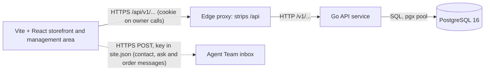

# Service & Interface Design — Đèo Bikes

Last updated: 2026-11-18
Source: `docs/data/SRS.md`, `docs/admin/SRS.md`, `docs/orders/SRS.md`, `docs/site/SRS.md`, `docs/architecture/erd.md`, and the committed backend scaffold (`code/backend/internal/httpx`, `internal/server`, `internal/config`, `cmd/api`). Shape: `fullstack`.

This file is the contract. The frontend Dev and the backend Dev both build to it; the test cases are written from it. Where the SRS fixes a sentence, a status or a shape, this file repeats it and marks it **fixed**; where it is silent this file decides, and says so. Where this file departs from `references/api-conventions.md` because an SRS requirement forces it, the departure is listed once in §2.8.

## 1. Service map



| Service | Responsibility | Owns (tables) | Depends on | Deploy unit |
|---|---|---|---|---|
| `api` (`code/backend/cmd/api`) | Serves the eight record collections to everyone, lets the one signed-in owner add, replace and delete bikes and riding types, takes and prices orders and holds their bikes, signs the owner in and out | `categories`, `products`, `reviews`, `gallery`, `team`, `services`, `faqs`, `shop`, `orders`, `order_lines`, `order_counters`, `sessions` (every table of `erd.md`) | PostgreSQL 16 (`DATABASE_URL`); the edge proxy in front of it; the secrets `ADMIN_EMAIL`, `ADMIN_PASSWORD` | one container (`backend` in `docker-compose.yml`) |
| Edge proxy (existing, not ours to change) | Terminates TLS, strips `/api`, forwards `X-Forwarded-For` and `X-Forwarded-Proto` | nothing | `api` | the deployment's Caddy |
| Agent Team inbox (third party, called by the **browser**, not by `api`) | Receives the contact form, the ask-the-shop-to-call form and one message per placed order, for the owner to read | nothing of ours | its own availability | not ours |

**Why these boundaries** — single service: no boundary is justified yet. There is one team, one release cadence, one database and one owner of every table, and every split would add a network call and a partial-failure mode to a shop that sells a few hundred bikes a month. The Agent Team inbox is deliberately *not* behind `api`: the SRS wires it from the browser through the key in `src/site.json` (SITE-012, SITE-013, ORD-008), the owner's messages are never stored here (`erd.md` §1), and routing them through `api` would put a third-party dependency on the order path.

**Who writes what inside the one service.** Every table has exactly one owning service (`api`). Inside it, each table has one *writer package*, with one deliberate exception that the contract depends on:

| Table(s) | Writer package | Other code paths that write it |
|---|---|---|
| `products`, `categories` | `collections` (the owner's `POST`/`PUT`/`DELETE`) | `orders` lowers `products.stock` in the order's transaction. Both paths take the bike's row lock and both bump `version` through the `touch_record` trigger, which is what makes the compare-and-swap of §3.5 true (ADMIN-008) |
| `reviews`, `gallery`, `team`, `services`, `faqs`, `shop` | none at run time (a migration writes them) | none |
| `orders`, `order_lines`, `order_counters` | `orders` | none |
| `sessions` | `auth` | none |

## 2. Cross-cutting contract

### 2.1 Base

- Base URL: `{scheme}://{host}/v1` — the backend's own routes, **without `/api`**. Browsers reach them as `/api/v1/...` (or `<VITE_API_URL>/v1/...`) through the edge proxy, which strips `/api` before forwarding. Every path in this file is written the way the backend mounts it. `GET /healthz` is the one unversioned route.
- Paths are exact: a trailing slash, a different case or an extra segment is `404 NOT_FOUND`. A route is added with one line in `internal/server.Router`.
- Content type: `application/json; charset=utf-8` on every body. A `204` has no body.
- Versioning: URL path major version (`/v1`). A new major version only for a breaking change (§8).
- Caching: **every** response, success or error, carries `Cache-Control: no-store` (the existing `httpx.NoStore` middleware). A saved edit must show on the next read from any visitor and no cache between the server and the browser may hold an older copy (ADMIN-007.1).
- Trace header: `X-Request-Id` is accepted from the caller when it matches `^[A-Za-z0-9._-]{1,64}$`, otherwise generated (32 hex characters); it is echoed on every response and present in every log line. It is a response *header only*, never part of a body.
- Same-origin only: the backend sends no CORS headers. The owner's cookie is sent by the browser to the same origin that served the page. Pointing `VITE_API_URL` at a different origin works for the public reads and not for the owner's calls; see §9, question 3.
- Date and time: only `POST /v1/orders` returns a time (`placed`). It is RFC 3339, to the second, in Vietnam time with its offset: `2026-11-16T09:40:00+07:00` (ORD-001.3, and the same zone the order number's date is counted in).
- Money: whole đồng as a JSON integer, never a float and never a string.
- Unknown values: a response consumer must ignore a response key it does not know, and must show an unknown `brand`, `status` or `wheel` value as plain text rather than fail (what makes §8's "new value" additive).

### 2.2 Authentication and authorization

| Aspect | Decision |
|---|---|
| Mechanism | One owner account; **server-side session** held in `sessions` and referenced by a random cookie. No accounts table, no JWT |
| Credentials | `ADMIN_EMAIL` and `ADMIN_PASSWORD`, two secrets the owner enters in the console (`request_secret`). Read once at start. The email is compared trimmed and lower-cased; the password is compared exactly |
| Password at rest | Only an in-memory `argon2id` hash (`m=19456 KiB, t=2, p=1`, 16-byte random salt made at each start, 32-byte output) of `ADMIN_PASSWORD`; the password string is dropped after hashing. Nothing is written to the database, the logs or any response (ADMIN-001.1, .2) |
| Session cookie | Name `deo_session`; value is 32 random bytes from `crypto/rand`, base64url (43 characters); `Path=/`; `HttpOnly`; `SameSite=Lax`; `Max-Age=604800` (7 days) with a matching `Expires`; `Secure` whenever the request arrived over HTTPS, i.e. `X-Forwarded-Proto: https` or a TLS connection |
| Session lifetime | Fixed 7 days from sign-in, not sliding (ADMIN-003.2). Expired rows are purged on each sign-in |
| Stored form | `sessions.token_hash` = `HMAC-SHA256(key = credential_fingerprint, message = token)`, 32 bytes, where `credential_fingerprint = SHA-256("deo-admin-v1" 0x00 email 0x00 password)` is computed in memory at start from the normalized secrets. The token itself is never stored. A copy of the database cannot be replayed as a cookie, and **changing either secret and restarting makes every earlier session fail the lookup** — that is how "the owner changes the account by changing its two secrets" (ADMIN §3) ends a stolen session. The column is still a 32-byte hash; `erd.md` §3.12 is unchanged |
| Refresh | None. After 7 days the owner signs in again |
| Transport | The cookie above. There is no `Authorization` header and no token in a body or URL |
| Roles | None. Signed in = owner. The only two kinds of caller are *anyone* and *owner* |
| Enforcement point | `requireOwner` middleware, applied per route to `POST`/`PUT`/`DELETE` on `/v1/{collection}…` after the collection checks of §3.4. It looks the cookie up with `WHERE token_hash = $1 AND expires_at > now() AND email = $2` (`$2` is the current normalized `ADMIN_EMAIL`). A malformed, unknown, expired or tampered cookie is `401 UNAUTHENTICATED` |
| CSRF | A write must be `Content-Type: application/json` (otherwise `400 MALFORMED_REQUEST`), the cookie is `SameSite=Lax`, and the backend sends no CORS headers, so a cross-site page can neither send the cookie on a write nor send JSON without a preflight that fails. `GET` never changes anything |
| Not configured | While `ADMIN_EMAIL` or `ADMIN_PASSWORD` is empty after trimming, no password hash exists and **every sign-in is refused exactly as a wrong password is** (`401`, the same sentence), counts toward the throttle like any failure, and the log says once per attempt `admin account is not configured`. The service still starts: the public shop must work before the owner has entered the secrets (ADMIN-001.3). This is fail-closed: there is no default account, no default password and no fallback value in the source |
| Secrets the project issues itself | **None.** The session token is random per sign-in and verified against the database; there is no signing key, cookie secret or HMAC secret to supply (the fingerprint above is derived from the two owner secrets). Nothing in this design is "generated at deploy time" |

**Throttle (ADMIN-002.3)** — in process memory, keyed by client address. Client address = the last entry of `X-Forwarded-For` (the one the edge proxy appended), else the connection's remote host, port removed. Rules: a *failure* is a `401` from `POST /v1/sessions` (wrong email, wrong password, or account not configured); a `400` is not a failure. An address with 5 failures inside the last 15 minutes is locked until 15 minutes after its latest failure; while locked **every** `POST /v1/sessions` from it is `429`, right password or wrong, and a `429` is not itself a failure (it does not extend the lock). A success clears that address's failures. The table is purged of entries older than 15 minutes on every access and capped at 10,000 addresses (oldest evicted). It resets on restart (accepted: `erd.md` §1). The clock is injected so tests can advance it.

### 2.3 Error contract

Every non-2xx response, from every endpoint, including the unknown-route and wrong-method answers, has this shape:

```json
{
  "error": "That email and password do not match.",
  "code": "UNAUTHENTICATED",
  "field": "price"
}
```

| Key | Type | Always present | Meaning |
|---|---|---|---|
| `error` | string | yes | One sentence a customer or the owner can read, never containing SQL, a stack trace, a path or a host. This is the key the scaffold's `httpx.WriteError` already writes and the one the frontend reads (`body.error`); it stays a string |
| `code` | string | yes | Machine-readable `UPPER_SNAKE` code from the catalog below. **Consumers branch on `code` (and the status), never on `error`** — with one exception: a sentence marked **fixed** is spelled by the SRS, appears in a test case verbatim, and is part of the contract |
| `field` | string | no | The one body field or query parameter to blame, present only on `MALFORMED_REQUEST`, `VALIDATION_FAILED` and `INVALID_QUERY` when a single one is at fault; the same name appears in the sentence (SRS: "400 naming the field") |

This extends the scaffold's `{"error": "<sentence>"}` additively (`code` and `field` are new keys, `error` is unchanged), so `httpx.WriteError` keeps working for existing callers; a handler that needs a specific code uses a sibling helper that takes the code and the field.

**Error catalog** — the full closed set for this project.

| Code | HTTP | Meaning | Retryable |
|---|---|---|---|
| `MALFORMED_REQUEST` | 400 | The body is not valid JSON or not a JSON object; the `Content-Type` of a write is not `application/json`; a body key has the wrong JSON type (a string where a number is expected); the body carries a key this contract does not define; `If-Match` is not one quoted whole number | no |
| `VALIDATION_FAILED` | 400 | A well-typed body whose values break a rule: blank, too long, out of range, not whole, not in a closed set, bad id, missing riding type, a live bike without a price, an order rule (cash on delivery, address, quantity) | no |
| `INVALID_QUERY` | 400 | A query parameter of a `GET` list is unknown, repeated, not parseable as the type of its field, a range on a boolean or list, or breaks a limit (`page`, `limit`, `q` length, `search`, `sort`) | no |
| `UNAUTHENTICATED` | 401 | No valid session on an owner call; wrong sign-in (the same code and sentence whichever of email or password is wrong) | no |
| `NOT_FOUND` | 404 | Unknown route, unknown collection, or no record with that id | no |
| `METHOD_NOT_ALLOWED` | 405 | The method is not offered on that path; includes every write to a collection other than `products` and `categories`. Carries `Allow` | no |
| `ID_TAKEN` | 409 | A new record's id is already used in its collection | no |
| `STALE_RECORD` | 409 | The record changed since the caller read it (`If-Match` no longer matches) | no — reload, then save again |
| `IN_USE` | 409 | A riding type still used by bikes cannot be deleted | no |
| `BIKE_UNAVAILABLE` | 409 | An order line names a bike that is gone, not live, short of stock, or has no such size | no |
| `PAYLOAD_TOO_LARGE` | 413 | The body is larger than the cap of its endpoint (§6) | no |
| `PRECONDITION_REQUIRED` | 428 | `PUT` without an `If-Match` header | no |
| `RATE_LIMITED` | 429 | The sign-in throttle; carries `Retry-After` (seconds) | yes, after `Retry-After` |
| `INTERNAL` | 500 | Unexpected failure, including a query or insert that failed; details are logged with the `X-Request-Id`, never returned. Sentence: "Something went wrong. Please try again." | yes |
| `UNAVAILABLE` | 503 | The database refused the connection, the pool cannot hand out a connection, or the process is shutting down. Sentence: "The service is not ready." | yes |

There is no `422` and no `403` in this project: the SRS fixes `400` for every refused value (ADMIN-005.8, ORD-003.6, DATA-003) and there are no roles.

**Which check answers first.** When a request breaks several rules the endpoint answers with the first failing check in the order its section lists; the order is part of the contract, so a test case that breaks two rules has one right answer. The common order is: route and method → collection (404) → writability (405) → session (401) → body shape (400) → value rules (400) → record existence (404) → `If-Match` (428/400) → database rules (400/409).

### 2.4 Pagination

One scheme for the whole project: **page number and page size**, because the SRS fixes it (DATA-002) and the frontend's `useCollection` already speaks it.

```
GET /v1/products?page=2&limit=12&status=live&sort=-price
```

```json
{ "items": [ { "id": "talon-2", "name": "Talon 2" } ], "total": 14, "page": 2, "limit": 12 }
```

| Aspect | Decision |
|---|---|
| Style | offset: `page` (1-based) and `limit` |
| Default | `page=1`, `limit=12` |
| Max limit | 100. A larger `limit` is **answered as 100** and the answer says `limit: 100` (DATA-002.2, AC-6). This is the SRS's rule and it is the one place the contract clamps instead of rejecting (§2.8) |
| Bad values | `page` or `limit` that is empty, not a whole number, or below 1 → `400 INVALID_QUERY` naming it (`page=0`, `limit=0`, `limit=-1`, `limit=abc`). `page` above 1,000,000,000 is also refused |
| Past the last page | `200` with `items: []` and the true `total` — not an error (DATA-002.4) |
| `total` | The number of records that match every condition and the search words, never the size of the page (DATA-003 AC-13) |
| Default sort | `seq` ascending: seeded records in file order, later records in the order they were added. The sort is stable and unique because `seq` is the final tiebreak of every ordering, so consecutive pages neither repeat nor skip a record (DATA-002.3) |

Offset paging is acceptable here and cursor paging is not needed: each collection holds at most a few hundred rows (`erd.md` §6), is read by an admin table that shows "1–14 of 14" and page numbers, and a record added between two page reads can at worst shift one row, which the owner's refresh (ADMIN-007.2) corrects.

### 2.5 Validation boundary

**The edge is the handler layer of the `api` service, before any SQL.** Each handler decodes and validates the whole request in one function (`internal/<package>/validate.go`), producing either a typed value or the first error of §2.3. Code below that point — the SQL layer and the transaction — trusts the typed value and does not re-validate defensively. The database's own `CHECK`s (`erd.md` §7) remain as a backstop; a `CHECK` that fires means a validator is missing a rule, and the answer is `500 INTERNAL` plus an error log, never a leaked constraint name.

Rules that hold for every endpoint:

1. **A field the contract does not define is rejected, never ignored.** A body key that is not listed for the endpoint answers `400 MALFORMED_REQUEST` naming the key (JSON decoding uses `DisallowUnknownFields` and rejects trailing data after the object). A query parameter that is not defined for the endpoint answers `400 INVALID_QUERY` naming it. There is exactly one carve-out, on `POST /v1/orders`, forced by the SRS (ORD-002 AC-1, ORD-006 AC-6): the keys listed there as *advisory* are accepted and never read.
2. A write body must be a JSON object, at most the cap of its endpoint (§6), `Content-Type: application/json` (a charset parameter is allowed).
3. **Reject, do not coerce:** `"5"` is not a number, `5.0` is not an integer for an integer field (an integer field takes a JSON integer literal: optional minus, digits, no fraction, no exponent), `"true"` is not a boolean. Text is stored exactly as sent; only the fields a section says are trimmed are trimmed.
4. "Characters" means Unicode code points, not bytes (`"Hùng Vương"` is 10 characters).
5. Path parameters are taken as given and never validated beyond lookup: an `{id}` that no record has is `404`, never `400`.
6. Every database value travels as a bound parameter; no request text is ever part of an SQL string. Field and sort names from the query are checked against the collection's schema and then selected from a fixed map to a column, never concatenated.

### 2.6 Idempotency

| Endpoint | Idempotent? | Decision |
|---|---|---|
| `GET` anything | yes | |
| `PUT /v1/{collection}/{id}` | in effect, not in status | Replaying the same request after it succeeded answers `409 STALE_RECORD` (the first save bumped `version`). The owner's double press is stopped in the browser (the button is disabled while sending, ADMIN-013.2) |
| `DELETE /v1/{collection}/{id}` | in effect, not in status | The second delete is `404` (ADMIN-006.1) |
| `POST /v1/{collection}` | no | Without an `id` every call makes a new record; with an `id` a replay is `409 ID_TAKEN` |
| `POST /v1/orders` | **no, by decision** | There is no `Idempotency-Key`. A customer who presses "Place order" again after a lost answer makes a second order that holds a second bike; the confirming call catches it and the owner corrects the stock (orders SRS §7, question 2; `erd.md` §9, question 5). The server never retries a write by itself and the client does not retry automatically |
| `POST /v1/sessions` | no | Each success creates another session; earlier ones stay valid until they expire or are signed out |
| `DELETE /v1/sessions/current` | yes | Always `204` (ADMIN-003.4) |

No `Idempotency-Key` header is read anywhere; sending one is not an error (it is a header, not a body or query field).

### 2.7 How a record is written on the wire

One representation, used by every `GET`, and by the `201`/`200` of a write. It is DATA-001.3 and .4 made precise.

- A record is a JSON object: `id` (string) plus one key per column the schema lists for the collection (`code/frontend/src/data/schema.json` — the column names *are* the schema keys, `erd.md` R2), plus `_source` and `_invented` where the row has them.
- **A column that is `NULL` has no key.** No field of any record is ever `null` (DATA-001.4). The empty list is `[]`, not omitted (`sizes_out` of `talon-2`).
- Types: text, long text, image and url → string; `number` → JSON number as stored (`4.8`, `2027`, never `"4.8"`); `price` and `stock` → JSON integer; `bool` → `true`/`false`; `list` → array of strings in stored order; a reference → the referenced id as a string.
- Never returned: `seq`, `version`, `created_at`, `updated_at`. `version` leaves only as the `ETag` header of §3.3.
- **Key order is not part of the contract.** Consumers compare records key for key, never as text (DATA-001 AC-2).

Records of the writable collections have these keys (all optional except the ones marked required; see §3.11 for their rules). Read-only collections return the columns of `erd.md` §3.3–§3.8 the same way.

| Collection | Keys |
|---|---|
| `products` | `id`, `name` (required), `brand`, `category`, `year`, `price`, `was`, `price_listed`, `fact`, `status`, `stock`, `sizes`, `sizes_out`, `size_fit`, `deal`, `month`, `wheel`, `travel`, `frame`, `fork`, `shock`, `motor`, `drivetrain`, `brakes`, `wheels`, `tyres`, `weight`, `colour`, `description`, `ride`, `rating`, `review_count`, `image`, `image_back`, `image_detail`, `_source`, `_invented` |
| `categories` | `id`, `name` (required), `line`, `terrain`, `_source` |

### 2.8 Departures from `api-conventions.md`

Each is forced by an SRS requirement and is stated once here, not repeated per endpoint.

| Convention | What this contract does | Forced by |
|---|---|---|
| Collection responses are `{ "data": [...] }` with cursor pagination | `{ "items": [...], "total", "page", "limit" }` with page numbers | DATA-002.1; the frontend module and the admin table's "1–14 of 14" |
| A `limit` over the cap is rejected, never clamped | A `limit` over 100 is answered as 100 | DATA-002.2, AC-6 |
| `422 VALIDATION_FAILED`; error object with `message`, `details`, `request_id` in the body | `400` for every refused value; error body is `{error, code, field?}`; the request id is the `X-Request-Id` header | ADMIN-005.8, ORD-003.6, DATA-003; the scaffold's `httpx` envelope that the frontend already reads |
| An undefined field is rejected | …except the advisory keys of `POST /v1/orders` | ORD-002 AC-1, ORD-006 AC-6 |
| `201` carries `Location` | No `Location`: the backend does not know the edge's `/api` prefix, the body carries the new `id`, and no consumer follows it | — |
| Timestamps in UTC | `placed` is in Vietnam time with its offset | ORD-001.3 ("with its offset"), ORD-006.1 |
| Optimistic locking in the body | Token in the `ETag` / `If-Match` headers, never in the body | DATA-001 AC-2 compares bodies key for key; `decision.concurrency` |
| `PATCH` for updates | `PUT`, a full replacement | ADMIN-005.1 ("replaces the whole record with the body", AC-4) |
| Lists are public only when the data is | Every record of every collection is public, drafts included | ADMIN-004.2; the storefront asks for `status=live` itself (SITE-003.3). A draft bike opens by its address (site SRS §7, question 2) |

## 3. Endpoints

Ten endpoints in four groups: health, the record collections (`/v1/{collection}`), the owner's session, and orders. The eight collection names are a closed set: `products`, `categories`, `reviews`, `gallery`, `team`, `services`, `faqs`, `shop`. Any other name in `{collection}` is `404 NOT_FOUND` ("That collection does not exist."), for every method, **before** anything else is checked (so `GET /v1/orders` and `GET /v1/orders/DEO-261116-0001` are `404`: no order is ever served, ORD-001.5, AC-6).

### 3.1 `GET /v1/healthz` — no: `GET /healthz`

**Purpose** — liveness and readiness for compose and the deploy. **Traces to** — none (infrastructure; exists in the scaffold). **Auth** — none. Unversioned.

**Success** — `200 {"status":"ok"}` only while `SELECT 1` answers within 2 s. **Errors** — `503 UNAVAILABLE` "The service is not ready.".

### 3.2 `GET /v1/{collection}`

**Purpose** — one page of a collection, narrowed, searched and ordered. **Traces to** — DATA-001, DATA-002, DATA-003, DATA-004, DATA-005, DATA-007, DATA-008; read by every storefront page and every management list (SITE-002 to SITE-005, SITE-011, SITE-014, ADMIN-009 to ADMIN-012). **Auth** — none: any visitor, signed in or not (DATA-002.6, ADMIN-004.2).

**Path and query parameters**

| Name | In | Type | Required | Constraints | Description |
|---|---|---|---|---|---|
| `collection` | path | string | yes | one of the eight names above | Which collection |
| `page` | query | integer | no | ≥ 1, ≤ 1,000,000,000; default 1 | Page number, 1-based |
| `limit` | query | integer | no | ≥ 1; default 12; above 100 is answered as 100 | Page size |
| `sort` | query | string | no | `<field>` ascending or `-<field>` descending; one field; the field must exist and must not be a list | Ordering. Empty = none (seed order) |
| `q` | query | string | no | trimmed; at most 100 characters; empty or blank filters nothing | Search words, one phrase. **Always** the search words, even on `faqs`, whose field is also called `q` (that field's exact value cannot be filtered on, DATA-003.6) |
| `search` | query | string | no | comma-separated field names; each must exist and be text-like (below) | Restricts `q` to these fields. Without it every text-like field is searched |
| `<field>` | query | string | no | `<field>` is `id` or a key of the collection's schema (`schema.json`); a comma separates alternatives | Keeps records whose field equals the value, or any of the comma-separated values |
| `<field>_from`, `<field>_to` | query | string | no | the same field names; both ends inclusive; not on a bool or a list | Keeps records whose field is at or above / at or below the value |

Parameter names `page`, `limit`, `q`, `search`, `sort` are the API's own. Any other name must be a field, a field with `_from`, or a field with `_to`; anything else is `400 INVALID_QUERY` naming it (DATA-003.6, AC-12). A parameter given twice (`category=a&category=b`) is also `400` naming it — use a comma. The query is never logged (`httpx.Log` logs the path only: a visitor's search words are private).

**How each kind of field behaves** (the kind comes from `schema.json`: `id` and every `text`, `longtext`, `image`, `url` and `ref:*` field are *text-like*; `number` and `price` are *numeric*; `bool`; `list`)

| Kind | `<field>=v` equality | `<field>_from` / `_to` | `sort` | Searched by default (`q`) |
|---|---|---|---|---|
| text-like | equal ignoring capitals and accents (`fold_text`, `erd.md` §3.14); `đ` equals `d` | compared as text in byte order (`COLLATE "C"`) on the stored value, which is how ISO dates (`2026-09-01`) compare | natural order of the folded text: digit runs compare as numbers (`Talon 2` before `Talon 29 3`), ignoring capitals and accents | yes, with `id`; **never** a field whose name begins with an underscore |
| numeric | numeric equality; `v` must be a plain decimal (`-?\d+(\.\d+)?`) or `400` | numeric; same parsing | numeric | no (`q=20990000` finds no bike by its price, DATA-004 AC-12) |
| bool | `v` must be exactly `true` or `false` or `400` | `400` | `false` before `true` | no |
| list | the record's list contains `v` (compared like text-like) | `400` | `400` (a list has no order) | no |

- A comma-separated value (`category=trail,e-mtb`) means *any of*; empty parts are ignored. A value that itself contains a comma cannot be filtered on (accepted). `q` and ranges are never split.
- An **empty** value (`category=`, `price_from=`, `sort=`, `search=`) filters nothing. An empty `page` or `limit` is not a whole number and is refused.
- A record that has **no value** (the column is `NULL`) does not match any condition on that field, and sorts **after** every record that has one, in either direction (DATA-003.5, DATA-005.2). Equal values keep `seq` order.
- Conditions on several fields, the search words, the sort and the page all combine; `total` counts every record matching all conditions and the search, and is the same with or without a sort.
- Search: the words, trimmed and folded, must appear as one phrase anywhere in at least one searched field; `%`, `_` and `\` in the words mean themselves (escaped for `LIKE`); the quote, semicolon and every other character are plain data (DATA-004 AC-13). A named `search` field that is numeric, bool or list is refused (`400`, "<field> cannot be searched.").
- `id` is accepted as a field in conditions, `search` and `sort` (the record has one); `_source` is not a schema field and is refused everywhere; `_invented` (a schema list) can be filtered with `_invented=<field>` and nothing else.

**Request body** — none (a body is not read).

**Success response** — `200`

```json
{
  "items": [
    { "id": "talon-2", "name": "Talon 2", "brand": "Giant", "category": "hardtail", "price": 18990000, "status": "live", "stock": 9, "sizes": ["XS", "S", "M", "L", "XL"], "sizes_out": [], "deal": true, "wheel": "29", "_source": "web:https://example.test/talon-2" }
  ],
  "total": 14,
  "page": 1,
  "limit": 12
}
```

| Field | Type | Nullable | Description |
|---|---|---|---|
| `items` | array of record (§2.7) | no | At most `limit` records; `[]` past the last page or when nothing matches |
| `total` | integer | no | Every match, not only this page |
| `page` | integer | no | The page asked for, as asked (not clamped to the last page; DATA-007's module clamps for its own state) |
| `limit` | integer | no | The size used: the one asked for, or 12, or 100 when more was asked |

**Errors** — in the order they are checked: unknown collection, then repeated parameter, then `page`, `limit`, `sort`, `search`, `q`, then the remaining parameters alphabetically.

| Code | HTTP | Trigger |
|---|---|---|
| `NOT_FOUND` | 404 | `collection` is not one of the eight |
| `INVALID_QUERY` | 400 | repeated parameter; `page`/`limit` not a whole number ≥ 1 (`page=0`, `limit=-1`, `limit=abc`, `limit=`); `sort` names a field the collection lacks or a list; `search` names a field the collection lacks or a non-text-like field; `q` longer than 100 characters; a parameter that is not a field, `<field>_from` or `<field>_to` (`colourful=red`); a non-numeric value on a numeric field (`stock=abc`); a bool field with anything but `true`/`false` (`deal=maybe`); a range on a bool or list field (`deal_from=1`). `field` names the parameter. Sentences name it, e.g. "There is no field “colourful” to filter bikes by." |
| `INTERNAL` | 500 | the query failed for any reason other than connectivity |
| `UNAVAILABLE` | 503 | the database refused the connection |

**Notes** — read-only and side-effect free. Never cached (§2.1). Performance: a page of 100 bikes, with or without `q`, p95 ≤ 500 ms over 100 sequential requests on the seeded database (data SRS §6). The shop asks for all live bikes in one request: `GET /v1/products?status=live&limit=100`. The search page asks five lists with the same words: `products?q=…&status=live`, `categories?q=…`, `services?q=…`, `faqs?q=…`, `gallery?q=…` (DATA-008 AC-8).

### 3.3 `GET /v1/{collection}/{id}`

**Purpose** — one record, and for a bike or riding type the token a later save needs. **Traces to** — DATA-006, DATA-007.6, ADMIN-008, SITE-005, SITE-016, ADMIN-011. **Auth** — none.

**Path parameters**

| Name | In | Type | Required | Constraints | Description |
|---|---|---|---|---|---|
| `collection` | path | string | yes | one of the eight names | |
| `id` | path | string | yes | any text; no format check | The record's id (`stance-0`, `trail`, `r-thao`, `shop`) |

**Request body** — none.

**Success response** — `200` with the record of §2.7, identical to the record the list holds for that id (DATA-006 AC-1). For `products` and `categories` the response also carries:

```
ETag: "7"
```

The `ETag` is the record's `version` as a quoted decimal integer: the **only** place a version is ever read. A list carries none, so a screen that is about to edit a record reads it by id first and keeps the `ETag` for its `PUT` (§3.5). The six read-only collections send no `ETag`. `If-None-Match` is not honoured (every answer is `no-store`).

**Errors**

| Code | HTTP | Trigger |
|---|---|---|
| `NOT_FOUND` | 404 | unknown collection ("That collection does not exist."); no record with that id ("That record does not exist.") — also an id with capitals or any other shape no record can have |
| `INTERNAL` | 500 | the query failed |
| `UNAVAILABLE` | 503 | the database refused the connection |

**Notes** — a bike in `draft` is returned like any other (ADMIN-004.2: reading is public; the storefront filters `status=live` itself).

### 3.4 `POST /v1/{collection}`

**Purpose** — the owner adds a bike or a riding type. **Traces to** — ADMIN-004, ADMIN-005, ADMIN-010, ADMIN-012, ADMIN-013. **Auth** — owner session (cookie). Only `products` and `categories`.

**Checks, in this order** — (1) collection exists, else `404`; (2) collection is `products` or `categories`, else `405` — **before** the session is looked at, so every other collection answers `405` to a write whether or not anyone is signed in (ADMIN-004.3, AC-5); (3) valid session, else `401`; (4) `Content-Type: application/json` and body within the cap, else `400`/`413`; (5) the body rules of §3.11, field by field in the schema's order, `id` first, then the cross-field rule "a live bike needs a price"; (6) inside the transaction: `category` names an existing riding type; (7) the id is not taken.

**Request body** — a record as §2.7, without `version` or `_source` (not schema fields, so refused as undefined keys), every key optional except `name`. Rules in §3.11.

```json
{ "name": "Test Bike", "brand": "Giant", "category": "trail", "price": 25000000, "status": "draft", "stock": 3 }
```

| Field | Type | Required | Constraints | Description |
|---|---|---|---|---|
| `id` | string | no | `^[a-z0-9][a-z0-9-]{0,63}$` | Used as given when present and free. When absent the server makes `<collection>-<6 random characters from a–z, 0–9>` (`products-k3f9a2`) and retries on a collision up to 5 times (ADMIN-005.7) |
| `name` | string | yes | not blank | The bike's model name, or the riding type's name |
| every other schema key of the collection | per §3.11 | no | per §3.11 | |

**Success response** — `201` with the saved record (§2.7, the same values as sent, plus the id) and `ETag: "1"`.

**Errors**

| Code | HTTP | Trigger |
|---|---|---|
| `NOT_FOUND` | 404 | unknown collection |
| `METHOD_NOT_ALLOWED` | 405 | any collection other than `products`, `categories`; `Allow: GET` |
| `UNAUTHENTICATED` | 401 | no cookie, or a cookie that is unknown, expired, tampered or signed out. **Nothing is created** (ADMIN-004 AC-1, AC-2, AC-3). Sentence: "You are not signed in." |
| `PAYLOAD_TOO_LARGE` | 413 | body over 1 MiB |
| `MALFORMED_REQUEST` | 400 | not JSON, not an object, trailing data, wrong `Content-Type`, an undefined key (`colourful`), a key of the wrong JSON type |
| `VALIDATION_FAILED` | 400 | any value rule of §3.11, including `id` format, a blank `name`, and **"A live bike needs a price."** (fixed) |
| `ID_TAKEN` | 409 | the `id` in the body already exists in the collection. **Fixed sentence:** "That id is already used." |
| `INTERNAL` | 500 | insert failed |
| `UNAVAILABLE` | 503 | database refused the connection |

**Notes** — a refused body saves nothing (ADMIN-005 AC-22): the insert is one statement in one transaction. A new bike's `_source` is `NULL` (`erd.md` §9, question 2). The saved record is readable by every visitor at once (`no-store`, no cache to invalidate).

### 3.5 `PUT /v1/{collection}/{id}`

**Purpose** — the owner replaces a bike or a riding type with the body, only if it is unchanged since it was read. **Traces to** — ADMIN-004, ADMIN-005, ADMIN-007, ADMIN-008, ADMIN-010, ADMIN-011, ADMIN-012, ADMIN-013. **Auth** — owner session. Only `products` and `categories`.

**Checks, in this order** — (1) collection exists `404`; (2) writable `405`; (3) session `401`; (4) content type and size `400`/`413`; (5) body rules of §3.11 field by field, **including `id`, which when present must equal the address's id**; (6) the record exists, else `404` ("That record does not exist."); (7) `If-Match` present, else `428`; well-formed (exactly one quoted whole number, e.g. `"7"`; no `*`, no weak `W/`, no list), else `400 MALFORMED_REQUEST`; (8) inside the transaction: `category` names an existing riding type (`400`); (9) the record's current `version` equals the `If-Match` number, else `409 STALE_RECORD`.

**Headers**

| Name | Required | Description |
|---|---|---|
| `If-Match` | yes | The `ETag` the caller last read for this record (§3.3), or got back from its own last `POST`/`PUT` |

**Request body** — the whole record, as §3.4. **It replaces the record:** every schema field absent from the body (or sent as an empty value) becomes "no value" (the column is set `NULL` and the key leaves the record, ADMIN-005 AC-4, AC-16). `id`, `seq` and `_source` are not touched: a seeded bike keeps its origin after the owner edits it (`erd.md` §9, question 2, decided here); `_invented`, being a schema field, is replaced like any other.

**Success response** — `200` with the saved record and the new `ETag: "<version + 1>"`. The caller may edit again with that `ETag` without re-reading.

**Errors**

| Code | HTTP | Trigger |
|---|---|---|
| `NOT_FOUND` | 404 | unknown collection; no record with that id (ADMIN-005 AC-5) |
| `METHOD_NOT_ALLOWED` | 405 | other collections; `Allow: GET` |
| `UNAUTHENTICATED` | 401 | no valid session (ADMIN-004 AC-1 to AC-3) |
| `PAYLOAD_TOO_LARGE` | 413 | body over 1 MiB |
| `MALFORMED_REQUEST` | 400 | as §3.4; also a malformed `If-Match` |
| `VALIDATION_FAILED` | 400 | as §3.4; also a body `id` that differs from the address (ADMIN-005 AC-17) |
| `PRECONDITION_REQUIRED` | 428 | no `If-Match` header |
| `STALE_RECORD` | 409 | the record changed since the caller read it — an order lowered its stock, or the owner saved it from another window. **Fixed sentence:** "This record changed while you were editing it — for example an order was placed. Reload and make your change again." Nothing is overwritten (ADMIN-008 AC-1, AC-3) |
| `INTERNAL`, `UNAVAILABLE` | 500, 503 | as §3.4 |

**Notes** — the write is one statement, `UPDATE … WHERE id = $1 AND version = $2`, whose row lock the order's transaction also takes; 0 rows is followed by a `SELECT` to tell `404` (deleted meanwhile) from `409`. When a save and an order for the same bike run at the same moment they apply one after the other: if the save lands first the order lowers the saved stock; if the order lands first the save is `409` (ADMIN-008.3, AC-5). The `touch_record` trigger bumps `version` on every update, so no code path can forget (`erd.md` §3.14). The token is never in the body, because DATA-001 compares bodies key for key.

### 3.6 `DELETE /v1/{collection}/{id}`

**Purpose** — the owner deletes a bike or a riding type. **Traces to** — ADMIN-004, ADMIN-006, ADMIN-008.4, ADMIN-010 to ADMIN-013. **Auth** — owner session. Only `products` and `categories`.

**Checks, in this order** — (1) collection `404`; (2) writable `405`; (3) session `401`; (4) the record exists, else `404`; (5) for `categories`, no bike uses it, else `409 IN_USE`.

**Request body** — none (never read). `If-Match` is not read: deleting is not refused for a change since the screen loaded the record (ADMIN-008.4, AC-6).

**Success response** — `204`, no body.

**Errors**

| Code | HTTP | Trigger |
|---|---|---|
| `NOT_FOUND` | 404 | unknown collection; no record with that id (ADMIN-006 AC-9) |
| `METHOD_NOT_ALLOWED` | 405 | other collections; `Allow: GET` |
| `UNAUTHENTICATED` | 401 | no valid session; nothing is deleted (ADMIN-006 AC-10) |
| `IN_USE` | 409 | a riding type that bikes still use. **Fixed sentence:** "<Name> is still the riding type of <N> bike. Give those bikes another riding type first." for one bike, "…of <N> bikes. Give…" for more (`<Name>` is the riding type's `name`: "Trail is still the riding type of 4 bikes. Give those bikes another riding type first.") |
| `INTERNAL`, `UNAVAILABLE` | 500, 503 | as §3.4 |

**Notes** — what the delete does to other tables follows `erd.md`: a deleted bike's reviews stay and lose `bike` (`SET NULL`); orders already placed keep their lines, because `order_lines.product_id` is a copy, not a key (ADMIN-006 AC-7); a deleted riding type's gallery photographs stay and lose `type`. The riding-type delete runs in one transaction: lock the row, count its bikes, delete; if a bike took the type in the instant between (the `RESTRICT` foreign key fires), the count is read again and the answer is the same `409`.

### 3.7 `POST /v1/sessions`

**Purpose** — the owner signs in. **Traces to** — ADMIN-001, ADMIN-002. **Auth** — none (this is how it is obtained).

**Request body** — max 8 KiB.

```json
{ "email": "  OWNER@deo.test ", "password": "the-owners-password" }
```

| Field | Type | Required | Constraints | Description |
|---|---|---|---|---|
| `email` | string | yes | at most 320 characters | Compared trimmed and ignoring capitals |
| `password` | string | yes | at most 1,024 bytes | Compared exactly, not trimmed |

An empty `email` or `password` string is accepted as a value and simply does not match (a `401` failure); a missing key or a non-string is `400`.

**Checks, in this order** — (1) the client address is not locked, else `429` (the lock is checked **first**, so a locked address gets `429` whatever it sends); (2) body is a JSON object with `Content-Type: application/json`, within 8 KiB, with exactly those two string keys, else `400`; (3) credentials: the email matches `ADMIN_EMAIL` (both trimmed, lower-cased) and the password verifies against the in-memory hash, else `401`. Step 3 **always runs one `argon2id` verification**, against a dummy hash when the account is not configured or the email is wrong, so the time taken does not say which part was wrong.

**Success response** — `200`

```
Set-Cookie: deo_session=<43 characters>; Path=/; Max-Age=604800; Expires=<now + 7 days>; HttpOnly; SameSite=Lax[; Secure]
```

```json
{ "email": "owner@deo.test" }
```

| Field | Type | Nullable | Description |
|---|---|---|---|
| `email` | string | no | The owner's email, trimmed and lower-cased. The password is never in any answer (ADMIN-001 AC-2) |

**Errors**

| Code | HTTP | Trigger |
|---|---|---|
| `RATE_LIMITED` | 429 | five failures from this address in the last 15 minutes and fewer than 15 minutes since the latest. **Fixed sentence:** "Too many attempts. Try again in a few minutes." `Retry-After: <seconds until unlock>` (1 to 900) |
| `MALFORMED_REQUEST` | 400 | body not a JSON object, a key missing (no password), a non-string, an undefined key, wrong `Content-Type` (ADMIN-002 AC-3) |
| `PAYLOAD_TOO_LARGE` | 413 | body over 8 KiB |
| `UNAUTHENTICATED` | 401 | wrong email, wrong password, or the account is not configured — the **same** answer for all three. **Fixed sentence:** "That email and password do not match." |
| `INTERNAL`, `UNAVAILABLE` | 500, 503 | the session row could not be written |

**Notes** — on success the server inserts one `sessions` row (`email` normalized, `expires_at = created_at + 7 days`), deletes every expired row, and clears this address's failures. It does not end the owner's other sessions. Every `401` adds a failure for the client address. Neither the password nor the typed email is ever logged; the log line carries the outcome (`ok`, `bad_credentials`, `not_configured`, `locked`) and the request id.

### 3.8 `GET /v1/me`

**Purpose** — who is signed in; the "me check" the site makes when it loads. **Traces to** — ADMIN-003.1 to .3, .7. **Auth** — the session cookie, if any.

**Request body** — none.

**Success response** — `200 { "email": "owner@deo.test" }` for a cookie whose session row exists, has not expired and carries the current normalized `ADMIN_EMAIL`.

**Errors**

| Code | HTTP | Trigger |
|---|---|---|
| `UNAUTHENTICATED` | 401 | no cookie; unknown, expired, tampered or signed-out cookie; secrets changed since sign-in; `ADMIN_EMAIL` not set. **Sentence:** "You are not signed in." (ADMIN-003 AC-2, AC-3, AC-8) |
| `INTERNAL`, `UNAVAILABLE` | 500, 503 | the lookup failed; the site then treats nobody as signed in (ADMIN-003.7) |

**Notes** — one indexed lookup (`uq_sessions_token_hash`); no write; it does not extend the session.

### 3.9 `DELETE /v1/sessions/current`

**Purpose** — the owner signs out. **Traces to** — ADMIN-003.4, .5. **Auth** — the session cookie, if any; none is required.

**Request body** — none.

**Success response** — `204`, always, whether or not a session existed (ADMIN-003 AC-9). It deletes the session row for the cookie, if any, and always sends the clearing cookie `Set-Cookie: deo_session=; Path=/; Max-Age=0; HttpOnly; SameSite=Lax[; Secure]`. The old cookie value fails the next `GET /v1/me` (AC-8).

**Errors**

| Code | HTTP | Trigger |
|---|---|---|
| `INTERNAL`, `UNAVAILABLE` | 500, 503 | the row could not be deleted: the cookie is then **not** cleared, so the owner is never told they are signed out while the session still works |

### 3.10 `POST /v1/orders`

**Purpose** — a customer places an order: the server prices it, checks every bike, holds the stock, numbers it and stores it, and answers with what it stored. **Traces to** — ORD-001 to ORD-006, ORD-007 (the caller), ADMIN-006.4, ADMIN-008. **Auth** — none: the customer has no account (ORD §2).

**Request body** — max 32 KiB. Sent by `src/lib/orders.ts`; the request carries no price and no total the server uses (ORD-001.1).

```json
{
  "name": "Minh",
  "phone": "0901234567",
  "delivery": "courier",
  "address": "12 Hùng Vương",
  "payment": "transfer",
  "note": "Please call after 5pm",
  "lines": [ { "id": "talon-2", "variant": "M", "qty": 2 } ],
  "website": ""
}
```

| Field | Type | Required | Constraints | Description |
|---|---|---|---|---|
| `name` | string | yes | trimmed, 1–100 characters | Customer's name |
| `phone` | string | yes | trimmed, 1–30 characters | Customer's phone |
| `delivery` | string | yes | `local`, `courier` or `pickup` | How it reaches them |
| `address` | string | when `delivery` is `local` or `courier` | trimmed, at most 300 characters; for `pickup` it may be absent or empty | Delivery address |
| `payment` | string | yes | `transfer`, `cod` or `shop`; `cod` only with `delivery: "local"` | How they pay |
| `note` | string | no | trimmed, at most 1,000 characters | Stored, never returned |
| `lines` | array | yes | 1 to 20 objects (a bike may repeat in different sizes) | The bikes |
| `lines[].id` | string | yes | non-empty, at most 200 characters | The bike's id |
| `lines[].variant` | string | no | trimmed, at most 20 characters | The chosen frame size. Required by the bike when it has sizes (a missing one is a `409`, not a `400`); ignored, and stored as `""`, for a bike with no sizes |
| `lines[].qty` | integer | yes | whole number, 1 to 10 | Quantity |
| `website` | string | no | — | The hidden field. Any text in it marks a bot |

**Advisory keys.** These keys are accepted and **never read**, so a browser that sends its own figures cannot change a price (ORD-002 AC-1, ORD-006 AC-6): at order level `number`, `placed`, `subtotal`, `delivery_fee`, `total`; at line level `name`, `price`, `image`. They are not type-checked. Every other undefined key, at either level, is `400 MALFORMED_REQUEST`.

**Checks, in this order**
1. Body within 32 KiB (`413`); `Content-Type: application/json` and a JSON object (`400 MALFORMED_REQUEST`, ORD-003 AC-16).
2. **Bot:** a `website` that is a string of at least one character → `202 {}`; nothing is validated, stored, held or sent (ORD-003.7, AC-15). A `website` that is not a string is `400`.
3. Undefined keys and wrong JSON types, `400 MALFORMED_REQUEST`.
4. Value rules, `400 VALIDATION_FAILED`, in this order: `name`, `phone`, `delivery`, `payment`, cash on delivery, `address`, `note`, `lines` (empty, then more than 20), then each line in the order sent: `id`, `variant`, `qty`. The first failure answers.
5. The transaction, `409 BIKE_UNAVAILABLE` or success (next paragraph).

**The transaction (one, all or nothing — ORD-005.1, .5; mechanics in `erd.md` §7).** `BEGIN` → lock each distinct bike row in ascending `id` order (`SELECT … FOR UPDATE`, one fixed order so overlapping orders never deadlock) → walk the lines in the order sent and refuse at the **first** line that fails, checking that line in this order:
1. the bike does not exist → "A bike in your bag is no longer in the shop."
2. the bike's `status` is not `live` → "<Brand> <Model> is no longer in the shop."
3. the sum of the quantities of that bike **up to and including this line** exceeds its stock (a `NULL` stock counts as 0) → "<Brand> <Model> is out of stock." when the stock is 0, otherwise "<Brand> <Model>: only <N> in stock." where `<N>` is the bike's whole stock
4. the bike has sizes and the line's `variant` is missing → "<Brand> <Model> needs a frame size."; or is not one of `sizes`, or is in `sizes_out` → "<Brand> <Model> is not available in size <variant>." (compared exactly, after trimming)

`<Brand> <Model>` is the brand, a space and the bike's `name`; the brand is left out when the bike has none. These sentences are **fixed** (ORD-004). A quantity equal to the stock is accepted (ORD-004.5). Then: read the courier charge from the `shop` record → lower each bike's stock with `UPDATE products SET stock = stock - $q WHERE id = $1 AND stock >= $q` (this bumps `version`, which is what makes an owner's concurrent save `409`) → allocate the number (`order_counters` upsert, `erd.md` §3.11) → insert the order and its lines → `COMMIT`. Any refusal or error rolls back all of it, including the counter, so a refused order spends no number, holds no stock and stores nothing (ORD-004.3, AC-13, ORD-005 AC-7).

**Pricing (ORD-002).** Each line's `name` and `price` are read from the bike's record **inside the transaction**; `subtotal` is the sum of `price × qty`; `delivery_fee` is the `shop` record's `delivery_fee` (absent = 0) when `delivery` is `courier`, else 0; `total = subtotal + delivery_fee`. A price the owner changes applies to the next order; a stored line keeps the price it was ordered at.

**Number (ORD-006).** `DEO-YYMMDD-NNNN`: the date is the day the order was stored in `Asia/Ho_Chi_Minh` (18:00 UTC on the 16th is the 17th), `NNNN` a counter that starts at `0001` each day. Issued only by the server.

**Success response** — `201` (no `Location`)

```json
{
  "number": "DEO-261116-0001",
  "placed": "2026-11-16T09:40:00+07:00",
  "name": "Minh",
  "phone": "0901234567",
  "delivery": "local",
  "address": "12 Hùng Vương",
  "payment": "transfer",
  "lines": [
    { "id": "talon-2", "name": "Giant Talon 2", "price": 18990000, "image": "/images/ref/talon-2.jpg", "variant": "M", "qty": 2 }
  ],
  "subtotal": 37980000,
  "delivery_fee": 0,
  "total": 37980000
}
```

| Field | Type | Nullable | Description |
|---|---|---|---|
| `number` | string | no | `DEO-YYMMDD-NNNN` |
| `placed` | string | no | RFC 3339 to the second with the Vietnam offset `+07:00` |
| `name`, `phone` | string | no | As stored (trimmed) |
| `delivery`, `payment` | string | no | `local`/`courier`/`pickup`; `transfer`/`cod`/`shop` |
| `address` | string | no | As stored; `""` for a pickup with none given. Always present |
| `lines` | array | no | In the order sent. `id`, `name` (`<Brand> <Model>`), `price` (unit price when ordered), `qty` always; `image` (the bike's main photograph) only when the bike has one; `variant` only when the order line has a size |
| `subtotal`, `delivery_fee`, `total` | integer | no | Whole đồng |

The note is stored and is **not** in the answer; the answer has exactly these eleven keys (ORD-001 AC-2, AC-3). No endpoint ever returns an order again (ORD-001.5).

**Success response, bot** — `202 {}`.

**Errors**

| Code | HTTP | Trigger |
|---|---|---|
| `PAYLOAD_TOO_LARGE` | 413 | body over 32 KiB |
| `MALFORMED_REQUEST` | 400 | not JSON; not an object; wrong `Content-Type`; an undefined key; a wrong JSON type (`qty: "2"`, `lines` not an array, `website` not a string) |
| `VALIDATION_FAILED` | 400 | a rule of step 4. `field` is `name`, `phone`, `delivery`, `payment`, `address`, `note` or `lines`, or `lines[i].id`, `lines[i].variant`, `lines[i].qty` with a zero-based `i`. Default sentences: "Your name is needed." · "Your phone number is needed." · "The delivery method must be local, courier or pickup." · "The payment method must be transfer, cod or shop." · "Cash on delivery is only available for delivery in town." · "A delivery address is needed." · "Your bag is empty." · "An order holds at most 20 lines." · "The quantity of line 1 must be a whole number from 1 to 10." · "A text is too long: name 100, phone 30, address 300, note 1000, size 20 characters." Tests match the quoted key words (name, phone, cash on delivery, address, quantity) and the status, not the exact wording |
| `BIKE_UNAVAILABLE` | 409 | the four refusals above; the sentence names the first failing line's bike (ORD-004.2) |
| `INTERNAL` | 500 | any other failure, including a simulated failure after the order row (ORD-005 AC-7): nothing is kept. Sentence: "Something went wrong. Please try again." |
| `UNAVAILABLE` | 503 | the database refused the connection |

**Notes** — no `Idempotency-Key` (§2.6). No rate limit at launch (§9, question 2). Concurrency: twenty simultaneous orders for a bike with stock 1 queue on its row lock — one `201`, nineteen `409`, stock 0, one order stored (ORD-005 AC-4 to AC-6); the `CHECK (stock >= 0)` makes −1 impossible even if that logic had a bug. A bike deleted while an order is in flight is either locked first (the order wins and keeps its lines) or gone (the order is `409`); neither loses an answered `201`. The server sends **nothing** to the owner: the Agent Team message is sent afterwards by the browser (§5, ORD-008). Personal data (`name`, `phone`, `address`, `note`) is never logged; the log line carries the status, the order `number` on success, and the request id. p95 ≤ 1 s for an order of 20 lines over 50 sequential requests on the seeded database (ORD §6).

### 3.11 Rules for the body of a bike or a riding type (shared by §3.4 and §3.5)

Fields are checked in the order of `schema.json`, `id` first; for each, the JSON type first (`MALFORMED_REQUEST`), then the value (`VALIDATION_FAILED`). The first failure answers and nothing is saved. Sentences name the field by its **key** in curly quotes (`The field “price” must be …`), except the ones marked fixed; tests match the key and the status.

**Empty values.** For an optional field, `null` and `""` (for a text, a number or a price field) mean *no value*: the field is left out of the saved record and is never stored as `null` (ADMIN-005.6, AC-16). A list takes `null` for "no value"; `[]` is a real empty list. A boolean takes only `true`, `false` or `null`. A required field (`name`) that is absent, `null`, `""` or only spaces is `VALIDATION_FAILED` naming it ("The field “name” is needed.").

| Keys | JSON type | Rule |
|---|---|---|
| `id` | string | `^[a-z0-9][a-z0-9-]{0,63}$` (lowercase letters, digits, hyphens, 1–64, not starting with a hyphen); on a `PUT` it must equal the address's id |
| `name` | string | required; not blank; at most 5,000 characters |
| text fields — products: `image`, `price_listed`, `fact`, `travel`, `frame`, `fork`, `shock`, `motor`, `drivetrain`, `brakes`, `wheels`, `tyres`, `weight`, `colour`, `description`, `ride`, `image_back`, `image_detail`; categories: `line`, `terrain` | string | at most 5,000 characters (5,000 is accepted, 5,001 is refused: ADMIN-005 AC-21) |
| `brand` | string | `Giant` or `Liv` |
| `status` | string | `draft` or `live` |
| `wheel` | string | `29` or `mixed` (the string `"29"`, not the number) |
| `category` | string | the id of a riding type that exists (`VALIDATION_FAILED`, `field: "category"`, checked in the transaction) |
| `year`, `rating`, `review_count` | number | any finite JSON number (fractions allowed: `erd.md` §9, question 3) |
| `price`, `was` | number | a JSON integer, 0 to 9,007,199,254,740,991 (`"cheap"` is `MALFORMED_REQUEST`; `-1` and `1.5` are `VALIDATION_FAILED`) |
| `stock` | number | a JSON integer, 0 to 9,007,199,254,740,991 |
| `deal`, `month` | boolean | `true` or `false` (`"yes"` is `MALFORMED_REQUEST`) |
| `sizes`, `sizes_out`, `size_fit`, `_invented` | array of string | at most 50 entries, each at most 5,000 characters (`"M"` instead of `["M"]` is `MALFORMED_REQUEST`) |
| cross-field | — | when the saved `status` is `live`, `price` must be present and above 0, else `VALIDATION_FAILED`, `field: "price"`, **fixed sentence** "A live bike needs a price." A `draft`, or a bike with no `status`, needs none (ADMIN-005 AC-14, AC-15) |

`price_listed` and `_invented` are hidden from the owner's form but are schema fields, so they are accepted when sent (ADMIN-005 "Data touched"). `_source`, `seq`, `version`, `created_at` and `updated_at` are not schema fields and are refused as undefined keys.

Default sentences: "The request must be a JSON object." · "The field “colourful” is not part of a bike." / "…of a riding type." · "The field “name” is needed." · "The field “price” must be a number." / "…must be text." / "…must be true or false." / "…must be a list of text." · "The field “price” must be a whole number of đồng, not below 0." · "The field “stock” must be a whole number, not below 0." · "The field “description” must be at most 5000 characters." · "The field “sizes” must have at most 50 entries." · "The field “status” must be one of: draft, live." · "The field “category” must be the id of a riding type that exists." · "The field “id” must be 1 to 64 lowercase letters, digits or hyphens, and not start with a hyphen." · "The field “id” must equal the address's id."

## 4. Asynchronous work

None. There is no queue, no scheduled job and no background worker. The two things that look like background work are not: expired sessions are purged inline on each sign-in (`erd.md` §3.12), and the owner's message for an order is sent by the browser after the `201` (§5), not by `api`.

| Name | Trigger | Payload | Retry | Backoff | Dead letter | Idempotent |
|---|---|---|---|---|---|---|
| — | — | — | — | — | — | — |

## 5. External integrations

| System | Purpose | Protocol | Timeout | Retry | On failure | Secrets |
|---|---|---|---|---|---|---|
| PostgreSQL 16 | Every read and write of `api` | pgx v5 pool over `DATABASE_URL`; hand-written SQL, bound parameters | Connect at start: fail the start-up. Per request: the request context with a 5 s deadline for reads and 10 s for writes and orders; `/healthz` 2 s | None. A failed write is never retried by the server (it could double an order or a save); a failed read is not retried either, the caller may | Connection refused or pool exhausted → `503 UNAVAILABLE` ("The service is not ready."); any other failure, including a deadline → `500 INTERNAL` ("Something went wrong. Please try again."). The storefront shows its existing empty states and the owner's screens show their own "could not be saved" sentences (DATA-007.5, ADMIN-013.4); nothing is stored half-way because every write is one transaction | `DATABASE_URL` (injected by the runtime; never logged) |
| Agent Team inbox — contact message, ask-to-call message, one message per placed order | The owner reads what customers send. Called by the **browser** through `src/site.ts` `sendEnquiry`, never by `api` | `POST {site.json.api}/{site.json.key}/messages`, JSON `{ name, reply_to, message, details?, website?, page }`, answers `{ "error": "<sentence>" }` on refusal | The caller stops waiting after **10 s** (the scaffold's `sendEnquiry` takes no abort signal, so the order screen races it against a 10 s timer and moves on) | **None.** A second try could put two messages in the owner's inbox. No idempotency key exists on this line | Contact and ask forms: the answer's sentence (or "The message could not be sent. Please try again, or call us.") in the `role="alert"` line, typed values kept (SITE-012 AC-8, SITE-013 AC-10). Order: **nothing is shown**; the order is already stored and the customer goes to the confirmation page (ORD-008.3, AC-4, AC-5) — the owner then learns of the order only from the stock falling (orders SRS §7, question 1). Not connected (no key): "This form is not connected yet — please try again later." | None. `site.json.key` is a write-only inbox key written when the project starts and shipped in the bundle by design; it is not a secret and needs no `request_secret` |
| Edge proxy (Caddy) | Strips `/api`, sets `X-Forwarded-For` and `X-Forwarded-Proto` | HTTP | its own | its own | The browser sees the proxy's own error page; `api` is not involved | none |

**Credentials this contract implies** — `ADMIN_EMAIL` and `ADMIN_PASSWORD` only, requested from the owner in the console (`request_secret`), listed in `code/backend/.env.example`, read at start. No third-party account is called by `api`, so there is no payment gateway, e-mail or SMS key, and **no callback, webhook or redirect address exists to register** (no `request_setup`). Card payment is not built (orders SRS §3). Nothing in the contract is a self-issued secret (§2.2).

The order of the two calls that make up "placing an order" is part of the contract between `OrderForm` and the outside world (ORD-008.1): `POST /v1/orders` first; the Agent Team message only after a `201`; never after a `400` or `409` (ORD-008 AC-2). The message is built from the **server's** answer, not from the bag: the server's `number`, one line per bike `"<qty> × <name> (size <variant>) — <line total>"` with line totals in the site's price format (`37.980.000 ₫`), `delivery` and `address`, `payment`, the server's `total`, and the customer's note when there is one (no empty note line, ORD-008 AC-7). The name and phone go in `name` and `reply_to`.

## 6. Non-functional targets

| Aspect | Target |
|---|---|
| p95 latency (read) | A page of 100 bikes, with or without `q`: ≤ 500 ms over 100 sequential requests on the seeded database on the same host (data SRS §6). A single record: ≤ 100 ms |
| p95 latency (write) | A bike or riding-type save: ≤ 1 s over 50 sequential requests (admin SRS §6). An order of 20 lines: ≤ 1 s over 50 sequential requests (orders SRS §6). Sign-in: ≤ 500 ms (one `argon2id` verification) |
| Availability | One container, restarted by compose; `/healthz` answers 200 only while the database answers. No stated SLA; a restart clears the sign-in throttle and nothing else |
| Rate limit | Sign-in only: 5 failures per client address per 15 minutes, then a lock until 15 minutes after the latest failure (§2.2). Nothing else is limited at launch (§9, question 2) |
| Payload cap | `POST`/`PUT` of a bike or riding type: 1 MiB; `POST /v1/orders`: 32 KiB; `POST /v1/sessions`: 8 KiB. Over the cap → `413 PAYLOAD_TOO_LARGE`. Reads have no body. Arrays are capped in the schema (50 entries; 20 order lines) |
| Timeout (inbound) | The existing server's: header 5 s, read 15 s, write 30 s, idle 60 s. Graceful shutdown drains for up to 10 s |
| Concurrency | Twenty simultaneous orders for one bike with stock 1: one `201`, nineteen `409`, stock 0 (ORD §6). A save racing an order: applied one after the other, neither lost (ADMIN-008) |
| Security | Passwords only as an `argon2id` hash in memory; cookie `HttpOnly` / `SameSite=Lax` / `Secure` over HTTPS; every database value bound as a parameter; no secret in the repository, a response or a log line |

## 7. Observability

- **Log line per request** (the existing `httpx.Log`, JSON via `slog`): `msg: "request"`, `request_id`, `method`, `path` (never the query), `status`, `ms`. A handler may add `outcome` (sign-in: `ok`, `bad_credentials`, `not_configured`, `locked`) and, for an accepted order, `order_number` and `lines`.
- **Error lines** carry the real cause (the SQL error, the constraint, the panic) and the same `request_id`; the response carries only the generic sentence. A support question starts from the `X-Request-Id` the browser saw.
- **Metrics** — none are exported: at a few hundred orders a month the request log answers rate, error count and duration per path and status. No `/metrics` route exists.
- **Never logged**: the query string (a visitor's search words), request bodies, cookies, the typed sign-in email and password, `ADMIN_EMAIL`, `ADMIN_PASSWORD`, `DATABASE_URL`, and a customer's name, phone, address or note.

## 8. Contract evolution

Everything here is `v1` and new, so nothing is breaking today. For later:

| Change | Additive or breaking | Migration path |
|---|---|---|
| A new field on a collection (a migration plus a key in `schema.json`) | Additive | Records gain an optional key; consumers ignore keys they do not know (§2.1). Writers may start sending it |
| A new collection | Additive | New name in the closed set; read-only until a section here makes it writable |
| A new value of `brand`, `status` or `wheel` | Additive for readers (they show unknown values as text); a relaxation for writers | A migration for the `CHECK` and one line in §3.11 |
| A new optional query parameter or a new response key | Additive | none |
| `GET` of an order, or a list of orders | Additive (new endpoint) | Needs an owner-only design and a retention decision first (`erd.md` §9, question 1) |
| Optional `Idempotency-Key` on `POST /v1/orders` | Additive | Closes the lost-answer duplicate (§2.6); needs a table or column for the key |
| Cursor pagination instead of `page`/`limit`, or `{data}` instead of `{items}` | **Breaking** | `/v2` served beside `/v1` for one release; the one-version rule applies after the frontend has moved |
| A different `ETag` format, or moving the token into the body | **Breaking** | `/v2`; the old and new frontends cannot both be live |
| Tightening a rule (whole-number `year`, a password minimum, a lower cap) | Breaking | Announce, fix existing data first, then tighten |
| Removing or renaming a key or an error code | **Breaking** | Deprecate with a `Deprecation` header and a date, ship the replacement, `410` only after the date |

## 9. Open questions

| # | Question | Owner | Blocking |
|---|---|---|---|
| 1 | **Password strength.** `ADMIN_PASSWORD` is chosen by the owner and the server enforces no minimum (a minimum would make a short test password a "not configured" account and break ADMIN-001 AC-1). The throttle is the only brake: 5 tries per address per 15 minutes. Proposed default: none now; add a 10-character minimum when the owner confirms the account | Stakeholder | No |
| 2 | **No limit on `POST /v1/orders`.** An order holds stock the moment it is accepted and there is no payment, so anyone can place orders for every bike and make the shop look sold out until the owner corrects stock by hand. The SRS accepts hold-on-order and sets no limit (orders SRS §2, §7). Proposed default: accept at launch; if it happens, add a per-address limit (for example 5 orders per hour, `429`) as an additive change | Stakeholder | No |
| 3 | **Cross-origin API address.** `VITE_API_URL` may point at another origin (DATA-007 AC-2). The public reads work; the owner's cookie does not travel to another origin and the backend sends no CORS headers. Proposed default: the deployment always uses the same origin through `/api`; local development uses the compose proxy | PM | No |
| 4 | **Sessions after a secret change.** The new secrets are read when the container restarts, and every earlier session then fails (§2.2), so the owner signs in again. Proposed default: as designed | — | No |
| 5 | **`docs/architecture/overview.md` is not in the repository** (`erd.md` §9, question 4). This file was written from the SRS files, the ERD and the committed scaffold; it should be re-checked against the overview if it is restored | TL | No |

## 10. Traceability

Every requirement that reads or writes data maps to at least one endpoint; every endpoint maps back to a requirement; a requirement about presentation only maps to none and says so.

**Endpoint → requirements**

| Endpoint | Requirements |
|---|---|
| `GET /healthz` | none — infrastructure (compose and deploy health check; exists in the scaffold) |
| `GET /v1/{collection}` | DATA-001 to DATA-005, DATA-007, DATA-008, ADMIN-004.2, ADMIN-007, ADMIN-009 to ADMIN-012, SITE-001 to SITE-003, SITE-005, SITE-010, SITE-011, SITE-014 |
| `GET /v1/{collection}/{id}` | DATA-006, DATA-007, ADMIN-008, ADMIN-011, SITE-005, SITE-016 |
| `POST /v1/{collection}` | ADMIN-004, ADMIN-005, ADMIN-010, ADMIN-012, ADMIN-013 |
| `PUT /v1/{collection}/{id}` | ADMIN-004, ADMIN-005, ADMIN-007, ADMIN-008, ADMIN-010 to ADMIN-013 |
| `DELETE /v1/{collection}/{id}` | ADMIN-004, ADMIN-006, ADMIN-008.4, ADMIN-010 to ADMIN-013 |
| `POST /v1/sessions` | ADMIN-001, ADMIN-002 |
| `GET /v1/me` | ADMIN-003 |
| `DELETE /v1/sessions/current` | ADMIN-003 |
| `POST /v1/orders` | ORD-001 to ORD-007, SITE-008, ADMIN-006.4, ADMIN-008 |

**Requirement → endpoint** (the whole of the four SRS files)

| Requirement | Maps to |
|---|---|
| DATA-001 | `GET /v1/{collection}`, `GET /v1/{collection}/{id}` serve what `erd.md` stores (the wire form is §2.7); the tables, the seed and the migrations are `erd.md` §8 and need no endpoint |
| DATA-002 | `GET /v1/{collection}` — `page`, `limit`, `items`/`total`/`page`/`limit`, stable order |
| DATA-003 | `GET /v1/{collection}` — field conditions, any-of, `_from`/`_to`, the 400s |
| DATA-004 | `GET /v1/{collection}` — `q`, `search` |
| DATA-005 | `GET /v1/{collection}` — `sort` |
| DATA-006 | `GET /v1/{collection}/{id}` |
| DATA-007 | consumes the two reads above. The hooks, `loadMore`, `loading`, `error`, stale-answer discard and the "collection changed" refresh are frontend behaviour and map to no endpoint |
| DATA-008 | none of its own (a parity requirement); exercised through `GET /v1/products?status=live&limit=100` and the five search lists of §3.2 |
| ADMIN-001 | §2.2 (account, hash, not configured) and `POST /v1/sessions` |
| ADMIN-002 | `POST /v1/sessions` (200/400/401/429, cookie). The sign-in screen's layout and copy are presentation: none |
| ADMIN-003 | `GET /v1/me`, `DELETE /v1/sessions/current`. The gate, deep links and the sidebar footer are frontend: none |
| ADMIN-004 | `POST`, `PUT`, `DELETE /v1/{collection}…` — 401 without a session, 405 for the six read-only collections; reads stay public |
| ADMIN-005 | `POST /v1/{collection}`, `PUT /v1/{collection}/{id}`, §3.11 |
| ADMIN-006 | `DELETE /v1/{collection}/{id}` |
| ADMIN-007 | `Cache-Control: no-store` on every response (§2.1) plus the two reads; the redraw of lists on screen is frontend: none |
| ADMIN-008 | `ETag` on `GET /v1/{collection}/{id}`, `If-Match` on `PUT`, the stock hold of `POST /v1/orders`, an unconditional `DELETE` |
| ADMIN-009 | `GET /v1/{collection}` (bikes with `limit=100` and the riding types); the frame, figures and panel are presentation: none |
| ADMIN-010 | `GET /v1/products` (`q`, `status`, `sort`, `page`, `limit`), `POST`, `PUT`, `DELETE` |
| ADMIN-011 | `GET /v1/products/{id}`, `PUT`, `DELETE`; tabs and fields are presentation |
| ADMIN-012 | the same four calls on `categories` |
| ADMIN-013 | the codes and sentences of §2.3 and §3.4 to §3.6 that the screens show; waiting, dialogs and "Saved." are presentation: none |
| ORD-001 | `POST /v1/orders` (the stored order and its answer; no read endpoint) |
| ORD-002 | `POST /v1/orders` — pricing |
| ORD-003 | `POST /v1/orders` — checks 1 to 4 |
| ORD-004 | `POST /v1/orders` — the transaction's four refusals |
| ORD-005 | `POST /v1/orders` — the hold, concurrency |
| ORD-006 | `POST /v1/orders` — the number |
| ORD-007 | the caller of `POST /v1/orders`: `src/lib/orders.ts` and `OrderForm`; none of its own |
| ORD-008 | §5, the Agent Team line; no `api` endpoint (`api` sends nothing) |
| SITE-001 | none — presentation; the footer and contact buttons read `categories` and `shop` through the list endpoint |
| SITE-002 | none — presentation; reads `products`, `categories`, `reviews`, `shop` through the list endpoint |
| SITE-003 | `GET /v1/products?status=live&limit=100` with `category`, `brand`, `wheel`, `sort=price`; frame-size and price-band narrowing stay in the browser (DATA-008.3) |
| SITE-004 | none — presentation of a bike's `stock` |
| SITE-005 | `GET /v1/products/{id}`; `GET /v1/reviews?bike={id}`; `GET /v1/products?status=live&category={id}`; `shop` through the list endpoint |
| SITE-006, SITE-007 | none — the hearts and the bag live in the browser |
| SITE-008 | `POST /v1/orders` through ORD-007; the form itself is presentation |
| SITE-009 | none — draws the `201` answer kept in the browser |
| SITE-010 | `GET /v1/gallery` |
| SITE-011 | `GET /v1/team`, `/v1/services`, `/v1/reviews`, `/v1/faqs`, `/v1/shop` |
| SITE-012, SITE-013 | §5 Agent Team line; no `api` endpoint. SITE-012 reads `shop` for the reply hours |
| SITE-014 | `GET /v1/{collection}?q=…` on `products`, `categories`, `services`, `faqs`, `gallery` |
| SITE-015 | none — layout |
| SITE-016 | `GET /v1/products/{id}` (a `404` is "no such bike"; the empty wait before the answer is frontend): none beyond that |
